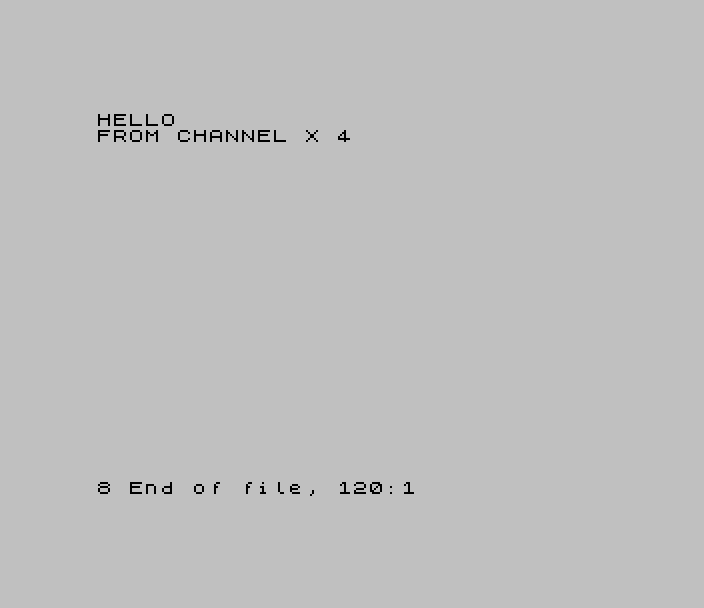

# TS-Pico Programmer's Manual

### Machine code for the TS-2068, and new commands for the Pico — version 2.3

> **About this manual.** This manual describes **TS-Pico 2.3** (firmware 2.3 and ROM 2.3, October
> 2026). It was written from the source code: the firmware, the ROM patches and the test
> harnesses. Appendix D lists the repository documents that go with it.
>
> **Every example is in the `examples` folder next to this manual.** Each machine-code example
> was assembled with sjasmplus. It was then run in the firmware repository's Z80 interpreter
> against a simulated TS-Pico: that's `test_examples.py`, with 111 checks, all passing. Some of
> those check this book: that the code it quotes from the examples still matches them. The
> Pico-side examples were run through the firmware's real command dispatcher by
> `test_extcmd_host.py`. **None of them has yet run on a real 2068.** `picoex.tap` holds all the
> machine-code examples, ready to try. The BIOS example (`bios.asm`) and the error trap in
> section 8.4 go through the ROM's bank switching, which the simulation can't model. Treat
> them as the least certain code in this book.
>
> **Appendix F's memory channel** (`xchan.asm`) needs the 2068's own ROM, so the simulation
> can't run it either. It ran in the ZEsarUX emulator instead, on the stock ROM and on ROM 2.3.

---

## Contents

**Part 1: Talking to the TS-Pico from the 2068**

1. Before You Start
2. The Hardware: Two Ports and a Status Byte
3. The Conversation: How a Command Travels
4. A Machine-Code Toolkit: `picolib.asm`
5. Worked Examples
6. Files as Streams: the Channel Commands
7. Other Commands, and What Not to Send
8. Using the ROM's Pico BIOS
9. Rules of the Road for Z80 Programs

**Part 2: Programming the TS-Pico**

10. Inside the Firmware
11. Your First Pico Command
12. A Cookbook of Answers
13. Adding a Built-in Command
14. Timing Rules on the Pico
15. Testing and Debugging
16. Rules of the Road for Pico Code

**Part 3: Reference**

- R1. Notation
- R5. The picolib Routines
- R6. The Pico BIOS

**Appendices**

- A. Protocol Quick Reference
- B. The Pico BIOS and Useful ROM Addresses
- C. Firmware Helper Reference
- D. Further Reading in the Repository
- E. The Example Files
- F. Writing Channel Code for the TS 2068
- G. The picolib.asm Listing

---

# Part 1: Talking to the TS-Pico from the 2068

# Chapter 1: Before You Start

> **Chapter Preview.** Who this book is for, what you need, the three ways a 2068 program can
> reach the TS-Pico, and how to tell which ROM you're running.

## 1.1 Who this book is for

The *TS-Pico User Manual* shows you every command from BASIC. This book is for when BASIC isn't
enough. Maybe you want a game to keep a high-score table on the SD card. Maybe you want to load a
file of any size straight into memory, or add a command of your own to the Pico. We assume you
know Z80 assembly language and TS-2068 BASIC. For Part 2, you'll also want some MicroPython.

The book has two halves, one for each end of the cable:

- **Part 1** is the 2068 side: the ports, the bytes that make up a command, and a small library
  of machine-code routines that does the work for you.
- **Part 2** is the Pico side: how the firmware is put together, and how to add a command, from
  a five-line experiment to a built-in feature.

## 1.2 What you need

- A TS-Pico with the **2.3 release**: its firmware, and ROM 2.3 in the 2068. The two go
  together: firmware 2.3 needs ROM 2.3 (section 3.7 says why). The ROM opens
  every exchange with a "SYNC" that the 1.1 firmware doesn't understand. Our
  machine-code routines do the same, so they don't work with the 1.1 firmware either.
- An assembler for your computer. The examples use **sjasmplus** syntax (local labels start with
  a dot, `equ` and `db` as usual).
- For Part 2: a USB cable and either Thonny or the repository's `tools/pico-serial.py`.

## 1.3 Three ways in

There are three ways for a 2068 program to use the TS-Pico. Pick the simplest one that does the
job.

1. **From BASIC**, with `SAVE "tpi:..."`. Every command in the User Manual works this way, and
   `SAVE t$ CODE a,b` works with a string variable, so a program can build its commands as it
   goes. For a command that sends data back, BASIC can read the data with `IN 14`
   (section 5.6).
2. **From machine code, straight through the ports.** This is the main subject of this book. It
   is plain `IN` and `OUT` on ports 14 and 15. You don't need the ROM, so it works from any
   memory bank, and you decide what happens when something goes wrong.
3. **From machine code, through the ROM's "Pico BIOS"**: a small table of routines in the
   EXROM. It saves a few bytes, but a program running in RAM has to switch ROM banks to reach
   it, and that has traps of its own (Chapter 8).

We recommend the second way, and the library in Chapter 4 makes it easy.

## 1.4 Which ROM am I running?

The byte at address 101 (0065h) of the HOME ROM tells you:

```basic
PRINT PEEK 101
```

| `PEEK 101` | ROM |
|---|---|
| 21 (15h) | 1.1 |
| 34 (22h) | 2.2 |
| 35 (23h) | 2.3 |

The ROM also tells the Pico: from 2.3 it sends its version in every command's pre-header
(section 3.4), and `SAVE "tpi:info"` shows it on its ROM line.

## 1.5 Summary

1. Part 1 is the 2068 side; Part 2 is the Pico side.
2. You need the 2.3 release: its firmware and ROM 2.3.
3. BASIC, raw ports, or the ROM's BIOS: raw ports are the most flexible, and this book's library
   does the hard parts.
4. `PEEK 101` tells you the ROM version: 35 for 2.3.

---

# Chapter 2: The Hardware: Two Ports and a Status Byte

> **Chapter Preview.** The two I/O ports, what each bit of the status byte means, the
> "auto-busy" rule, and how fast you can send and receive.

## 2.1 The ports

The TS-Pico answers on two Z80 I/O ports:

| Port | Decimal | `IN` gives you | `OUT` does |
|---|---|---|---|
| 0Eh | 14 | the next byte from the Pico's transmit FIFO, or **00h if it's empty** | puts a byte in the Pico's receive FIFO |
| 0Fh | 15 | the **status byte**. Reading it takes nothing from the FIFO. | **SYNC / abort**: the firmware treats any write here as "stop whatever you're doing and start fresh" |

Each FIFO holds only **four bytes**. There's no wait line: the Z80 is never held up. This has
two consequences you'll meet again and again:

- A read from port 14 when the Pico hasn't queued anything yet quietly gives you **00h**.
  Nothing tells you it happened, except a checksum that doesn't match later.
- A byte sent while the Pico's receive FIFO is full is quietly **lost**.

So everything in this book is paced: we either wait for the status byte to say "ready", or we
leave a short gap between bytes that the Pico is known to keep up with.

## 2.2 The status byte

Port 15 reads a status byte. Three bits matter:

| Bit | Name | Meaning |
|---|---|---|
| 6 | READY | 1 = the Pico has its answer (or is ready for your next bytes) |
| 3 | IDLE | 1 = no transaction is open |
| 2 | RECOVERED | **0** = the Pico gave up on a transaction by itself (active low) |

The other bits are reserved. In practice you'll see four values:

| Value | Meaning |
|---|---|
| FFh | ready and idle: the Pico is waiting for a new command |
| F7h | ready, but the command isn't finished yet (IDLE is clear) |
| FBh | ready and idle, but RECOVERED: the Pico abandoned the last transaction. The ROM reports this as **T TS-Pico reset, try again** |
| 00h | busy |

Test RECOVERED only when READY is set: the busy value, 00h, has bit 2 clear too.

## 2.3 Auto-busy

**Every `OUT` to either port makes the status byte read 00h (busy).** The Pico's interface does
this by itself, in hardware, the moment your byte arrives. The status stays busy until the
firmware has dealt with the byte and says READY again.

This is the most useful rule in the whole protocol. After you send anything, wait for READY
before you read the answer, and you can't read too early.

## 2.4 How fast?

| Direction | Safe pace | Notes |
|---|---|---|
| Z80 → Pico, inside a command | a byte every 30–50 µs | the ROM sends every ~30 µs. Our library sends one every 62–72 µs. Never use `OTIR`. |
| Pico → Z80, data answers | a byte every ~75 µs | the ROM's own channel driver reads every ~75 µs. Our library reads one every ~87 µs. Never use `INIR`. |
| Gaps | up to 1 second | the Pico gives up on a half-received command after **1 s** of silence |

Slower is always safe, up to that one-second limit. At 3.5 MHz, 1 µs is 3.5 T-states. The
library pauses with a `DJNZ` loop: 11 times round before each byte it sends, 16 before each byte
it reads. R5.4 and R5.6 work out what that comes to.

## 2.5 Summary

1. Port 14 carries data both ways; port 15 is the status (IN) and SYNC/abort (OUT).
2. Four-byte FIFOs, no wait line: an empty read gives 00h and an overflow is lost.
3. READY (bit 6), IDLE (bit 3), RECOVERED (bit 2, active low).
4. Every OUT makes the Pico busy until it says READY again.
5. Pace your bytes: about 50 µs out, 75 µs in, and never a gap of a second in the middle of a
   command.

---

# Chapter 3: The Conversation: How a Command Travels

> **Chapter Preview.** What happens, byte by byte, when the 2068 sends `SAVE "tpi:path"`: the
> SYNC, the pre-load byte, the pre-header, the body, and the answer. Then the status codes and
> the "response functions" that let the Pico print on your screen.

## 3.1 The shape of a transaction

Every command is one **transaction**, and every transaction has the same shape:

```
2068                                             Pico
(wait for IDLE)
OUT (0Fh),03h        SYNC ------------------>    empties both FIFOs, queues one 01h, says idle
(wait for READY+IDLE)
OUT the 10-byte pre-header ------------------>   (busy after each byte)
IN (0Eh) = 01h  <---- the "pre-load" byte
(wait for READY)                                 "I'm listening" (status F7h)
OUT the body: 'D', length, text, XOR -------->   checks the XOR, runs the command
(wait for READY)                                 queues its answer, then says READY
IN (0Eh) = the answer
[more bytes, if the answer has any]
                                                 finishes, queues the next 01h, says idle (FFh)
```

Let's take each part in turn.

## 3.2 SYNC

`OUT (0Fh),03h` starts every transaction. The Pico drops anything half-done, empties both
FIFOs, puts a single 01h in its transmit FIFO, and goes ready-and-idle. So whatever happened
before, even an earlier program that crashed halfway through a command, a SYNC puts the link
back into a known state.

Two things to watch:

- **Wait for IDLE before you SYNC.** Some answers, notably the channel commands in Chapter 6,
  say READY without IDLE. The Pico is still tidying up behind them. A SYNC sent in that
  moment can be lost along with the pre-header behind it, and you get **T**. Wait for IDLE first,
  and wait up to a second.
- **Wait for READY and IDLE after the SYNC**, as the ROM does, before the first pre-header
  byte.

BREAK uses the same byte. If the user presses BREAK while your program is waiting, send
`OUT (0Fh),03h`, wait for idle, and stop. The Pico abandons the command cleanly. It is listening
for that write even while it's in the middle of sending you a long listing.

## 3.3 The pre-load byte

Between transactions, the Pico's transmit FIFO always holds exactly **one 01h**. The ROM reads
it straight after the tenth pre-header byte, without waiting. If it reads 00h instead, nothing
was there, and that's **Report J**.

Because every SYNC puts a fresh 01h in place, a program that SYNCs first always finds it.

## 3.4 The pre-header

Ten bytes, sent one at a time:

| Byte | Contents | Notes |
|---|---|---|
| 0 | `'B'` (42h) | a command |
| 1 | 0 | 0 = a `SAVE "tpi:..."` command. 1, 2 or 3 = `LOAD`/`VERIFY`/`MERGE "tpi:name"`, which mounts a file. **4, 5 and 6 are printer traffic: never send them.** |
| 2 | 23h | the ROM's version, as `PEEK 101` gives it. The ROM sends 23h; send the same. The Pico keeps it and shows it in `tpi:info`. |
| 3, 4 | first CODE number, low byte first | `SAVE "tpi:..." CODE a,b` sends *a* here; 0 without CODE |
| 5, 6 | second CODE number, low byte first | *b* |
| 7, 8 | length of the command text, low byte first | |
| 9 | XOR of bytes 0–8 | the Pico doesn't check this one, but send it right |

## 3.5 The body

After the pre-load byte, wait for READY, then send:

```
'D' (44h), length low, length high, the text..., XOR
```

The XOR covers everything from the `'D'` to the last character of the text. **The Pico does
check this one:** a wrong XOR gives **Report R**, and the command isn't run.

The text must start with the four characters `tpi:` (in any case). The command word runs up to
the first space, and anything after the space is the argument, with its case kept. The text
must be plain ASCII. Anything that isn't valid text gives Report C.

> **By the way:** from BASIC, the ROM only sends names of 6 to 31 characters as commands. From
> machine code there's no such limit (the length is 16 bits), but keep commands under 256
> bytes and you'll be in the same territory the ROM's own code has been tested in.

## 3.6 The answer: a status byte

After the body, wait for READY and read one byte. For most commands, that byte is a
**status**:

| Status | Report | Error code (for `RST 8`) |
|---|---|---|
| 00h | J Invalid I/O device (nothing there) | 12h |
| 1 | OK | — |
| 2 | R Tape loading error | 1Ah |
| 3 | F Invalid file name | 0Eh |
| 4 | Q Parameter error | 19h |
| 5 | C Nonsense in BASIC | 0Bh |
| 6 | 6 Number too big | 05h |
| 7 | 8 End of file | 07h |
| 8 | A Invalid argument | 09h |
| 9 | 9 STOP statement | 08h |
| 10 | J Invalid I/O device | 12h |
| 11–127 | D BREAK - CONT repeats | 0Ch |
| (RECOVERED bit) | T TS-Pico reset, try again | 1Ch |

The "error code" column is the byte that follows `RST 8` in the ROM. Put it there and BASIC
stops with that report, exactly as if a BASIC command had failed.

## 3.7 The answer: a response function

A first byte of 80h or more isn't a status. It's a **response function**: a request for the 2068
to do something, usually print. Each function carries its own status byte, which becomes the
command's result. The firmware uses these:

| Code | What follows | What the 2068 does |
|---|---|---|
| 81h | status, text, 00h | prints the text (the TS-Pico's start and end with a carriage return) |
| 86h | status, then pages of text. Each page ends in 00h, and the whole thing ends in 03h. | prints each page. At each 00h it waits for a key, waits for READY, and sends the key, then waits for READY again and reads on, whatever the key was. Only the 03h ends it. |
| 88h | as 86h, on the lower screen | only for `tpi:fopen` (the "Replace?" question of `SAVE "f:..."`) |

Text ends at 00h, and an 86h listing at 03h; every other byte is printed with `RST 10h`. That
includes bytes of 80h and more (block graphics, UDGs, keywords), and the value bytes after a
control code: INK 0 is a color, and AT 3,0 a position, not the end of the text. The ROM also
understands 82h–85h and 87h, but the firmware never sends them. Any other code gives
**Report D**, with the rest of the answer left unread.

**The key is the Pico's to interpret.** Keys go back as typed, in either case, and the Pico
decides what each one means at that prompt. At a "Scroll?" prompt `N` stops, a digit 1–9 shows
that many lines before the next prompt, `0` shows ten, and anything else shows a full page; at an
ERASE question `N` skips that file. Whatever the key, **keep reading**: after `N` the Pico still
sends something, at least an echo of the key and the closing 03h. A client that stops at its own
`N` leaves those bytes behind, and the next command reads them as its status.

## 3.8 The tail

When the command has finished, the Pico waits until you've read everything it sent. It then
empties its receive FIFO, queues the next 01h pre-load, and says ready-and-idle (FFh). That's
the end of the transaction.

## 3.9 Summary

1. SYNC (`OUT (0Fh),03h`), pre-header, pre-load, body, answer: every command, every time.
2. Wait for IDLE before a SYNC, and for READY before every read.
3. Pre-header byte 1 is 0 for a command. The CODE numbers go in bytes 3–6.
4. The body's XOR is checked: a mistake is Report R.
5. The answer is a status (1 = OK), or a response function (81h/86h) that prints.

---

# Chapter 4: A Machine-Code Toolkit: `picolib.asm`

> **Chapter Preview.** The small library every example in this book is built on, and the ideas
> behind it: patient waiting, a clean exit on BREAK, careful pacing, and errors BASIC
> understands. Chapter R5 describes each routine in full; Appendix G has the whole source.

## 4.1 Using the library

`picolib.asm` is about 350 bytes of code. `include` it at the end of your program, and define
two words that hold the command's CODE numbers:

```asm
PMR1:   dw 0            ; SAVE "tpi:..." CODE PMR1,PMR2
PMR2:   dw 0
        ...
        include "picolib.asm"
```

It's written for a program that BASIC calls with `USR`, with the HOME ROM paged in and
interrupts on. It doesn't use IX or IY, and it only calls the ROM to print (`RST 10h`).

Every routine that can fail returns with **carry set and an error code in A**. The code is the
byte BASIC's `RST 8` takes: 12h for J, 0Ch for D, 1Ah for R, and so on. When you want to give
up, `JP RAISE` stops the BASIC program with that report.

Most programs need only three routines: `SEND_CMD` to send a command, then `GET_REPLY` or
`GET_DATA` to read the answer. Here is the whole library, by job:

| Job | Routines |
|---|---|
| Waiting | `WAIT_IDLE` (R5.1), `PICO_SYNC` (R5.2), `WAIT_READY` (R5.3) |
| Sending | `TXX` (R5.4), `SEND_CMD` (R5.5) |
| Reading | `RXP` (R5.6), `GET_REPLY` (R5.7), `TEXT` (R5.8), `GETKEY` (R5.9), `GET_DATA` (R5.10) |
| Errors | `MAP_STATUS` (R5.11), `RAISE` (R5.12) |
| Odds and ends | `HEX` (R5.13) |

Each R5 entry says what the routine takes and returns, which registers it changes, how much
stack it needs and how long it can take. This chapter is about why the routines work the way
they do.

## 4.2 Waiting, and BREAK

There are two waits, because there are two things to wait for.

**Between commands**, you wait for READY and IDLE together: the Pico has finished the last
command and is ready for a new one. That never takes long, so `WAIT_IDLE` gives up after
about a second.

**Inside a command**, you wait for READY alone. That can take a while: the Pico might be
reading a slow SD card or working through a long folder. `WAIT_READY` waits up to about 20
seconds, the same patience as the ROM, and it watches for BREAK while it waits.

Notice what happens on BREAK. From `picolib.asm`:

```asm
.brk:   ld a,03h
        out (PORT_STAT),a       ; abort: the Pico drops the command
        call WAIT_IDLE
        ld a,E_D
```

We don't just walk away: we tell the Pico with a SYNC, so it stops too, and we wait until it's
idle. The link is ready for the next command, and the Pico isn't left waiting for bytes that
will never come.

Once READY is set, `WAIT_READY` checks one more bit:

```asm
.ready: bit ST_RECOV,a          ; active low
        ld a,E_T
        jr z,.fail
```

RECOVERED means the Pico gave up on the transaction by itself. It only means something when
READY is set (the busy value, 00h, has bit 2 clear too), which is why we test it here and not
before.

## 4.3 Sending: pacing and the pre-load

Every byte to the Pico goes through `TXX`:

```asm
TXX:    out (PORT_DATA),a
        xor d
        ld d,a
        push bc
        ld b,11
.d:     djnz .d
        pop bc
        ret
```

It does two jobs besides the `OUT`. It keeps a running XOR in D, because both halves of a
command end with one. And it waits, because the Pico reads each byte in software and `OTIR`
would outrun it. With the pause, `SEND_CMD` sends a byte every 62 to 72 µs, inside the safe
pace of section 2.4. R5.4 shows the arithmetic.

`SEND_CMD` sends a whole command: HL points at the text and BC holds its length. It starts
with `PICO_SYNC`, which clears out whatever an earlier program left behind and puts the
pre-load byte in place. Then it sends the pre-header, and reads the pre-load straight away:

```asm
        ld a,d
        call TXX                ; 9: XOR of bytes 0-8
        in a,(PORT_DATA)        ; the pre-load, waiting since the SYNC
        cp 1
        ld a,E_J
        scf
        ret nz                  ; anything else: the link is out of step
        call WAIT_READY         ; the Pico says READY when it's listening
```

If that byte isn't 01h, something is badly out of step, and Report J is the honest answer.
Then `SEND_CMD` waits for READY and sends the body. When it returns with no carry, the
command is on its way. Now read the answer with `GET_REPLY` or `GET_DATA`.

## 4.4 Reading an answer: GET_REPLY

`GET_REPLY` handles the answers the ROM handles: a status, an 81h message or an 86h/88h
listing. Messages are printed with `RST 10h`, so select a channel first. The main screen is
stream 2:

```asm
        ld a,2
        call CHAN_OPEN          ; 1230h in the HOME ROM
```

The first byte of the answer says what kind it is. From `picolib.asm`:

```asm
        in a,(PORT_DATA)
        cp 81h
        jr z,.msg
        cp 86h
        jr z,.loop
        cp 88h
        jr z,.loop
        cp 80h
        jp c,MAP_STATUS         ; a plain status byte
        ld a,03h                ; a function this code doesn't know:
        out (PORT_STAT),a       ; abort it, as BREAK would
```

Below 80h it's a plain status. 81h is a message, and 86h and 88h are listings. Anything else is
a response function this code doesn't know, and it gets the same treatment as BREAK: a SYNC,
so the Pico doesn't sit waiting for us to read an answer we don't understand.

The text is read and printed one character at a time by `TEXT`. Two things make this work
without a handshake on every character. The Pico queues the first few bytes of a message
*before* it says READY. After that, `RST 10h` is slow enough that the Pico keeps ahead of it.

`TEXT` has one subtlety. A control code from 10h (INK) to 17h (TAB) carries one or two value
bytes, and those can be anything, 00h included. So `TEXT` prints a control code's values along
with it, whatever they are, and only a 00h or 03h *in place of a character* ends the text.

A listing comes in pages. At the end of each page the Pico waits for a key, and so do we:

```asm
        call GETKEY             ; 00h: end of a page, the Pico waits for a key
        push af
        call WAIT_READY         ; the ROM waits for READY before it sends a key
        jr c,.kfail
        pop af
        out (PORT_DATA),a       ; any key, N included: the Pico ends the loop
```

We send the key as typed, and we keep reading whatever the key was. It's the Pico that decides
`N` means stop, and it ends the listing with a 03h either way. `GETKEY` waits for the key the
gentle way: it HALTs until the ROM's own keyboard scan, which runs on every interrupt, says a
new key has arrived.

## 4.5 Reading data: GET_DATA

Some answers aren't for printing: they're data for your program. The channel read command in
Chapter 6 uses this format, and so does the example Pico command in Part 2:

```
status 1, count n (1-255), n bytes, XOR of the n bytes
```

Status 7 means "end of file"; any other status is an error. `GET_DATA` stores the bytes at HL.
It returns three ways: **NC and Z** means E bytes arrived; **NC and NZ** means end of file;
**carry** means an error, with its code in A.

The XOR is your safety net:

```asm
        call RXP
        cp c
        ld a,E_R                ; a byte went missing or changed
        scf
        ret nz
```

Remember that a read from an empty FIFO gives 00h without complaint. The checksum is the only
thing that catches a byte that went missing.

## 4.6 From status to report: MAP_STATUS and RAISE

`MAP_STATUS` turns a status byte into our error codes, using the same table the ROM uses:

```asm
; status 2..11 -> R F Q C 6 8 A 9 J D  (the ROM's own table at EXROM 1BF3h)
RPT_TAB:
        db 1Ah, 0Eh, 19h, 0Bh, 05h, 07h, 09h, 08h, 12h, 0Ch
```

A status of 0 isn't a status at all: it's an empty FIFO, and it becomes J. Anything above 11
becomes D.

`RAISE` hands a code to BASIC:

```asm
RAISE:  ld (.code),a
        rst 8
.code:  db 0
```

`RST 8` reads the byte after itself as the report, so we store the code there first. BASIC
then stops with, say, "F Invalid file name", just as if one of its own commands had failed.

## 4.7 Summary

1. `include "picolib.asm"` and define `PMR1` and `PMR2`.
2. `SEND_CMD` (HL = text, BC = length), then `GET_REPLY` for ordinary commands or `GET_DATA`
   for data.
3. Carry means failure, with a BASIC error code in A. `JP RAISE` reports it.
4. BREAK and unknown answers are handled with a SYNC, so the link is always left clean.
5. Chapter R5 has every routine's details, and Appendix G the whole source.

---

# Chapter 5: Worked Examples

> **Chapter Preview.** Six small programs: a general command sender, a file loader, a log
> writer, a file counter, a program that reads a data answer, and reading data from BASIC.
> Each one has a BASIC program to drive it. All of them are on `picoex.tap`.

All the examples load at 60000, so start with `CLEAR 59999`. Each one begins with a few
`JP`s and data fields at fixed addresses, so BASIC can `POKE` its inputs and call the right
entry.

To get them onto the 2068, copy `picoex.tap` to the `/TAP` folder of your SD card, then:

```basic
LOAD "tpi:picoex.tap"
LOAD "picocmd" CODE
```

The TS-Pico reads a mounted TAP forward, like a tape. If a `LOAD` can't find an example you've
already passed, `SAVE "tpi:rew"` winds back to the start.

## 5.1 Any command from machine code: `picocmd`

The simplest useful program: it sends the command you give it and reports the result. Its
layout:

| Address | Contents |
|---|---|
| 60000 | `LET r=USR 60000`: run the command; r = 0 for OK, else the report's code |
| 60003 | `RANDOMIZE USR 60003`: run the command; stop with its report if it fails |
| 60006/7 | first CODE number |
| 60008/9 | second CODE number |
| 60010/11 | length of the command |
| 60012… | the command text (up to 128 characters) |

The whole program, apart from the library:

```asm
        org 60000
        jp RUN_CODE             ; 60000
        jp RUN_RAISE            ; 60003
PMR1:   dw 0                    ; 60006
PMR2:   dw 0                    ; 60008
CMDLEN: dw 0                    ; 60010
CMDBUF: ds 128                  ; 60012

RUN:    ld a,2
        call CHAN_OPEN          ; anything the Pico prints goes to the screen
        ld hl,CMDBUF
        ld bc,(CMDLEN)
        call SEND_CMD
        ret c
        jp GET_REPLY

RUN_CODE:
        call RUN
        ld bc,0
        ret nc                  ; OK: 0
        inc a                   ; ERR_NR + 1
        ld c,a
        ret

RUN_RAISE:
        call RUN
        ret nc
        jp RAISE

        include "picolib.asm"
```

`RUN_CODE` returns the error code plus one. That number is the report's position in the list
`0123456789ABCD...`, so BASIC can show the letter. Here's a driver:

```basic
10 CLEAR 59999: LOAD "picocmd" CODE
20 LET a=0: LET b=0
30 LET c$="tpi:path": GO SUB 1000
40 LET c$="tpi:dir": GO SUB 1000
50 LET c$="tpi:nosuch": GO SUB 1000
60 STOP
1000 REM send c$ with CODE a,b
1010 POKE 60006,a-256*INT (a/256): POKE 60007,INT (a/256)
1020 POKE 60008,b-256*INT (b/256): POKE 60009,INT (b/256)
1030 POKE 60010,LEN c$: POKE 60011,0
1040 FOR i=1 TO LEN c$: POKE 60011+i,CODE c$(i): NEXT i
1050 LET r=USR 60000
1060 IF r THEN PRINT "Report ";"0123456789ABCDEFGHIJKLMNOPQRSTUVWXYZ"(r+1)
1070 RETURN
```

What you should see: the current folder (`tpi:path` always prints), then the folder listing.
A long listing stops at "Scroll?". Then comes `Report C` for the command that doesn't exist.
Change line 1050 to `RANDOMIZE USR 60003` and the program stops with `C Nonsense in BASIC`
instead.

> **Remember:** BREAK works while the program is waiting for the Pico (in `WAIT_READY`): you
> get Report D, and the next command works normally. At a "Scroll?" prompt the program is
> waiting for *you*, and `GETKEY` doesn't watch for BREAK, so press **N** to stop a listing:
> the Pico echoes it and ends the listing. A BASIC program that catches the D with `ON ERR GO
> TO` should wait until CAPS SHIFT and SPACE are let go before it goes on: keys still down give
> L BREAK into program at its next statement, or D again at its next command (User Manual,
> 11.2).

## 5.2 Loading any file into memory: `loadfile`

`LOAD "" CODE` needs a tape header. With the channel commands (Chapter 6) you can read any
file, byte for byte: a screen dump, a data file made on a PC, a font. `loadfile` opens the file
as a binary stream, reads it 255 bytes at a time, and closes it.

| Address | Contents |
|---|---|
| 60000 | `LET n=USR 60000`: n = bytes read |
| 60003/4 | where to put the file (default 32768) |
| 60005/6 | the most to read (default 16384) |
| 60007 | length of the file name |
| 60008… | the name (up to 64 characters), relative to the current folder or starting with `/` |

The heart of it:

```asm
STREAM  equ 200                 ; the Pico's key for this channel: any 0-255
                                ; that BASIC isn't using for OPEN #
OPEN_T: db "tpi:chopen rb "     ; rb = read, binary (no text translation)
OPEN_L  equ $-OPEN_T
RD_T:   db "tpi:chrd"
RD_L    equ $-RD_T
CL_T:   db "tpi:chclose"
CL_L    equ $-CL_T

LOAD:   ld hl,OPEN_T            ; build "tpi:chopen rb <name>"
        ld de,CMDBUF
        ld bc,OPEN_L
        ldir
        ld a,(NAMELEN)
        ld c,a
        ld b,0
        or a
        jr z,.named             ; no name: the Pico answers F
        ld hl,NAME
        ldir
.named: ld a,(NAMELEN)
        add a,OPEN_L
        ld c,a                  ; BC = length of the command
        ld b,0
        ld hl,STREAM
        ld (PMR1),hl            ; CODE stream, 0: a plain stream, not records
        ld hl,0
        ld (PMR2),hl
        ld (TOTAL),hl
        ld hl,CMDBUF
        call SEND_CMD
        call nc,GET_REPLY
        jp c,RAISE

.next:  ld hl,(MAXLEN)          ; room left
        ld de,(TOTAL)
        and a
        sbc hl,de
        jr z,.full
        ld a,h
        or a
        ld a,l
        jr z,.ask
        ld a,255                ; at most 255 bytes a read
.ask:   ld l,a
        ld h,0
        ld (PMR2),hl            ; CODE stream, how many bytes
        ld hl,RD_T
        ld bc,RD_L
        call SEND_CMD
        jr c,.fail
        ld hl,(DEST)
        ld de,(TOTAL)
        add hl,de
        call GET_DATA           ; NC Z: E bytes arrived
        jr c,.fail
        jr nz,.full             ; end of the file
        ld hl,(TOTAL)
        ld d,0
        add hl,de
        ld (TOTAL),hl
        jr .next

.full:  call CLOSE
        jp c,RAISE
        ld bc,(TOTAL)
        ret

.fail:  push af                 ; close the channel, then report the error
        call CLOSE
        pop af
        jp RAISE
```

Notice `.fail`: whatever goes wrong, we close the channel before we report it. An open
channel doesn't hurt the Pico, but a tidy program leaves nothing behind.

A driver that loads a screen dump made on a PC (a 6912-byte `.scr` file) straight onto the
screen:

```basic
10 CLEAR 59999: LOAD "loadfile" CODE
20 LET f$="/SCREENS/castle.scr"
30 POKE 60003,0: POKE 60004,64: REM to 16384
40 POKE 60005,0: POKE 60006,27: REM at most 6912 bytes
50 POKE 60007,LEN f$
60 FOR i=1 TO LEN f$: POKE 60007+i,CODE f$(i): NEXT i
70 LET n=USR 60000
80 PAUSE 0: PRINT n;" bytes"
```

A file that isn't there stops the program with **F Invalid file name**. A byte lost on the way
gives **R Tape loading error**.

## 5.3 Adding to a log file: `logline`

A game that remembers its high scores, or a program that keeps a diary, needs to add a line to a
text file. `logline` opens the file for appending in text mode, sends the line with
`tpi:chwr`, adds a carriage return (which text mode turns into a newline on the card), and
closes it. If the file isn't there, it's made.

| Address | Contents |
|---|---|
| 60000 | `RANDOMIZE USR 60000` |
| 60003 | length of the file name |
| 60004… | the name (up to 32 characters) |
| 60036 | length of the line |
| 60037… | the line (up to 200 characters) |

`tpi:chwr` sends its bytes as hexadecimal, two digits a byte, because the command text must be
plain text. The library's `HEX` routine does the conversion. Here's the routine that sends B
bytes from HL:

```asm
WR_T:   db "tpi:chwr "
WR_L    equ $-WR_T

WRITE:  push hl
        ld hl,WR_T
        ld de,CMDBUF
        ld c,WR_L
        push bc
        ld b,0
        ldir                    ; "tpi:chwr "
        pop bc
        pop hl
        push bc
.hex:   ld a,(hl)
        inc hl
        call HEX                ; two hex digits at DE
        djnz .hex
        pop bc
        push hl
        ld a,b
        add a,a                 ; 2 digits a byte
        add a,WR_L
        ld c,a
        ld b,0
        call SEND_REPLY         ; send CMDBUF, read the status
        pop hl
        ret
```

The main routine sends the line 64 bytes at a time, then a single 0Dh. A driver:

```basic
10 CLEAR 59999: LOAD "logline" CODE
20 LET f$="scores.txt"
30 INPUT "Name? ";n$: INPUT "Score? ";s
40 LET l$=n$+" "+STR$ s
50 POKE 60003,LEN f$
60 FOR i=1 TO LEN f$: POKE 60003+i,CODE f$(i): NEXT i
70 POKE 60036,LEN l$
80 FOR i=1 TO LEN l$: POKE 60036+i,CODE l$(i): NEXT i
90 RANDOMIZE USR 60000
100 GO TO 30
```

Put the file on a PC and you'll find one line per score. You can read it back with
`OPEN #4,"f:scores.txt"` and `INPUT #4`.

> **Note:** in a channel, the byte 23 (17h) is always the start of a TAB (a seek), even in
> binary mode. Text doesn't contain it, but a block of machine code or a screen might. **To
> write binary data, use an ordinary `SAVE ... CODE`**, or `SAVE "f:..." CODE`, not
> `tpi:chwr`.

## 5.4 Counting files: `countdir`

The channel commands can open a folder listing as if it were a file (the `d:` device, as in
`OPEN #4,"d:*.tap"`). A TAB 0 on that channel asks for the number of names, and the next read
returns it as digits and a carriage return. `countdir` uses that trick to count the files that
match a pattern, without reading the whole listing:

```asm
OPEN_T: db "tpi:chopen r d:"
TAB0_T: db "tpi:chwr 170000"    ; 23, 0, 0: TAB 0
```

After the TAB, one `tpi:chrd` returns something like `12` and a CR, which the program turns
into a number for USR:

```basic
10 CLEAR 59999: LOAD "countdir" CODE
20 LET p$="*.tap"
30 POKE 60003,LEN p$
40 FOR i=1 TO LEN p$: POKE 60003+i,CODE p$(i): NEXT i
50 PRINT USR 60000;" TAP files here"
```

An empty pattern counts everything in the current folder. `GAMES/*.tap` counts in a
subfolder, and a folder that isn't there gives **F**.

## 5.5 Reading a data answer: `fact`

Part 2 builds a new Pico command, `tpi:.fact`, that works out *n*! (n factorial) and sends the
digits back as data, in the same format as `tpi:chrd`. The 2068 side is short, because
`GET_DATA` does the work:

```asm
FACT:   ld a,(N)
        ld (PMR1),a             ; SAVE "tpi:.fact" CODE n,0
        ld a,2
        call CHAN_OPEN
        ld hl,CMD_T
        ld bc,CMD_L
        call SEND_CMD
        jp c,RAISE
        ld hl,DIGITS
        call GET_DATA
        jp c,RAISE              ; n too big: Report 6
        ld hl,DIGITS
        ld b,e
.pr:    ld a,(hl)
        inc hl
        rst 10h
        djnz .pr
        ld a,0Dh
        rst 10h
        ret
```

```basic
10 CLEAR 59999: LOAD "fact" CODE
20 FOR n=0 TO 33
30 PRINT n;"! = ";: POKE 60003,n: RANDOMIZE USR 60000
40 NEXT n
```

Numbers up to 32! (36 digits) print in full, far beyond what BASIC's arithmetic can hold. At
33 the Pico answers with status 6, and the program stops with **6 Number too big**. (You'll
need the Pico side from Chapter 11 installed first.)

## 5.6 Reading a data answer from BASIC

You don't need machine code to read data from the Pico. When BASIC sends `SAVE "tpi:.fact"`,
the ROM reads the status byte, sees 1 (OK), and carries on with the next statement. The rest
of the answer is still waiting in the Pico, and `IN 14` reads it:

```basic
10 INPUT "n? ";n
20 SAVE "tpi:.fact" CODE n,0
30 LET c=IN 14
40 FOR i=1 TO c: PRINT CHR$ IN 14;: NEXT i
50 LET x=IN 14: PRINT
60 GO TO 10
```

BASIC is slow enough that the Pico always keeps up. If the program leaves bytes unread, no
harm is done: the next command's SYNC clears them.

## 5.7 Summary

1. Fixed data fields at known addresses make machine code easy to drive from BASIC.
2. `picocmd` sends anything. `loadfile` reads any file. `logline` appends text. `countdir`
   counts. `fact` reads data.
3. Close channels on the way out, even after an error.
4. BASIC can read a data answer with `IN 14` after the `SAVE "tpi:..."`.

---

# Chapter 6: Files as Streams: the Channel Commands

> **Chapter Preview.** The four commands behind `OPEN #`, `PRINT #`, `INPUT #` and `CLOSE #`,
> and how your machine code can use them directly.

## 6.1 The four commands

| Command text | First CODE | Second CODE | Answer |
|---|---|---|---|
| `tpi:chopen <mode> <path>` | stream (0–255) | record length (0 = a plain stream, 1–254) | a status |
| `tpi:chopen r d:<pattern>` | stream | 0 | a status; the channel reads a folder listing |
| `tpi:chwr <hex>` | stream | 0 | a status |
| `tpi:chrd` | stream | the most bytes you want (1–255; 0 means 255) | a **data answer**: `1, n, bytes, XOR`, or 7 at the end of the file |
| `tpi:chclose` | stream | 0 | a status (closing a stream that isn't open is fine) |

**The stream number is just a label** the Pico files the channel under. Any number from 0 to
255 will do. If your program runs alongside BASIC programs that use `OPEN #`,
use numbers above 15 so you don't close one of theirs by accident. The examples use 200–202.

All four answer "READY but not IDLE" (F7h), because the ROM's channel driver sends its next
command at once. That's why `PICO_SYNC` waits for IDLE first.

## 6.2 Modes

| Mode | Meaning |
|---|---|
| `r` | read; the file must exist (**F** if not) |
| `w` | write; makes the file, or empties it |
| `a` | append; makes the file if needed, then writes at its end |
| `u` | update: read and write |

Add `b` for **binary** (`rb`, `wb`, `ab`, `ub`). Without it, a channel is in **text** mode:

- **writing**, a carriage return (13) becomes a newline in the file, and the 2068's keyword
  tokens are spelled out as text;
- **reading**, newlines become carriage returns, so `INPUT #` sees lines.

Binary mode passes the bytes through unchanged, with one exception: in a write, **byte 23 is
always the start of a TAB**, in either mode (next section). Paths work as they do everywhere
else: relative to the current folder, or from the card's `/TAP` folder if they start with `/`.

## 6.3 TAB: seeking

A write of the three bytes `23, n low, n high` moves the channel to byte *n* of the file (1 is
the first byte). This is how `PRINT #s;TAB n;` works, and it's how your machine code
seeks: `tpi:chwr 17` followed by the two bytes in hex.

**TAB 0** (`tpi:chwr 170000`) is a question. The next `tpi:chrd` answers it with a count, as
text ending in a carriage return:

- for a folder listing, the number of names (as `countdir` uses);
- for a record file, the number of records;
- for any other file, its length in bytes.

## 6.4 Record files

Open a file with a record length in the second CODE number (1 to 254), and it's divided into
records of that size. TAB *n* moves to record *n*. Each `tpi:chrd` returns one record plus a
carriage return, padded with spaces in text mode or zeros in binary mode. The User Manual's
address-book example in Chapter 6 shows record files from BASIC. The commands underneath are
the same.

## 6.5 Folder listings: `d:`

`tpi:chopen r d:<pattern>` opens a read-only channel over the names that `CAT "<pattern>"`
would list, one per line, with a `/` after each folder name. It's read in text mode, so each
`tpi:chrd` gives you lines ending in carriage returns. It must be opened `r` with no record
length (**Q** otherwise). A folder that isn't there gives **F**.

## 6.6 Summary

1. `chopen`, `chwr` (hex), `chrd` (data answer), `chclose`: the stream number is just a label.
2. Modes `r w a u`, plus `b` for binary. Text mode translates line ends and keywords.
3. Byte 23 in a write is always a TAB: don't write raw binary containing it.
4. TAB 0 then a read gives you a count; `d:` lists a folder.

---

# Chapter 7: Other Commands, and What Not to Send

> **Chapter Preview.** Which of the User Manual's commands make sense from machine code, a few
> that only exist inside the ROM, and the pre-header values to stay away from.

## 7.1 Everything in the User Manual

Every `SAVE "tpi:..."` command in the User Manual can be sent with `SEND_CMD` and
`GET_REPLY`. Put the CODE numbers in `PMR1` and `PMR2`, exactly as you'd write them after
`CODE`. The ones a program is most likely to want:

| Command | Useful for |
|---|---|
| `tpi:cd <folder>`, `tpi:cd -` | moving around (see the User Manual) |
| `tpi:path` | prints the current folder |
| `tpi:dir [pattern]` | prints a listing (86h, with "Scroll?") |
| `tpi:copy a b`, `tpi:ren a b`, `tpi:erase x`, `tpi:format x` | file handling, as COPY, MOVE, ERASE and FORMAT use |
| `tpi:verbose` | turns the Pico's messages on or off |

Remember that most commands only print a message when VERBOSE is on. With it off, you get a
bare status. `GET_REPLY` handles both.

## 7.2 Mounting a file from machine code

`LOAD "tpi:game.tap"` mounts a file. On the wire it's an ordinary command, except that
pre-header **byte 1 is 1** (LOAD) instead of 0, and the text is `tpi:` followed by the file
name. To do this from machine code, copy `SEND_CMD` and change the second `TXX` to send 1.
The answer is a message or status, as for any command. (We haven't tested this one from
machine code; it follows the firmware's dispatcher.)

## 7.3 Commands that never reach the Pico

`tpi:tape`, `tpi:sdcard`, `tpi:picopt` and `tpi:ts2040` look like commands, but the **ROM**
handles them: they just set bits in the TPMODE system variable at 24027 (5DDBh). Sent to the
Pico, they're "Unrecognized command" (**C**). From machine code, set the bits yourself:

| Bit | Meaning | Set by |
|---|---|---|
| 1 | LOAD and SAVE go to the TS-Pico | `tpi:sdcard` (bit set), `tpi:tape` (bit clear) |
| 0 | LPRINT/LLIST/COPY go to the TS-Pico | `tpi:picopt` (bit set), `tpi:ts2040` (bit clear) |

```asm
        ld hl,5DDBh
        set 1,(hl)              ; the same as SAVE "tpi:sdcard"
```

## 7.4 What not to send

- **Pre-header byte 1 of 4, 5 or 6.** Those are the printer (COPY and LPRINT) and aren't
  commands.
- **A first byte other than `'B'`.** 00h and FFh are the ROM's LOAD and SAVE blocks, `'A'` is
  an old leftover, and anything else is thrown away *without* the pre-load byte being put back.
  If you then send a command without a SYNC, you get J.
- **ZX48 mode.** After `tpi:zx48` the Pico speaks a different, Spectrum-style protocol with no
  status port. The only way back from the 2068 is `OUT 14,14`. Don't send commands while it's
  in that mode.

## 7.5 Summary

1. Any User Manual command works through `SEND_CMD` and `GET_REPLY`.
2. Mounting is byte 1 = 1 with the file name as the text.
3. `tpi:tape` and friends are ROM-only: set TPMODE (24027) yourself.
4. Stick to `'B'` blocks with byte 1 = 0 (or 1 to mount).

---

# Chapter 8: Using the ROM's Pico BIOS

> **Chapter Preview.** The small table of routines the ROM provides for the TS-Pico, how a RAM
> program reaches them across the HOME/EXROM bank switch, and the two dangers that come with
> it: interrupts and errors.

## 8.1 The table

The EXROM holds a jump table at 1840h, the same in every ROM from 1.1 to 2.3:

| Address | Name | In short |
|---|---|---|
| 1840h | G_MODE | read TPMODE |
| 1842h | S_MODE | set TPMODE |
| 1844h | G_VERS | read the ROM's version: **0023h on 2.3** |
| 1846h | TX_A | `OUT (0Eh),A` |
| 1848h | RX_A | `IN A,(0Eh)` |
| 184Ah | C_END | wait for the answer, read it and act on it, as the ROM does |
| 184Ch | WF_NPH | wait for READY, up to ~20 s, without raising a report |

A few more EXROM routines sit at fixed addresses outside the table: `SYNC_WRITE` at 2300h,
`SYNC_WAIT` at 230Eh, and `STATUS_TO_REPORT` at 1BF3h. Chapter R6 has an entry for each of
them, with its registers and failure codes. **Don't call 2003h, 2006h or 2027h–203Ch**: they're
padding that jumps to itself, and the machine hangs.

## 8.2 Getting there from RAM

A USR program runs with the HOME ROM paged in. The BIOS is in the EXROM at the same addresses,
so you have to switch banks to call it. HOME has a routine for that at **03FCh**. Put the EXROM
address in HL and call it: A, F, BC and DE reach the routine, and its A, F, BC, DE and HL come
back to you. **IX is not kept.** If the routine needs an HL argument, store it at 5DCDh first.

**Interrupts must be off.** The 2068 switches banks in two steps, and an interrupt between them
can land in an empty memory bank and wipe memory. Put `DI` before the call and `EI` after it.

Here's `bios.asm`, which reads the version and mode and sets the mode:

```asm
THUNK   equ 03FCh
G_MODE  equ 1840h               ; BC = the mode bits
S_MODE  equ 1842h               ; mode bits := A AND 0Fh
G_VERS  equ 1844h               ; BC = the interface version

        org 60000
        jp VERS                 ; 60000
        jp MODE                 ; 60003
        jp SETM                 ; 60006
M:      db 0                    ; 60009

VERS:   ld hl,G_VERS
        jr BIOS
MODE:   ld hl,G_MODE
        jr BIOS
SETM:   ld a,(M)
        ld hl,S_MODE
BIOS:   di                      ; the bank switch is not interrupt-safe
        call THUNK
        ei
        ret                     ; BC comes back to USR
```

```basic
10 CLEAR 59999: LOAD "bios" CODE
20 PRINT "Interface version ";USR 60000
30 PRINT "Mode bits ";USR 60003
40 POKE 60009,2: RANDOMIZE USR 60006: REM the same as SAVE "tpi:sdcard"
```

You should see version 33.

## 8.3 The danger: errors inside the EXROM

The bank-switching routine keeps its own small stack at (65CEh), four bytes per call. If a
report is raised while you're inside the EXROM, BASIC unwinds the Z80 stack but not that one,
so each error leaves it four bytes short. After about sixteen errors it overwrites the
bank-switching code itself, and the machine crashes.

G_VERS, G_MODE, S_MODE, TX_A, RX_A and WF_NPH never raise a report, so they're safe to call as
above. **C_END is not safe on its own**: it runs the response functions, which can raise D
(BREAK at "Scroll?") or T from inside.

## 8.4 C_END, and a trap for errors

C_END fails with A = status−1 for an error status, 09h if the Pico never answered, 0Ch for
BREAK and 1Ch if the Pico reset the transaction. Those are the terms of the ROM's
`STATUS_TO_REPORT` (1BF3h), with one exception: it reports anything from 0Ah up as D, so a
1Ch comes out as D, not T. Calling 1BF3h from RAM would also leave the bank stack short
(section 8.3). Back in RAM, turn the code into a report yourself. 1Ch is already T's code.
For anything else, `INC A` gives back a status (the timeout, 09h, becomes 10, J; BREAK, 0Ch,
becomes 13, D), and `picolib`'s `MAP_STATUS` (R5.11) turns that into its code. Then `JP RAISE`
(R5.12):

```asm
        cp 1Ch                  ; the Pico reset the transaction: T
        jp z,RAISE
        inc a                   ; status - 1 -> the status
        call MAP_STATUS
        jp RAISE
```

To call C_END safely, catch any report on the way out. BASIC finds its error handler through
ERR_SP (5C3Dh). Point ERR_SP at a trap of your own for the length of the call, and the trap
can put the bank stack right before passing the error on. The ROM's disk commands do exactly
this. Here's the same idea for a RAM program. It's modeled on the ROM's code, but it is
**untested**, so try it carefully:

```asm
BANK_SP equ 65CEh
ERR_SP  equ 5C3Dh

; XCALL -- call the EXROM routine at HL, catching any report it raises.
XCALL:  push hl
        ld hl,(ERR_SP)
        ex (sp),hl              ; stack: old ERR_SP
        push hl
        ld hl,(BANK_SP)
        ex (sp),hl              ; stack: the bank stack pointer, as it is now
        push hl
        ld hl,XTRAP
        ex (sp),hl              ; stack: the trap          HL = target again
        ld (ERR_SP),sp
        di
        call 03FCh
        ei
        inc sp                  ; no error: drop the trap and the bank value
        inc sp
        inc sp
        inc sp
        ex (sp),hl              ; HL = old ERR_SP; the result's HL on the stack
        ld (ERR_SP),hl
        pop hl
        ret

XTRAP:  pop hl                  ; a report: RST 8 has returned here
        ld (BANK_SP),hl         ; put the bank stack back
        pop hl
        ld (ERR_SP),hl
        ld sp,hl
        ei
        ret                     ; on to BASIC's own error handling
```

Honestly, it's simpler not to need this. `GET_REPLY` in Chapter 4 does everything C_END does,
in RAM, with no bank switching at all.

## 8.5 Summary

1. The BIOS table at EXROM 1840h: mode, version, raw byte I/O, wait, and C_END.
2. Reach it from RAM through HOME 03FCh, with HL = the address, between `DI` and `EI`.
3. IX isn't kept across the call.
4. A report raised inside the EXROM leaks bank stack. C_END can raise one, so trap ERR_SP
   around it, or use `GET_REPLY` instead.

---

# Chapter 9: Rules of the Road for Z80 Programs

> **Chapter Preview.** A checklist to keep beside you.

1. **Not the 1.1 firmware.** It doesn't know SYNC, and a SYNC makes it lose track of the
   command.
2. **SYNC first, every time**, and wait for IDLE before the SYNC.
3. **Wait for READY after every OUT**, before you read. Every OUT makes the Pico busy.
4. **Never `OTIR` or `INIR`.** About 50 µs a byte out, 75 µs a byte in, and no gap longer than
   a second in the middle of a command.
5. **Check the XOR** on data answers. An empty FIFO reads 00h silently.
6. **After a key, keep reading.** Send the key as typed; the Pico decides what it means and
   ends a listing with 03h, even after `N`.
7. **Handle BREAK with a SYNC** so the Pico stops too.
8. **Close your channels**, even when something fails.
9. **Don't write byte 23 through a channel** unless you mean a TAB.
10. **`DI` around every bank switch**, and don't let a report escape from the EXROM without a
    trap.
11. **Stay out of ZX48 mode** with this protocol; `OUT 14,14` leaves it.
12. **If the Pico says T** (RECOVERED), it has already reset the transaction: just try again.

---

# Part 2: Programming the TS-Pico

# Chapter 10: Inside the Firmware

> **Chapter Preview.** How the firmware is organized, what happens between the 2068's last
> byte and the Pico's answer, and the one rule every command must follow.

## 10.1 The pieces

The TS-Pico runs **MicroPython** on its RP2040. The firmware is Python, "frozen" into the UF2
file you flash, plus two PIO state machines that watch the 2068's bus:

| File (in `src/`) | What it does |
|---|---|
| `main.py` | starts everything; chooses the development override if there is one (10.4) |
| `TS/tspico.py` | the main loop, the command dispatcher, every `tpi:` command, the helpers |
| `TS/tspico_io.py` | the PIO program for the two ports, and the low-level FIFO routines |
| `TS/channels.py`, `TS/catalog.py`, `TS/native.py` | the channel, listing and `f:` file logic: plain Python you can test on a PC |
| `TS/extcmd.py` | external commands: the easy place to add your own |
| `test/` | host tests, which run on a PC with no hardware, and on-hardware harnesses |

The port interface is a PIO program called `TS_IO_DUAL`. It passes bytes between the 2068 and
two four-byte FIFOs, and it keeps the status byte in a PIO register. That register is how
Python says READY: `MQ_READY()` sets it. The PIO clears it on every OUT from the 2068 (the
auto-busy of section 2.3).

## 10.2 From pre-header to answer

The main loop captures the ten pre-header bytes. For a `'B'` block that isn't printer
traffic, it calls `PROCESS_CMD`, which:

1. says "mid" (F7h) and captures the body, giving up after a second of silence;
2. checks the body's XOR (Report R if it's wrong) and decodes the text (Report C if it isn't
   text);
3. for byte 1 = 0, looks up the command word, up to the first space and in upper case, in
   **`SA_funct`**, the built-in table, and then in **`EXT_SA_FUNCT`**, the external table. It
   calls the handler it finds, or answers "Unrecognized command" (C);
4. **runs the tail**, whatever happened: it waits for the 2068 to read everything, empties the
   receive FIFO, queues the next 01h pre-load, and says idle.

A handler that raises an exception gets Report J, sent by the dispatcher, and the tail still
runs. A BREAK (the 2068's SYNC) while the handler is sending raises `CmdAbort`, which empties
both FIFOs. Again the tail runs.

## 10.3 The one rule

> **A handler gives exactly one answer, and never writes the 01h pre-load.**

One answer means one status byte, or one response function with its data, or one data answer
in a format your 2068 code expects. **Not zero:** the 2068 waits, then gives J. **Not two:**
the second answer's bytes sit in the FIFO and are read as part of the next command, which
usually shows up as Report R one command later. **And no pre-load:** the tail writes it. A
second 01h is an orphan byte with the same effect.

Because a mistake shows up one command *later*, these bugs are confusing to chase. Test for
them (Chapter 15).

## 10.4 Two development overrides

You don't have to rebuild the UF2 to try things:

- **`/dev_extcmd.py`** on the Pico's flash replaces the built-in `TS/extcmd.py`. This is where
  new commands start (Chapter 11).
- **`/dev_tspico.py`** (or `.mpy`) replaces the whole of `TS/tspico.py`. Delete it to go back.

> **Note:** the repository keeps `src/dev_tspico.py` and `src/dev_extcmd.py` identical to
> `src/TS/tspico.py` and `src/TS/extcmd.py`. A CI test (`dev_sync_hosttest.py`) fails when
> they drift, so the copy you deploy is always the current firmware. CI also builds
> `dev_tspico.mpy`, which loads faster than the `.py`.

## 10.5 Summary

1. MicroPython, frozen into the UF2; a PIO program runs the ports.
2. `PROCESS_CMD` captures, checks, dispatches (built-in table first), and always runs the tail.
3. Exactly one answer; never the pre-load.
4. `/dev_extcmd.py` and `/dev_tspico.py` let you experiment without a rebuild.

---

# Chapter 11: Your First Pico Command

> **Chapter Preview.** Three external commands, from "hello" to reading the SD card, installed
> without rebuilding the firmware.

## 11.1 The external-command file

External commands live in a file with a dictionary called `EXT_SA_FUNCT`. The dictionary maps
each command word, **in upper case with its `TPI:`**, to a handler:

```python
EXT_SA_FUNCT = {
    "TPI:.HELLO": HELLO,
    "TPI:.FACT": FACT,
    "TPI:.LINES": LINES,
}
```

By convention, external commands start with a dot, which keeps them clear of the built-in
names. Each handler is called as:

```python
def HANDLER(MQ, TSP, pre, cmd):
```

| Argument | What it is |
|---|---|
| `MQ` | the port state machine *at the time of the call*. Prefer the helpers (below): after SD card work this one is stale. |
| `TSP` | the firmware's settings object: `TSP.cur_path` (the current folder, as a real path such as `/sd/TAP/GAMES`), `TSP.VERBOSE`, `TSP.f_name` (the mounted file), and so on |
| `pre` | the ten pre-header bytes |
| `cmd` | `"D.."` + the command text. `cmd[7:]` is everything after `tpi:`. |

## 11.2 The helpers

Your handler talks to the 2068 through the firmware's own helpers. Import the *module*, so you
always use the live copy, and prefer `dev_tspico` when there is one, because that's the module
running:

```python
try:
    import dev_tspico as tp
except ImportError:
    import TS.tspico as tp
```

Define the status codes you use yourself, too:

```python
OK = 1                  # 0 OK
F_BAD_NAME = 3          # F Invalid file name
NUM_TOO_BIG = 6         # 6 Number too big
```

`tspico.py` has names for them (`_1_OK`, `_3_F_Invalid_file`, …), but they're `const()`s
whose names start with an underscore. MicroPython builds those into `tspico` itself and never
stores them on the module, so `tp._1_OK` works on a PC and fails on the Pico. (That's how the
first version of `.fact` came to answer J instead of 6.)

| Helper | Use |
|---|---|
| `tp.PARAMS(pre)` | `(a, b)`: the two CODE numbers |
| `tp.getArgs(cmd)` | the text after the command word, case kept |
| `tp.SEND_MSG(msg, msg1, st, forceDisplay)` | one answer: a message (81h) when VERBOSE is on or `forceDisplay` is True, otherwise the bare status `st` |
| `tp.SEND_MSG2(text, st)` | one answer: scrolling text (86h) with "Scroll?" prompts for long text |
| `tp.CMD_PUT(b)` | queue one byte of your own answer. It waits while the FIFO is full, and turns a BREAK into `CmdAbort`. |
| `tp.MQ_READY()` | say READY and IDLE (FFh) |
| `tp.CH_READY()` | say READY but not IDLE (F7h), for answers the 2068 follows up at once |
| `tp.SD_CALL(fn, *args)` | run `fn` with the SD card active, and give the bus back afterwards |
| (your own constants) | the status codes: define `OK = 1`, `F_BAD_NAME = 3` and so on in your file (see below) |

## 11.3 Hello

```python
def HELLO(MQ, TSP, pre, cmd):
    """A message answer: function 81h, printed by the ROM."""
    tp.SEND_MSG("Hello from the TS-Pico!", "", OK, True)
```

That's the whole command: `SEND_MSG` with `forceDisplay` True is one complete answer. From the 2068:

```basic
SAVE "tpi:.hello"
```

and you'll see:

```
Hello from the TS-Pico!
```

## 11.4 A data answer: `.fact`

```python
def FACT(MQ, TSP, pre, cmd):
    """A data answer the Z80 reads itself: 1, n, n bytes, XOR of the bytes."""
    n, _ = tp.PARAMS(pre)
    if n > 32:                                  # 33! has 37 digits: keep it short
        tp.CMD_PUT(NUM_TOO_BIG)                 # Report 6 Number too big
        tp.MQ_READY()
        return
    digits = str(math.factorial(n)).encode()
    x = 0
    for b in digits:
        x ^= b
    tp.CMD_PUT(1)                               # status: data follows
    tp.CMD_PUT(len(digits))                     # the count
    tp.MQ_READY()                               # data in TX first, then READY
    for b in digits:
        tp.CMD_PUT(b)                           # waits while TX is full
    tp.CMD_PUT(x)
```

Three things to notice:

1. **The error is a plain status.** Status 6 makes the ROM (or `GET_DATA`) report "6 Number too
   big". There's no need to invent codes of your own.
2. **Data first, then READY.** We queue the status and the count, *then* say READY, then send
   the digits. If we said READY first, the 2068 could read an empty FIFO and get 00h.
3. **The format matches `tpi:chrd`**, so the 2068's `GET_DATA` reads it, and so does BASIC
   (section 5.6). Choosing a format your client already knows saves writing new 2068 code.

## 11.5 Reading the SD card: `.lines`

```python
def LINES(MQ, TSP, pre, cmd):
    """SD card work, then a message: how many lines a text file has."""
    name = tp.getArgs(cmd).strip()
    real = catalog.resolve(TSP.cur_path, name) if name else None
    if real is None:
        tp.SEND_MSG("Usage: tpi:.lines <file>", "", F_BAD_NAME)
        return

    def count():                                # runs with the SD card active
        n = 0
        with open(real, "rb") as f:
            while True:
                block = f.read(512)
                if not block:
                    break
                n += block.count(b"\n")
        return n

    n = tp.SD_CALL(count)                       # gives the bus back afterwards
    if isinstance(n, tuple):                    # SD_CALL's (message, status)
        tp.SEND_MSG("Can't read " + name, "", n[1])
        return
    tp.SEND_MSG("%s: %d lines" % (name, n), "", OK, True)
```

The SD card shares pins with the 2068's data bus, so the card and the ports can't be active at
the same time. **Always use `SD_CALL`** for SD work. It switches the pins to the card, runs
your function, and switches them back, even if the function fails. An `OSError` comes back as
`("SD card error", 3)`. Do all your SD work first, and only then queue the answer and say
READY.

`catalog.resolve` turns what the user typed into a real path. It follows the same rules as
every other command: relative to the current folder, `/` for the top of `/TAP`, and no
climbing above it.

## 11.6 Installing it

The complete file is `examples/dev_extcmd.py`. To install it:

1. **Switch the TS-2068 off.** The Pico runs from USB power alone.
2. Connect the Pico to your computer with a USB cable.
3. Copy the file to the root of the Pico's flash as `/dev_extcmd.py`, with Thonny, or from the
   firmware repository:

   ```bash
   python3 tools/pico-serial.py break
   ```

   ```bash
   python3 tools/pico-serial.py put docs/manual/examples/dev_extcmd.py /dev_extcmd.py
   ```

   ```bash
   python3 tools/pico-serial.py softreset
   ```

4. Unplug USB, reseat the SD card, and switch the 2068 on.

Check it's loaded with `SAVE "tpi:help"`: the end of the help lists "External commands loaded
are:" with your three names. To go back to the built-in commands, delete `/dev_extcmd.py` from
the flash.

## 11.7 Summary

1. `EXT_SA_FUNCT` maps `"TPI:.NAME"` to `handler(MQ, TSP, pre, cmd)`.
2. Import the helpers module (`dev_tspico` or `TS.tspico`) and use `CMD_PUT`, `SEND_MSG`,
   `MQ_READY` and `SD_CALL`.
3. One answer: a message, a status, or data (data first, then READY).
4. SD card work goes inside `SD_CALL`, before the answer.
5. Install as `/dev_extcmd.py` with the 2068 switched off.

---

# Chapter 12: A Cookbook of Answers

> **Chapter Preview.** Every kind of answer a command can give, the firmware call that makes
> it, and what the 2068 does with it.

## 12.1 A bare status

```python
tp.SEND_MSG("Why it failed", "", F_BAD_NAME)    # a message only if VERBOSE
```

or, when the message would never be shown:

```python
tp.CMD_PUT(OK)
tp.MQ_READY()
```

The ROM reports the status (Appendix A). For a command that runs in the middle of a BASIC
statement, as the channel commands do, use `tp.CH_REPLY(st)`. It never prints (printing
would move the ROM's current channel to the screen), and it says READY without IDLE.

## 12.2 A one-line message (81h)

```python
tp.SEND_MSG("First line", "Second line", OK, True)
```

The ROM prints a carriage return, the first line, a carriage return, the second line, and a
carriage return to end it, so a program's next `PRINT` starts on a new line. Keep
the text to plain ASCII: a byte of 128 or more prints as a 2068 graphic, UDG or keyword. The
control codes 16–23 (INK, PAPER, AT, TAB…) take the bytes that follow them as their values.

## 12.3 Scrolling text (86h)

```python
tp.SEND_MSG2("\r".join(lines), OK)
```

Text that fits on the screen goes out in one piece. Longer text stops every screenful at
"Scroll? (Y/n)" and waits for a key: `N` ends it, a digit sets the page length, and anything
else continues. `SEND_MSG2` handles the prompt, the key in either case, BREAK, and the closing
03h, which it sends after `N` too. `\*`
in the text prints as ©.

## 12.4 A yes/no question

```python
key = tp.SEND_MSG_PROMPT_YN("Erase everything? (y/N) ")
if key == ord("Y"):
    ...
```

This prints the prompt, waits for one key, echoes it as typed, and returns it in upper case. **It is
the answer**: once it returns, send nothing more. Do the work quietly and record any failure
in the log (`tp.LOG(msg, 2)`), because the 2068 has already moved on.

## 12.5 Data

Queue your own bytes with `tp.CMD_PUT`, and call `tp.MQ_READY()` (or `tp.CH_READY()`) **after
the first bytes are in the FIFO**. The 2068 must know exactly how many bytes to read, so start
with a count, as `.fact` does, and end with a checksum. Reusing the `1, n, bytes, XOR` format
means `GET_DATA` and BASIC's `IN 14` loop both work unchanged. For more than 255 bytes, let the
client ask again, as `tpi:chrd` does, rather than inventing a longer format.

**Don't make the first byte 80h or more.** The ROM would take it for a response function and
report D. The only exception is if your 2068 code is the only client, and never the ROM.

## 12.6 What not to do: two answers

Here's a handler that looks reasonable but breaks the link:

```python
def BROKEN(MQ, TSP, pre, cmd):
    MQ.put(0x01)                  # "OK" -- that's one answer...
    for c in b"hello":
        MQ.put(c)                 # ...and five bytes nobody asked for
```

From BASIC, the ROM reads the 01h and carries on. The five letters stay in the FIFO, and the
next command may read them where it expected its pre-load byte. (The next command's SYNC clears
them, which is why today's ROM copes better than older ones.) `MQ.put` also blocks for good once the four-byte
FIFO is full, and no one is reading. That's why `CMD_PUT` exists. The right versions are
`SEND_MSG(..., True)` for text, or a counted data answer.

> **By the way:** the two example commands built into the firmware's `TS/extcmd.py` used to
> be written this way. They've been rewritten: `.fact` now gives the counted data answer of
> section 11.4, and `.rndw` a single 81h message.

## 12.7 Summary

| You want | Call | The 2068 sees |
|---|---|---|
| success or failure | `SEND_MSG(msg, "", st)`, or `CMD_PUT(st)` + `MQ_READY()` | a report |
| mid-statement status | `CH_REPLY(st)` | a report, nothing printed |
| a line of text | `SEND_MSG(msg, msg1, st, True)` | printed text |
| a long listing | `SEND_MSG2(text, st)` | pages with "Scroll?" |
| a yes/no | `SEND_MSG_PROMPT_YN(prompt)` | a prompt; its key comes back to you |
| data | `CMD_PUT`… then `MQ_READY()`, then more `CMD_PUT` | whatever your client reads |

---

# Chapter 13: Adding a Built-in Command

> **Chapter Preview.** When a command is ready to ship, it moves from `dev_extcmd.py` into the
> firmware proper.

## 13.1 Where it goes

1. Write the handler in `src/TS/tspico.py`. Built-in handlers take `(pre, cmd)`. They use the
   module globals `MQ` and `TSP` directly (declare `global MQ` if you assign to it), and call
   the helpers without the `tp.` prefix.
2. Add it to the `SA_funct` dictionary inside `TS2068_IO()`:

   ```python
   "TPI:MYCMD": MYCMD,
   ```

   The key is the upper-case command word with its `TPI:`.
3. If the command needs help text, add `mycmd.txt` (lower case) to the SD card's `/help`
   folder, and `SAVE "tpi:help mycmd"` shows it.
4. Build: the repository's CI builds the UF2 (MicroPython with the `src/` modules frozen in)
   on every push, and `tools/pico-serial.py flash --branch <your-branch>` installs that build.
   **Flash only with the 2068 switched off**, and reseat the SD card afterwards.

## 13.2 Built-in rules

Everything in Chapter 11 applies, plus:

- Never put a pre-load back yourself. The one place the firmware does (when a command body
  never arrives) runs outside the dispatcher's `try` for exactly that reason: inside it, the
  tail would add a second one.
- Don't catch `CmdAbort`. It's a `BaseException` on purpose, so a handler's
  `except Exception:` can't swallow a BREAK.
- Catch the errors you expect (a missing file, a bad argument) and answer them with a proper
  status. Anything else becomes Report J, which tells the user nothing.

## 13.3 Summary

1. The handler goes in `tspico.py`, and its entry in `SA_funct`.
2. CI builds the UF2; flash it with the 2068 off.
3. Same rules as external commands, and never catch `CmdAbort`.

---

# Chapter 14: Timing Rules on the Pico

> **Chapter Preview.** The Pico is fast, but MicroPython isn't always. These rules come from
> bugs found the hard way.

1. **Capture first, think later.** While the 2068 is sending, don't do per-byte Python work.
   Receive the whole block into a buffer (`RX_CAPTURE`), then decode it. The 2068 sends a byte
   every 30 µs, and the FIFO holds four.
2. **No allocation in per-byte loops.** A garbage collection takes 6–25 ms, long enough for the
   2068 to overrun the FIFO. Call `gc.collect()` *before* a data answer, as `CH_READ` does.
3. **No `print()`, `LOG` or `TLM` in fast paths.** A USB print takes 5–10 ms. `MQ_READY` and
   `MQ_STATUS` deliberately log nothing.
4. **Data in the FIFO first, then READY.** The 2068 reads the moment it sees READY.
5. **Do slow work while the 2068 is waiting** for READY: SD access, calculations, building the
   text. Never after you've said READY.
6. **Use `MQX(MQ, instr)`**, not `MQ.exec()`, for PIO instructions. It takes 18 µs instead of
   9.6 ms on MicroPython 1.20.
7. **Any idle loop you add must call `DRAIN_STDIN(MQ)`**, so Ctrl-C from the USB console can
   still reach the firmware.
8. **Don't start threads on core 1** unguarded: set `busy` first, wrap the spawn in
   `try/except OSError` and clear `busy` yourself if it fails, the way the idle loop
   spawns `SAVE_LOG`. An uncaught "core1 in use" reaches `main.py` and drops the Pico
   to a REPL.

---

# Chapter 15: Testing and Debugging

> **Chapter Preview.** How to find out whether a command works before, and after, it meets a
> real 2068.

## 15.1 Host tests

The repository's `src/test/*_hosttest.py` files run on an ordinary computer with CPython, and
CI runs them on every push. `process_cmd_hosttest.py` is the one to copy for commands. It
replaces the hardware modules with fakes, gives `PROCESS_CMD` a `FakeMQ` holding a command
body, and records every byte the firmware sends back. This book's
`examples/test_extcmd_host.py` does exactly that for the three example commands. For
`.hello` it checks:

```python
log = send("tpi:.hello")
h.check(msg(log) == b"\x81\x01\rHello from the TS-Pico!\r\x00\x01",
        "81h message, then one pre-load")
```

That final `\x01` is the tail's pre-load. Checking for exactly one is how you catch the
two-answer bug from section 12.6.

For the 2068 side, `examples/test_examples.py` runs the assembled examples in the repository's
Z80 interpreter (`src/test/z80core.py`) against a model of the Pico. It checks the results, and
that the link is left idle with exactly one pre-load after every command.

## 15.2 Watching the Pico

- `python3 tools/pico-serial.py watch` shows the Pico's USB console with timestamps, without
  disturbing it. With telemetry on (it is, in `main.py`), each command step prints a `[TLM ...]`
  line showing the time and the FIFO levels.
- `SAVE "tpi:log"` on the 2068 shows the log (`/activity.log` on the flash), and
  `tp.LOG(msg, level)` writes to it (0 = info, 3 = critical).
- **Thonny stops the firmware when it connects.** The 2068 then sees a long pause and Report J.
  Close Thonny, or use `pico-serial.py`, which refuses to share the port.
- To put a test tape on the SD card without taking the card out: `pico-serial.py break`, then
  `pico-serial.py put --sd mytest.tap /TAP/mytest.tap`, then `pico-serial.py softreset`.
  `get --sd` copies a SAVE back off the card the same way.

## 15.3 On the hardware

`src/test/_harness_template.py` is a starting point for on-hardware experiments. It sets up
the pins and state machines, and captures bytes without the rest of the firmware in the way.
For your own commands, the simplest test is a BASIC loop that runs the command a few hundred
times and then runs another command. A broken pre-load chain shows up on the *second* command.

## 15.4 Summary

1. Test commands on the host with `PROCESS_CMD` and a `FakeMQ`: check the bytes and the single
   01h.
2. `pico-serial.py watch` and the `[TLM]` lines show what the firmware is doing.
3. Thonny interrupts the firmware; `pico-serial.py` doesn't.
4. On hardware, repeat the command many times and always follow it with another.

---

# Chapter 16: Rules of the Road for Pico Code

> **Chapter Preview.** The Part 2 checklist.

1. **Exactly one answer. Never the pre-load.**
2. **Data first, then READY.**
3. **`CMD_PUT`, not `MQ.put`**, for anything the 2068 reads.
4. **SD work inside `SD_CALL`**, and before the answer.
5. **Plain status codes for errors**: the ROM already knows how to report them.
6. **Text below 128**, and no 03h inside an 86h listing.
7. **No response-function codes** (80h and up) as the first byte of a data answer.
8. **Never catch `CmdAbort`.**
9. **Don't decode 2068 bytes outside a `try`.** Names can contain bytes of 128 or more.
10. **Mask receive-FIFO words with `& 0xFF`.** Bit 8 marks a write to port 15.
11. **Bound every wait.** `while MQ.tx_fifo(): pass` can hang for ever.
12. **Flash and reset with the 2068 switched off**, and reseat the SD card afterwards.

---

# Part 3: Reference

Parts 1 and 2 explain how things work. Part 3 is for looking things up: every routine a
program can call, with what it takes, what it gives back and what it costs. Each chapter opens
with a quick list, then has one entry per routine, numbered so the rest of the book can cite it
("R5.3"). For the reasons behind a routine, follow the "Background" link at the end of its
entry.

> **Work in progress.** This part is new in this edition. R1, R5 and R6 are written. R2 to R4
> (the ports, the transaction byte by byte, and the answers) and R7 to R10 (system variables,
> the channels, the external-command contract and the firmware helpers) will follow. Until they
> do, that material is in Chapters 2, 3, 6 and 11 and Appendices A to C.

---

# Chapter R1: Notation

**Numbers.** Hex has an `h` suffix (`0Fh`), as in the ROM listings. Decimal is plain. A value
you'd use from BASIC gets both: port 15 (0Fh).

**Carry.** In this book, **carry set means failure**, with an error code in A, and carry clear
means success. The C64's KERNAL does the same. (The Spectrum +3's +3DOS does the opposite, so
take care if you've used it.)

**Error codes** are the bytes `RST 8` takes, one less than the report's number: 12h for J,
0Ch for D, 1Ah for R. R5.11 has the full table.

**Entries.** A Z80 routine's entry has these fields. A field that doesn't apply is left out.

| Field | What it says |
|---|---|
| **Purpose** | what the routine is for, in one line |
| **Call** | how to call it |
| **On entry** | the registers and memory it reads, with the values they may hold |
| **If OK** | the flags and registers on success |
| **If it fails** | the flags, and every error code with what causes it |
| **Always** | registers **corrupt** (anything at all on exit) and **kept** (the same as on entry). IX and IY are kept unless the entry says otherwise. |
| **Calls first** | anything that must happen before the call |
| **Stack** | the bytes of stack it uses, counting its own return address |
| **Time** | how long it takes, or how long it can wait, with the arithmetic |

Then come the **Description**, numbered steps under **How to use**, an **Example**, **Notes**
(the traps), **Bugs** (known faults), and **See also**.

**Examples** say which file they come from. Every one is copied from a file in the `examples`
folder, and `test_examples.py` checks that the copy still matches.

**Time** is worked out at 3.5 MHz, so 1 µs is 3.5 T-states. Two formulas come up again and
again:

- a delay loop `ld b,n` / `djnz $` takes 7 + 13*n* − 5 T-states;
- a polling loop that can run *n* times, at *T* T-states a pass, gives up after
  *n* × *T* ÷ 3 500 000 seconds.

---

# Chapter R5: The picolib Routines

The routines of `picolib.asm`, the library of Chapter 4. Background: Chapter 3 (the
transaction) and Chapter 4 (why the routines work the way they do). The whole source is in
Appendix G.

**Before you use any of them:** your program must define the two words `PMR1` and `PMR2`
(section 4.1), and the library expects what a `USR` call gives it: the HOME ROM paged in,
interrupts on in interrupt mode 1, and IY at 5C3Ah.

| No. | Name | Purpose |
|---|---|---|
| R5.1 | `WAIT_IDLE` | wait up to 1 s for READY and IDLE |
| R5.2 | `PICO_SYNC` | start a new transaction |
| R5.3 | `WAIT_READY` | wait up to 21 s for READY, watching for BREAK |
| R5.4 | `TXX` | send one byte, add it to the XOR, pause |
| R5.5 | `SEND_CMD` | send a whole command |
| R5.6 | `RXP` | pause, then read one byte |
| R5.7 | `GET_REPLY` | read a status, message or listing, and print it |
| R5.8 | `TEXT` | read one character of an answer and print it |
| R5.9 | `GETKEY` | wait for a key |
| R5.10 | `GET_DATA` | read a data answer into memory |
| R5.11 | `MAP_STATUS` | turn a status byte into an error code |
| R5.12 | `RAISE` | stop the BASIC program with a report |
| R5.13 | `HEX` | write A as two hex digits |

## R5.1 `WAIT_IDLE`

| | |
|---|---|
| **Purpose** | Wait up to about a second for READY and IDLE together. |
| **Call** | `call WAIT_IDLE` |
| **If OK** | Z: the Pico is idle. A = 48h. |
| **If it fails** | NZ: it timed out. A = 1. |
| **Always** | carry clear. AF and BC corrupt; DE and HL kept. |
| **Stack** | 2 bytes |
| **Time** | up to 1.05 s: 65 536 polls × 56 T ÷ 3.5 MHz |

**Description.** Reads the status port until bits 6 (READY) and 3 (IDLE) are both set, or
until it has polled 65 536 times. It doesn't watch for BREAK: a second is short enough to
wait out.

Unlike the other routines, it reports with the **zero flag**, not carry, and it has no error
code. A Pico that never goes idle shows up at the next `WAIT_READY` as Report J.

**How to use**

1. `call WAIT_IDLE`.
2. Z: carry on. NZ: the Pico is still busy with something.

**Example** (from `picolib.asm`)

```asm
PICO_SYNC:
        call WAIT_IDLE
        ld a,03h
        out (PORT_STAT),a
        jp WAIT_IDLE
```

**See also.** R5.2 `PICO_SYNC`, R5.3 `WAIT_READY`, R6.9 `SYNC_WAIT` (the ROM's version).
Background: section 2.2.

## R5.2 `PICO_SYNC`

| | |
|---|---|
| **Purpose** | Start a new transaction: SYNC, and wait for the Pico to be idle. |
| **Call** | `call PICO_SYNC` |
| **If OK** | Z: the Pico is idle, both its FIFOs are empty but for one 01h, the pre-load, waiting to be read. |
| **If it fails** | NZ: the Pico didn't go idle within a second of the SYNC. |
| **Always** | carry clear. AF and BC corrupt; DE and HL kept. |
| **Stack** | 4 bytes |
| **Time** | up to 2.1 s: two `WAIT_IDLE`s |

**Description.** Waits for IDLE (R5.1), writes 03h to port 15, and waits for IDLE again. The
first wait matters: a channel command answers READY but not IDLE (F7h) while it finishes, and a
SYNC sent then would be lost. If the first wait times out, the SYNC is sent anyway.

**How to use.** `SEND_CMD` calls it for you. Call it yourself only if you're writing your own
command sender.

**See also.** R5.1 `WAIT_IDLE`, R5.5 `SEND_CMD`, R6.8 `SYNC_WRITE` (the ROM's version).
Background: section 3.2.

## R5.3 `WAIT_READY`

| | |
|---|---|
| **Purpose** | Wait for the Pico to set READY, for up to about 21 seconds, watching for BREAK. |
| **Call** | `call WAIT_READY` |
| **If OK** | carry clear. The Pico has an answer ready, or is ready for your next bytes. |
| **If it fails** | carry set, and A is: **12h** (J) the Pico didn't answer in time; **1Ch** (T) the Pico gave up on the transaction by itself (RECOVERED); **0Ch** (D) BREAK was pressed. On BREAK the routine has already sent a SYNC and waited for IDLE. |
| **Always** | AF corrupt: A is *not* the status byte, even on success. BC, DE and HL kept. |
| **Stack** | 8 bytes |
| **Time** | up to 20.9 s: 13 × 65 536 polls × 86 T ÷ 3.5 MHz. (A poll is 86 T with no key down.) |

**Description.** Reads the status port until bit 6, READY, is set. Between reads it looks at
the keyboard: if SPACE and CAPS SHIFT are both down, it sends a SYNC (`OUT (0Fh),03h`) so the
Pico drops the command, waits for IDLE, and fails with D. Once READY is set, it tests bit 2,
RECOVERED, which is active low and only means something when READY is set.

**How to use**

1. Send something to the Pico: a pre-header, a body or a key.
2. `call WAIT_READY`.
3. Carry: stop, or `jp RAISE` to give BASIC the report in A.
4. No carry: read the answer from port 14 (0Eh).

**Example** (from `picolib.asm`)

```asm
GET_DATA:
        call WAIT_READY
        ret c
        in a,(PORT_DATA)
```

**Notes.** To wait between commands, use `WAIT_IDLE` (R5.1). A poll takes longer while SPACE
alone is held down, so the timeout stretches a little.

**See also.** R5.1 `WAIT_IDLE`, R6.7 `WF_NPH` (the ROM's version, which fails with 02h on a
timeout). Background: sections 2.2 and 2.3, and 4.2.

## R5.4 `TXX`

| | |
|---|---|
| **Purpose** | Send one byte to the Pico, add it to a running XOR, and pause. |
| **Call** | `call TXX` |
| **On entry** | A = the byte. D = the XOR so far. |
| **If OK** | D = the old D XOR A, and A = the same. Carry clear; Z if the XOR is now 0. |
| **Always** | AF and D corrupt; BC, E and HL kept. |
| **Stack** | 4 bytes |
| **Time** | 212 T (61 µs) from the `CALL` to the return. The pause is `ld b,11` / `djnz`: 7 + 13 × 11 − 5 = 145 T (41 µs). |

**Description.** `OUT (0Eh),A`, `XOR D`, `LD D,A`, then the pause. It doesn't wait for READY:
inside a command, the Pico takes bytes as fast as the pause allows. Called from a loop, it sends
a byte every 62 to 72 µs, depending on what the loop does in between.

**How to use**

1. Set D to 0 before the first byte of a block.
2. `ld a,`*byte* / `call TXX` for each byte.
3. Send D itself as the block's checksum: `ld a,d` / `call TXX`.

**Example** (from `picolib.asm`)

```asm
        ld d,0
        ld a,'D'
        call TXX                ; the body: 'D', length, text, XOR
        ld a,c
        call TXX
        ld a,b
        call TXX
```

**Notes.** Don't use it between transactions: a byte sent while the Pico is idle is taken as
the start of a pre-header.

**See also.** R5.5 `SEND_CMD`, R5.6 `RXP`. Background: section 2.4, and 4.3.

## R5.5 `SEND_CMD`

| | |
|---|---|
| **Purpose** | Send one command: SYNC, pre-header, pre-load check, body. |
| **Call** | `call SEND_CMD` |
| **On entry** | HL = the command's text, which starts `tpi:`. BC = its length, 1 to 65 535 (keep it under 256). The words `PMR1` and `PMR2` = the two CODE numbers. |
| **If OK** | carry clear, A = 0. The command has been sent: read the answer next. HL = just past the text, BC = 0. |
| **If it fails** | carry set, and A is: **12h** (J) the pre-load byte wasn't 01h, or the Pico never said READY for the body; **1Ch** (T) or **0Ch** (D), from `WAIT_READY`. |
| **Always** | AF, BC, D and HL corrupt; E kept. |
| **Calls first** | Nothing. It does its own SYNC. |
| **Stack** | 10 bytes |
| **Time** | up to 2.1 s for the SYNC, then 10 bytes at about 64 µs each, up to 21 s for READY, and 4 + *n* bytes at about 72 µs each, for *n* characters of text. |

**Description.** Calls `PICO_SYNC`, sends the ten-byte pre-header (`'B'`, 0, 23h, `PMR1`,
`PMR2`, the length, the XOR), reads the pre-load byte at once, waits for READY, then sends the
body (`'D'`, the length, the text, the XOR). It doesn't wait for the answer.

**How to use**

1. Store the CODE numbers in `PMR1` and `PMR2` (0 if the command takes none).
2. Point HL at the text and put its length in BC.
3. `call SEND_CMD`. On carry, the command wasn't sent.
4. Read the answer: `GET_REPLY` (R5.7) for an ordinary command, `GET_DATA` (R5.10) for data.

**Example** (from `fact.asm`)

```asm
FACT:   ld a,(N)
        ld (PMR1),a             ; SAVE "tpi:.fact" CODE n,0
        ld a,2
        call CHAN_OPEN
        ld hl,CMD_T
        ld bc,CMD_L
        call SEND_CMD
        jp c,RAISE
```

**Notes.** BC = 0 is not "no text": the body loop would send 65 536 bytes after a pre-header
that promised none. A timeout in the opening SYNC isn't reported by itself; it shows up as J
at the wait for READY.

**See also.** R5.2 `PICO_SYNC`, R5.4 `TXX`, R5.7 `GET_REPLY`, R5.10 `GET_DATA`. Background:
Chapter 3, and 4.3.

## R5.6 `RXP`

| | |
|---|---|
| **Purpose** | Pause, then read one byte from the Pico. |
| **Call** | `call RXP` |
| **If OK** | A = the byte from port 14 (0Eh). 00h if the Pico had nothing to send. |
| **Always** | A corrupt; F, BC, DE and HL kept. (`IN A,(n)` changes no flags.) |
| **Stack** | 4 bytes |
| **Time** | 269 T (77 µs) from the `CALL` to the return; the read is about 74 µs after the call. The pause is `ld b,16` / `djnz`: 7 + 13 × 16 − 5 = 210 T (60 µs). |

**Description.** Pauses, then reads port 14. It doesn't check READY: use it for the bytes of
an answer after the first, once `WAIT_READY` has said the answer is there. The pause gives the
Pico time to put the next byte in its FIFO.

**Example** (from `picolib.asm`)

```asm
.data:  call RXP
        ld e,a                  ; n
        ld b,a
        ld c,0                  ; XOR
```

**Notes.** An empty FIFO reads 00h, with no error. Check the XOR, if the answer has one.

**See also.** R5.4 `TXX`, R5.10 `GET_DATA`. Background: section 2.4.

## R5.7 `GET_REPLY`

| | |
|---|---|
| **Purpose** | Read the answer to an ordinary command, printing any text, as the ROM does. |
| **Call** | `call GET_REPLY` |
| **Calls first** | `SEND_CMD`, which must have returned with no carry. A channel selected for `RST 10h`: `ld a,2` / `call CHAN_OPEN` for the main screen. |
| **If OK** | carry clear, A = 0: the Pico answered status 1, "0 OK". |
| **If it fails** | carry set, and A is: the code for the Pico's status (R5.11); **12h**, **1Ch** or **0Ch** from `WAIT_READY`; or **0Ch** (D) for an answer this code doesn't understand, after a SYNC. |
| **Always** | AF, BC and HL corrupt; DE kept. `RST 10h` prints using the alternate registers (HOME 11EDh), so BC′ and DE′ are corrupt too. |
| **Stack** | 14 bytes, or 12 plus what `RST 10h` needs |
| **Time** | no limit. Each wait for READY can take 21 s, and at a "Scroll?" prompt it waits for a key for ever. |

**Description.** Waits for READY and reads the first byte. Below 80h it's a status, which
`MAP_STATUS` turns into the result. 81h is a message: a status, then text up to 00h, printed.
86h and 88h are listings: a status, then pages of text. At the end of each page (00h) it waits
for a key with `GETKEY`, waits for READY, and sends the key as typed; the Pico decides what the
key means and ends the listing with 03h. Any other byte of 80h or more is a response function
it doesn't know: it sends a SYNC and fails with D.

**How to use**

1. Select the channel the text should go to.
2. `call SEND_CMD`, and stop if it fails.
3. `call GET_REPLY`. Carry: the command failed, with the report's code in A.

**Example** (from `picocmd.asm`)

```asm
RUN:    ld a,2
        call CHAN_OPEN          ; anything the Pico prints goes to the screen
        ld hl,CMDBUF
        ld bc,(CMDLEN)
        call SEND_CMD
        ret c
        jp GET_REPLY
```

**Notes.** Function 88h prints on whatever channel is selected, like 86h: it doesn't move to
the lower screen.

**See also.** R5.5 `SEND_CMD`, R5.8 `TEXT`, R5.9 `GETKEY`, R5.11 `MAP_STATUS`, R6.6 `C_END`
(the ROM's version). Background: sections 3.6 and 3.7, and 4.4.

## R5.8 `TEXT`

| | |
|---|---|
| **Purpose** | Read one character of an answer and print it. |
| **Call** | `call TEXT` |
| **If OK** | carry clear: a character was printed, with its value bytes if it's a control code. |
| **If it fails** | carry set: a terminator, with A = 00h (the end of the text or of a page) or 03h (the end of a listing). Nothing was printed. |
| **Always** | AF corrupt; BC, DE and HL kept. BC′ and DE′ corrupt (`RST 10h`). |
| **Stack** | 8 bytes, plus what `RST 10h` needs |

**Description.** Reads a byte with `RXP`. 00h and 03h end the text. Anything else is printed
with `RST 10h`. A control code from 10h (INK) to 15h (OVER) is followed by one value byte, and
16h (AT) and 17h (TAB) by two; `TEXT` reads and prints those too, whatever they are, so INK 0
or PAPER 3 isn't mistaken for the end.

"Fails" here isn't an error: carry is how `TEXT` says it met a terminator.

**Example** (from `picolib.asm`)

```asm
.msg:   call RXP                ; 81h: status, text, 00h
        push af
.m1:    call TEXT
        jr nc,.m1               ; until 00h (or 03h)
```

**See also.** R5.6 `RXP`, R5.7 `GET_REPLY`. Background: 4.4.

## R5.9 `GETKEY`

| | |
|---|---|
| **Purpose** | Wait for a key press and return it. |
| **Call** | `call GETKEY` |
| **Calls first** | Interrupts in mode 1 with the ROM's handler, and IY = 5C3Ah, as under `USR`. |
| **If OK** | A = the key's code, from LAST_K (5C08h), as typed. |
| **Always** | F corrupt; BC, DE and HL kept. **Interrupts are left on.** |
| **Stack** | 4 bytes |
| **Time** | no limit |

**Description.** Clears bit 5 of FLAGS (5C3Bh), then HALTs until the ROM's keyboard scan, which
runs on every interrupt, sets it again with a new key in LAST_K.

**Notes.** It doesn't test for BREAK: BREAK is just another key here. It executes `EI`, so
don't call it from code that needs interrupts off.

**See also.** R5.7 `GET_REPLY`. Background: 4.4.

## R5.10 `GET_DATA`

| | |
|---|---|
| **Purpose** | Read a data answer into memory. |
| **Call** | `call GET_DATA` |
| **Calls first** | `SEND_CMD`, which must have returned with no carry. |
| **On entry** | HL = where the data goes, with room for 256 bytes (see Bugs). |
| **If OK** | carry clear, and: **Z**: E = *n*, the number of bytes stored, and HL = just past them; or **NZ**: status 7, end of file, nothing stored, A = 7, HL unchanged. |
| **If it fails** | carry set, and A is: **1Ah** (R) the XOR didn't match (the bytes are stored anyway, and HL is past them); the code for any other status (R5.11); or **12h**, **1Ch** or **0Ch** from `WAIT_READY`. |
| **Always** | AF, BC, E and HL corrupt; D kept. |
| **Stack** | 10 bytes |
| **Time** | up to 21 s for READY, then 303 T (87 µs) a byte: 255 bytes take about 22 ms. |

**Description.** Waits for READY and reads the status. 1 is data: a count *n* (1 to 255), *n*
bytes and the XOR of the *n* bytes, read with `RXP` and stored at HL. 7 is the end of the file.
Anything else is an error status, passed to `MAP_STATUS`.

**How to use**

1. `call SEND_CMD` with a command that answers with data (`tpi:chrd`, `tpi:.fact`).
2. Point HL at the buffer and `call GET_DATA`.
3. Carry: an error. NZ: the end of the file. Z: E bytes arrived.

**Example** (from `fact.asm`)

```asm
        ld hl,DIGITS
        call GET_DATA
        jp c,RAISE              ; n too big: Report 6
```

**Bugs.** If the count reads 00h, which only an empty FIFO gives, `DJNZ` runs 256 times: 256
zero bytes are stored, their XOR is 0, the checksum (also read from the empty FIFO) is 0, and
`GET_DATA` returns Z with E = 0. Leave room for 256 bytes, and treat E = 0 as nothing read.

**See also.** R5.6 `RXP`, R5.11 `MAP_STATUS`. Background: Chapter 6, and 4.5.

## R5.11 `MAP_STATUS`

| | |
|---|---|
| **Purpose** | Turn a status byte from the Pico into a result. |
| **Call** | `call MAP_STATUS`, or `jp MAP_STATUS` to make it your routine's result |
| **On entry** | A = a status byte, 00h to 7Fh. |
| **If OK** | carry clear, A = 0, Z: the status was 1. |
| **If it fails** | carry set, A = the error code, from the table below. |
| **Always** | AF corrupt; BC, DE and HL kept. |
| **Stack** | 6 bytes |

| Status | Code | Report |
|---|---|---|
| 0 | 12h | J Invalid I/O device (no answer: an empty FIFO) |
| 1 | — | 0 OK |
| 2 | 1Ah | R Tape loading error |
| 3 | 0Eh | F Invalid file name |
| 4 | 19h | Q Parameter error |
| 5 | 0Bh | C Nonsense in BASIC |
| 6 | 05h | 6 Number too big |
| 7 | 07h | 8 End of file |
| 8 | 09h | A Invalid argument |
| 9 | 08h | 9 STOP statement |
| 10 | 12h | J Invalid I/O device |
| 11 and up | 0Ch | D BREAK - CONT repeats |

**Description.** The table, `RPT_TAB`, is the one the ROM uses at EXROM 1BF3h, so your program
gives the same report BASIC would.

**Example** (from `picolib.asm`)

```asm
        cp 80h
        jp c,MAP_STATUS         ; a plain status byte
```

**See also.** R5.12 `RAISE`, R6.10 `STATUS_TO_REPORT`. Background: section 3.6, and 4.6.

## R5.12 `RAISE`

| | |
|---|---|
| **Purpose** | Stop the BASIC program with a report, as if BASIC had raised it. |
| **Call** | `jp RAISE` (it never returns, so there's no point calling it) |
| **On entry** | A = the error code: one of the codes in R5.11, or any other code `RST 8` takes. |
| **Calls first** | The library must be in RAM, and BASIC's error handling must be in place, as it is under `USR`. |

**Description.** Stores A in the byte after its own `RST 8` and runs it. BASIC stops with the
report, and `ON ERR` can catch it like any other.

**Example** (from `picocmd.asm`)

```asm
RUN_RAISE:
        call RUN
        ret nc
        jp RAISE
```

**Notes.** It changes its own code, so it can't run from ROM.

**See also.** R5.11 `MAP_STATUS`. Background: 4.6.

## R5.13 `HEX`

| | |
|---|---|
| **Purpose** | Write A as two hex digits. |
| **Call** | `call HEX` |
| **On entry** | A = the byte. DE = where the digits go. |
| **If OK** | two ASCII digits stored at DE, lower case (`0`–`9`, `a`–`f`); DE advanced by 2. |
| **Always** | AF corrupt; BC and HL kept. |
| **Stack** | 6 bytes |

**Description.** Writes the high digit, then the low one. The Pico's channel commands take
binary data as hex, which is what this is for.

**Example** (from `logline.asm`)

```asm
.hex:   ld a,(hl)
        inc hl
        call HEX                ; two hex digits at DE
        djnz .hex
```

**See also.** Chapter 6.

## R5.14 Summary

**Constants**

| Name | Value | Meaning |
|---|---|---|
| `PORT_DATA` | 0Eh | data, both ways |
| `PORT_STAT` | 0Fh | status (IN); SYNC (OUT) |
| `ST_READY` | 6 | the status bit: 1 = the Pico has its answer ready |
| `ST_IDLE` | 3 | the status bit: 1 = no transaction open |
| `ST_RECOV` | 2 | the status bit: 0 = the Pico gave up on a transaction |
| `E_R` | 1Ah | R Tape loading error (a checksum) |
| `E_D` | 0Ch | D BREAK - CONT repeats |
| `E_J` | 12h | J Invalid I/O device (no answer) |
| `E_T` | 1Ch | T TS-Pico reset, try again |
| `LAST_K` | 5C08h | the last key pressed (system variable) |
| `FLAGS` | 5C3Bh | bit 5 set = a new key is in LAST_K |
| `CHAN_OPEN` | 1230h | HOME: select stream A for `RST 10h` |
| `RPT_TAB` | — | the status-to-code table (R5.11) |

**What your program defines:** `PMR1` and `PMR2`, a word each: the CODE numbers `SEND_CMD`
sends.

**Routines**

| Routine | Takes | Gives | Corrupts |
|---|---|---|---|
| `WAIT_IDLE` | — | Z idle, NZ timeout | AF, BC |
| `PICO_SYNC` | — | Z idle, NZ timeout | AF, BC |
| `WAIT_READY` | — | NC ready; C, A = J, T, D | AF |
| `TXX` | A, D | D = D XOR A | AF, D |
| `SEND_CMD` | HL, BC, PMR1, PMR2 | NC sent; C, A = code | AF, BC, D, HL |
| `RXP` | — | A = byte | A |
| `GET_REPLY` | — | NC OK; C, A = code | AF, BC, HL |
| `TEXT` | — | NC printed; C, A = 00h or 03h | AF |
| `GETKEY` | — | A = key | F; interrupts on |
| `GET_DATA` | HL | NC Z: E bytes; NC NZ: end; C, A = code | AF, BC, E, HL |
| `MAP_STATUS` | A = status | NC OK; C, A = code | AF |
| `RAISE` | A = code | never returns | — |
| `HEX` | A, DE | DE + 2 | AF |

---

# Chapter R6: The Pico BIOS

The routines the ROM provides for machine code that talks to the TS-Pico. Seven of them are in a
jump table at EXROM 1840h; three more are at fixed addresses outside it. Background: Chapter 8,
which explains the bank switch and its dangers.

These entries describe **ROM 2.3**. The table's addresses are the same in every ROM from 1.1
on, but on 1.1, C_END and WF_NPH raise reports from inside instead of returning carry.

**Calling the BIOS from RAM.** The BIOS is in the EXROM, and a `USR` program runs with HOME
paged in. HOME's routine at **03FCh** switches banks for you:

1. If the routine takes HL, store it at 5DCDh. (03FCh uses HL for the address.)
2. `ld hl,`*address*.
3. `di`. The 2068 switches banks in two steps, and an interrupt between them can land in empty
   memory.
4. `call 03FCh`.
5. `ei`.

A, F, BC and DE reach the routine, and its A, F, BC, DE and HL come back to you. **IX isn't
kept.** The routine's HL starts as the word at 5DCDh, so your own HL is gone unless you
saved it. The bank switch keeps a frame on its own stack at (65CEh); a report raised inside
the EXROM leaves that frame behind (section 8.3).

| No. | Address | Name | Purpose | Safe from RAM? |
|---|---|---|---|---|
| R6.1 | 1840h | `G_MODE` | read TPMODE | yes |
| R6.2 | 1842h | `S_MODE` | set TPMODE | yes |
| R6.3 | 1844h | `G_VERS` | read the ROM's version | yes |
| R6.4 | 1846h | `TX_A` | send A | yes |
| R6.5 | 1848h | `RX_A` | read a byte | yes |
| R6.6 | 184Ah | `C_END` | read and act on an answer | only with a trap |
| R6.7 | 184Ch | `WF_NPH` | wait for READY | yes |
| R6.8 | 2300h | `SYNC_WRITE` | SYNC, wait, send A | yes |
| R6.9 | 230Eh | `SYNC_WAIT` | wait for READY and IDLE | yes |
| R6.10 | 1BF3h | `STATUS_TO_REPORT` | raise the report for a status | no |

"Safe" means the routine never raises a report, so it can't leave the bank stack short.

**Never call EXROM 2003h, 2006h or 2027h–203Ch:** they're padding that jumps to itself, and
the machine hangs.

## R6.1 `G_MODE` (1840h)

| | |
|---|---|
| **Purpose** | Read TPMODE, the two TS-Pico switches. |
| **Call** | `ld hl,1840h` / `di` / `call 03FCh` / `ei` |
| **If OK** | BC = TPMODE AND 0Fh: B = 0, C = the mode. |
| **Always** | AF and DE kept. IX corrupt (the bank switch). |

TPMODE is the system variable at 5DDBh (`PEEK 24027`):

| Bit | 1 means | Set by | Cleared by |
|---|---|---|---|
| 0 | printer output goes to the Pico | `SAVE "tpi:picopt"` | `SAVE "tpi:ts2040"` |
| 1 | LOAD, SAVE, VERIFY and MERGE go to the Pico | `SAVE "tpi:sdcard"`, and at power-on | `SAVE "tpi:tape"` |
| 2–3 | unused | | |

It's 2 at power-on.

**Description.** Reads 5DDBh and masks it to the low four bits. The high four bits are the
ROM's own short-lived flags, which you never see this way.

**Example** (from `bios.asm`)

```asm
MODE:   ld hl,G_MODE
        jr BIOS
```

**Notes.** From BASIC, `PEEK 24027` gives the same thing, high bits and all.

**See also.** R6.2 `S_MODE`. Background: section 8.2.

## R6.2 `S_MODE` (1842h)

| | |
|---|---|
| **Purpose** | Set TPMODE. |
| **Call** | `ld a,`*mode* / `ld hl,1842h` / `di` / `call 03FCh` / `ei` |
| **On entry** | A = the new mode (R6.1). Only the low four bits are used. |
| **If OK** | TPMODE = A AND 0Fh. |
| **Always** | AF, BC and DE kept. IX corrupt (the bank switch). |

**Description.** Stores A AND 0Fh at 5DDBh. That clears the high four bits too, which is
harmless between statements.

**Example** (from `bios.asm`)

```asm
SETM:   ld a,(M)
        ld hl,S_MODE
```

**Notes.** Setting bit 1 is the same as `SAVE "tpi:sdcard"`; clearing it, as `SAVE
"tpi:tape"`.

**See also.** R6.1 `G_MODE`.

## R6.3 `G_VERS` (1844h)

| | |
|---|---|
| **Purpose** | Read the ROM's version. |
| **Call** | `ld hl,1844h` / `di` / `call 03FCh` / `ei` |
| **If OK** | BC = 0023h on ROM 2.3 (0022h on 2.2, 0015h on 1.1). |
| **Always** | AF and DE kept. IX corrupt (the bank switch). |

**Description.** Returns the same number as the byte at HOME 0065h, which BASIC reads with
`PEEK 101`. The high digit is the major version and the low digit the minor.

**Example** (from `bios.asm`)

```asm
VERS:   ld hl,G_VERS
        jr BIOS
```

**Notes.** `PEEK 101` is simpler, and needs no bank switch.

**See also.** Section 1.4.

## R6.4 `TX_A` (1846h)

| | |
|---|---|
| **Purpose** | Send A to the Pico. |
| **Call** | `ld a,`*byte* / `ld hl,1846h` / `di` / `call 03FCh` / `ei` |
| **On entry** | A = the byte. |
| **If OK** | the byte is sent. Carry clear; Z if A is 0. |
| **Always** | A kept; flags corrupt (`AND A`). IX corrupt (the bank switch). |

**Description.** `OUT (0Eh),A`, `AND A`. No wait for READY, no BREAK test and no pause.

**Notes.** A bank switch per byte is slow, which happens to keep the pace safe. It's still far
simpler to `OUT` the byte yourself.

**See also.** R5.4 `TXX`, R6.8 `SYNC_WRITE`.

## R6.5 `RX_A` (1848h)

| | |
|---|---|
| **Purpose** | Read a byte from the Pico. |
| **Call** | `ld hl,1848h` / `di` / `call 03FCh` / `ei` |
| **If OK** | A = the byte from port 14. Carry clear; Z if the byte is 0. |
| **Always** | flags corrupt. IX corrupt (the bank switch). |

**Description.** `IN A,(0Eh)`, `AND A`. No wait. Z means 00h, which is what an empty FIFO
gives, so a status of 0 is never a real status.

**See also.** R5.6 `RXP`, R6.7 `WF_NPH`.

## R6.6 `C_END` (184Ah)

| | |
|---|---|
| **Purpose** | Finish a command: wait for the answer, read it, and act on it as the ROM does. |
| **Call** | through a trap that catches reports: see section 8.4 |
| **Calls first** | A command sent up to the end of its body. |
| **If OK** | carry clear, A = 0: status 1. Any message or listing has been printed. |
| **If it fails** | carry set, and A is: the status − 1 for an error status (01h R, 02h F … 09h J, 0Ah and up D); **09h** if the Pico never answered; **0Ch** on BREAK; **1Ch** if the Pico reset the transaction. |
| **Always** | IX corrupt (the bank switch). *Other registers: not documented here yet.* |
| **Time** | up to 19.9 s for READY, then as long as any listing takes, "Scroll?" prompts included. |

**Description.** Waits for READY with `WF_NPH`, reads the status, and runs any response
function: 81h prints a message, 86h and 88h a listing with "Scroll?" prompts. A timeout comes
back as 09h, J, the report the ROM's own commands give; 0Ch and 1Ch can't be confused with a
status − 1, because the firmware's highest status is 11.

**Notes.** The response functions can raise a report from inside: D at a "Scroll?" prompt, or
T. Without a trap that leaves the bank stack four bytes short (section 8.3), and about sixteen
of those crash the machine.

**See also.** R5.7 `GET_REPLY` (does the same job in RAM, with no bank switch), R6.7 `WF_NPH`,
R6.10 `STATUS_TO_REPORT`. Background: sections 8.3 and 8.4.

## R6.7 `WF_NPH` (184Ch)

| | |
|---|---|
| **Purpose** | Wait for READY, up to about 20 s. Never raises a report. |
| **Call** | `ld hl,184Ch` / `di` / `call 03FCh` / `ei` |
| **If OK** | carry clear. A and BC as on entry. |
| **If it fails** | carry set, and A is: **02h** on a timeout; **0Ch** on BREAK (the Pico has been told with a SYNC, and is idle); **1Ch** if the Pico reset the transaction (RECOVERED). |
| **Always** | BC and DE kept. IX corrupt (the bank switch). |
| **Time** | up to 19.9 s: 226 polls of about 88 ms. Each poll runs the ROM's debounced BREAK test, ten keyboard scans, which is what makes it slow. |

**Description.** The ROM's own wait, made safe for machine code: it fails with a code instead
of raising D or T.

**Notes.** A timeout is 02h, which is also status 3's status − 1 (F). Don't pass it to
`STATUS_TO_REPORT` as if it were a status. `C_END` turns it into 09h for you.

**See also.** R5.3 `WAIT_READY`, R6.6 `C_END`.

## R6.8 `SYNC_WRITE` (2300h)

| | |
|---|---|
| **Purpose** | Start a transaction: SYNC, wait, then send the first byte. |
| **Call** | `ld a,`*byte* / `ld hl,2300h` / `di` / `call 03FCh` / `ei` |
| **On entry** | A = the first byte of the pre-header (`'B'`). |
| **If OK** | the SYNC and the byte are sent. Carry clear. |
| **Always** | every register kept; the flags change (`AND A`). IX corrupt (the bank switch). |
| **Time** | up to 1.05 s: the wait for READY and IDLE |

**Description.** `OUT (0Fh),03h`, then `SYNC_WAIT`, then `OUT (0Eh),A`. It carries on even if
the wait times out: a Pico that never answers shows up at the next wait for READY.

**See also.** R5.2 `PICO_SYNC`, R6.9 `SYNC_WAIT`.

## R6.9 `SYNC_WAIT` (230Eh)

| | |
|---|---|
| **Purpose** | Wait up to about a second for READY and IDLE together. |
| **Call** | `ld hl,230Eh` / `di` / `call 03FCh` / `ei` |
| **If OK** | Z, A = 48h: the Pico is idle. |
| **If it fails** | NZ: it timed out. |
| **Always** | AF and BC corrupt. IX corrupt (the bank switch). |
| **Time** | up to 1.05 s: 65 536 polls × 56 T ÷ 3.5 MHz |

**Description.** The same loop as `WAIT_IDLE` (R5.1).

**See also.** R5.1 `WAIT_IDLE`.

## R6.10 `STATUS_TO_REPORT` (1BF3h)

| | |
|---|---|
| **Purpose** | Raise the report for a status. |
| **On entry** | A = status − 1, 1 or more. |
| **If OK** | never returns. |

| A | Report |
|---|---|
| 1 | R Tape loading error |
| 2 | F Invalid file name |
| 3 | Q Parameter error |
| 4 | C Nonsense in BASIC |
| 5 | 6 Number too big |
| 6 | 8 End of file |
| 7 | A Invalid argument |
| 8 | 9 STOP statement |
| 9 | J Invalid I/O device |
| 10 and up | D BREAK - CONT repeats |

**Description.** Turns interrupts on and raises the report. It's what the ROM's own commands
use, and `C_END`'s failure codes are in its terms.

**Notes.** It raises a report inside the EXROM, so from RAM it always leaves the bank stack
short (section 8.3). Use `MAP_STATUS` and `RAISE` (R5.11, R5.12) instead. It gives D for both
0Ch and 1Ch, so a T from `C_END` comes out as D.

**See also.** R5.11 `MAP_STATUS`, R6.6 `C_END`.

---

# Appendix A: Protocol Quick Reference

**Ports:** 0Eh data (IN: next byte, 00h if empty; OUT: a byte to the Pico). 0Fh status (IN)
and SYNC/abort (OUT any value; the ROM sends 03h).

**Status byte:** bit 6 READY, bit 3 IDLE, bit 2 RECOVERED (active low). FFh idle, F7h mid,
FBh recovered, 00h busy (after every OUT).

**A command:**

```
wait IDLE; OUT (0Fh),03h; wait READY+IDLE
OUT 42h, 0, 23h, a lo, a hi, b lo, b hi, len lo, len hi, XOR(bytes 0-8)
IN (0Eh) -> 01h
wait READY
OUT 44h, len lo, len hi, text..., XOR(44h..last text byte)
wait READY
IN (0Eh) -> answer
```

**Statuses:**

| Byte | Report | ERR_NR |
|---|---|---|
| 00h | J | 12h |
| 1 | OK | — |
| 2 | R | 1Ah |
| 3 | F | 0Eh |
| 4 | Q | 19h |
| 5 | C | 0Bh |
| 6 | 6 | 05h |
| 7 | 8 | 07h |
| 8 | A | 09h |
| 9 | 9 | 08h |
| 10 | J | 12h |
| 11–127 | D | 0Ch |
| RECOVERED | T | 1Ch |

**Response functions:** 81h (status, text, 00h), 86h (status, pages ending 00h each, key
exchange, 03h at the end), 88h (86h on the lower screen). Other codes are Report D.

**Data answer (`tpi:chrd`, `.fact`):** status 1, n (1–255), n bytes, XOR of the n bytes; or
7 at end of file.

**Firmware status constants:** `_1_OK`, `_2_R_Tape_load`, `_3_F_Invalid_file`,
`_4_Q_Parameter`, `_5_C_Nonsense`, `_6_6_Num2Big`, `_7_8_EOF`, `_8_A_Invalid_arg`,
`_9_9_STOP`, `_10_J_Invalid_IO`, `_11_D_Break`.

# Appendix B: The Pico BIOS and Useful ROM Addresses

Chapter R6 has a full entry for each EXROM routine here.

| Where | Address | What |
|---|---|---|
| EXROM | 1840h | G_MODE: BC = TPMODE |
| EXROM | 1842h | S_MODE: TPMODE := A AND 0Fh |
| EXROM | 1844h | G_VERS: BC = 0023h on ROM 2.3 |
| EXROM | 1846h | TX_A: OUT (0Eh),A |
| EXROM | 1848h | RX_A: IN A,(0Eh) |
| EXROM | 184Ah | C_END: wait, read the answer, run response functions |
| EXROM | 184Ch | WF_NPH: wait for READY (02h timeout, 0Ch BREAK, 1Ch T) |
| EXROM | 1BF3h | A = status−1: raise the matching report (never returns) |
| EXROM | 2300h | SYNC_WRITE: SYNC, wait, OUT (0Eh),A |
| EXROM | 230Eh | SYNC_WAIT: wait ~1 s for READY+IDLE |
| HOME | 03FCh | call EXROM: HL = address; DI around it |
| HOME | 1230h | CHAN_OPEN: select stream A for RST 10h |
| HOME | 0065h | ROM version byte (`PEEK 101`) |
| RAM | 5C08h | LAST_K |
| RAM | 5C3Bh | FLAGS (bit 5: new key) |
| RAM | 5C3Dh | ERR_SP |
| RAM | 5DDBh (24027) | TPMODE: bit 1 LOAD/SAVE to the Pico, bit 0 printer to the Pico |
| RAM | 65CEh | the bank-switch stack pointer |

Never call EXROM 2003h, 2006h or 2027h–203Ch: they loop for ever.

# Appendix C: Firmware Helper Reference

| Name | Module | Purpose |
|---|---|---|
| `PARAMS(pre)` | tspico | the two CODE numbers |
| `getArgs(cmd)` | tspico | text after the command word |
| `SEND_MSG(msg, msg1, st, forceDisplay=False)` | tspico | status, or 81h message |
| `SEND_MSG2(text, st)` | tspico | 86h scrolling text |
| `SEND_MSG_PROMPT_YN(prompt)` | tspico | 86h prompt; returns the key |
| `CMD_PUT(b)` / `CMD_KEY()` / `CMD_DRAIN()` | tspico | answer bytes, a key, wait until read; BREAK raises `CmdAbort` |
| `MQ_READY()` | tspico | status FFh |
| `CH_READY()` / `CH_REPLY(st)` | tspico | status F7h / a bare status with F7h |
| `SD_CALL(fn, *args)` | tspico | run `fn` with the SD card active |
| `LOG(msg, level)` | tspico | write to `/activity.log` |
| `TLM(action, detail)` | tspico | a telemetry line on the USB console |
| `catalog.resolve(cur, arg)` | catalog | the real path for a user's path |
| `catalog.public(real)` | catalog | the path as the user sees it |
| `MQX(MQ, instr)` | tspico_io | run one PIO instruction, fast |
| `RX_CAPTURE(MQ, buf, n, ms)` | tspico_io | capture n bytes; negative on a SYNC |
| `DRAIN_STDIN(MQ)` | tspico_io | keep Ctrl-C reachable in idle loops |

# Appendix D: Further Reading in the Repository

These documents in the firmware repository match the code this book describes:

| Document | What it covers |
|---|---|
| `docs/PROTOCOL_GUIDE.md` | the protocol in plain language: a good first read before Chapter 3 |
| `docs/PROTOCOL.md` | the byte-level reference: ports, status values, every transaction, response functions 81h–88h, the BIOS, and a long list of pitfalls |
| `docs/EXTCMD_PROTOCOL.md` | external commands: the contract of Chapter 11 and the examples |
| `docs/DISK_COMMANDS_SPEC.md` | the disk commands and channels, from the BASIC side |
| `src/CLAUDE.md` | working on the firmware: harnesses, the two-phase capture rule, talking to the Pico over USB |

`docs/GUSTAVO_PROTOCOL.md` is the original design, kept as history. A note at its top lists
where today's protocol differs.

# Appendix E: The Example Files

In the `examples` folder next to this manual:

| File | What |
|---|---|
| `picolib.asm` | the library (Chapter 4, Chapter R5, and listed in Appendix G) |
| `picocmd.asm` | send any command (5.1) |
| `loadfile.asm` | load any file into memory (5.2) |
| `logline.asm` | append a line to a text file (5.3) |
| `countdir.asm` | count matching files (5.4) |
| `fact.asm` | read the `.fact` data answer (5.5) |
| `bios.asm` | call the Pico BIOS (8.2) |
| `*.bin`, `picoex.tap` | the assembled examples; the TAP has them all as CODE blocks at 60000 |
| `make_tap.py` | assembles everything and rebuilds `picoex.tap` (needs sjasmplus) |
| `dev_extcmd.py` | the Pico commands `.hello`, `.fact` and `.lines` (Chapter 11) |
| `test_examples.py` | runs the Z80 examples against a simulated Pico |
| `test_extcmd_host.py` | runs the Pico commands through the firmware's real dispatcher |
| `xchan.asm`, `xchan.bas` | the memory channel (Appendix F): source, and the BASIC loader in zmakebas form |

The folder is `docs/manual/examples/` in the firmware repository, and CI runs both tests on
every change. To run them yourself, from the repository's top folder:

```bash
python3 docs/manual/examples/test_examples.py
```

```bash
python3 docs/manual/examples/test_extcmd_host.py
```

`test_examples.py` and `make_tap.py` need sjasmplus.

# Appendix F: Writing Channel Code for the TS 2068

The TS-Pico's ROM gives the 2068 two new kinds of channel: `f:` reads and writes files on the SD
card, and `d:` reads folder listings. A BASIC program connects one to a stream number with `OPEN
#`. After `OPEN #4,"f:log.txt","a"`, `PRINT #4`, `INPUT #4`, `LIST #4` and `INKEY$ #4` work on
that file the way `PRINT #2` works on the screen and `PRINT #3` on the printer. The program
picks the number: any stream from 4 to 15 will do, and several can have files or listings open
at once. The next section explains what a stream and a channel each are.

The 2068 was built for this. Timex wrote much of the code for channels whose software lives in
expansion banks, then left it unconnected, and the 2068 Technical Manual says plainly that `OPEN #`
on anything but the keyboard, screen and printer is an error. Users added channels anyway. In
1986 John Pazmino walked *LISTing* readers through a channel for the ZTALKER voice box, and
Thomas Woods showed *Computer Updates* readers one for an IBM keyboard. Both did it by poking
the right bytes into memory.

This appendix puts the whole picture in one place: how channels work on the 2068, what Timex
left unfinished, and what can go wrong. It includes a channel you can type in and run this
afternoon, and what it took to build `f:` and `d:` into the TS-Pico's ROM. Chapter 6 covers the
`tpi:` commands the `f:` and `d:` channels send underneath.

## F.1 Streams and channels

BASIC talks to the outside world through *streams*, numbered −3 to 15. Every `PRINT` goes to a
stream: plain `PRINT` uses stream 2, the upper screen, and `PRINT #3` uses stream 3, the
printer. A stream doesn't know anything about devices. It points at a *channel*, and the
channel does the work. Streams −3 to −1 belong to the ROM. At power-on and after `NEW`,
streams 0 and 1 go to the keyboard channel, 2 to the screen and 3 to the printer, and 4 to 15
are closed.

Think of a stream as an extension on an office phone system and a channel as the person who
answers it. Dial extension 3 and the printer picks up. `OPEN #` changes who answers an
extension. The person at the other end doesn't need to know which extension you dialed.

On the 2068 the two halves live in two places:

- **STRMS**, at 23568 (5C10h), is the stream table: two bytes for each stream from −3 to 15.
  Stream *n*'s entry is at 23568 + 2 × (*n* + 3), so stream 4's is at 23582. A 0 means the
  stream is closed. Anything else is an *offset* into the channel area, plus one.
- **CHANS**, whose address is in the system variable at 23631 (5C4Fh), is the channel area:
  one *record* per channel, ending with an 80h byte. On a fresh 2068 it starts at 26688
  (6840h), well above where the Spectrum keeps it: the 2068 keeps its machine stack and its
  bank-switching code below it.

A channel record starts with five bytes:

| Bytes | What |
|---|---|
| 0–1 | the address of the output routine |
| 2–3 | the address of the input routine |
| 4 | the channel's letter |

Anything after those five bytes belongs to the channel. The ROM never looks there.

The 2068 starts with four records, copied from HOME 11AAh at power-on: **K** (the keyboard and
the lower screen), **S** (the upper screen), **R** (the ROM's own workspace) and **P** (the
printer). K, S and P share one output routine, PRINT-OUT at 0500h. Only K has a real input
routine. The input address in S, R and P stops with **J Invalid I/O device**, because you
can't read from the screen.

When BASIC selects a stream, the ROM's SELECT routine (HOME 1230h) looks the offset up in
STRMS, adds it to CHANS, and stores the result in **CURCHL** (23633, 5C51h), the current
channel. Then it reads the record's letter and, for K, S or P, runs a short setup routine:
the lower screen for K, the upper screen for S, the printer for P. Any other letter skips the
setup. The setup is why a 1980s CATS library program, *Streams and Channels*, could send
every `PRINT` to the printer with `POKE 26697,80`: that byte is the S record's letter, and
changing it to P (80) makes SELECT set up the printer while the output routine stays the
same.

From then on every character goes through CURCHL:

- **Output.** `RST 10h` with the character in A calls the output routine. That's all `PRINT`
  is, one character at a time, including the control codes for `AT`, `TAB`, `INK` and the rest.
- **Input.** `INPUT` and `INKEY$` call the input routine. It returns one of three answers:

| Carry | Zero | Means |
|---|---|---|
| set | — | A holds the next character |
| clear | set | nothing yet: the ROM calls again |
| clear | clear | no more: the ROM stops with **8 End of file** |

That third answer is how a file channel ends. You don't write any error handling for it. The
ROM's WAIT-KEY routine (HOME 11CFh) turns "no more" into Report 8 by itself.

## F.2 What Timex left unfinished

The stock ROM gives us streams, records and CURCHL, and a channel needs nothing more to work.
It gives us no way to name a new one:

- **`OPEN #` knows three channels.** In `OPEN #4,"p"`, the string names the channel. The stock
  code accepts a one-character `"k"`, `"s"` or `"p"`, in either case. Anything else, `"x"` or
  `"printer"`, is **J Invalid I/O device**.
- **`OPEN #` won't replace a channel it doesn't know.** If stream 4 already points at a record
  whose letter isn't K, S or P, `OPEN #4,"p"` stops with **O Invalid stream**.
- **`CLOSE #` crashes on a channel it doesn't know.** `CLOSE #4` takes only the stream number.
  The ROM follows stream 4's offset to its record and reads the letter in the record's fifth
  byte, then looks that letter up in a table of K, S and P to find out how to close the
  channel. The table has no end marker (HOME 1407h), so if the record holds any other letter,
  the search runs on into the code that follows the table, and where it ends up is anyone's
  guess.

Timex had a plan for other channels, and you can see it in the ROM. The 2068 pages memory in
banks, and a bank number is one byte: the DOCK cartridge is bank 0, HOME is 255 and the EXROM is
254. The machine that shipped had those three. Expansion banks were to be numbered from 1 up.
David Ornstein's functional specification for Timex's Bank Switching Controller Chip describes a
chip for each expansion bank, which the system software gives its bank number at start-up by
walking a daisy chain of banks one at a time. More banks were to come with the TS2060, the bus
expansion unit Timex never released. Its [preliminary product
specification](https://www.timexsinclair.com/document/ts2060-interface-product-specification-preliminary/index.html)
(January 1984) lists microdrives, a network, an RS-232 port, a Centronics printer port and a 16K
ROM of BASIC extensions, and it names their channels: C and G for the printer, T and B for
RS-232, N for the network. T, B and N are the letters the Spectrum's Interface 1 uses.

A device like that would bring its software in its own bank, and the 2068's ROM was written to
let it bring its channels too. Lon Hildreth's notebook from the expansion unit's ROM work shows
the design. Timex's notes call a device in an expansion bank an *intelligent device*. At
start-up, the ROM was to find each one and build tables of the channel letters the device
handles and the bank and address of its routines for selecting, opening and closing a stream.
`OPEN #` would look the letter up among K, S and P first, then in those tables. On a match it
would call the device's open routine in the device's bank and store the stream's entry with its
top bit set: "indicates intelligent device," the notebook's comment says. The letter is still
one character.

Most of that reached the shipped ROM. A stream whose STRMS entry has its top bit set doesn't
point into CHANS at all. It points into the area SYSCON describes, the table the 2068 builds
from the banks it finds, and that kind of record starts with a bank number. SELECT and `CLOSE #`
both handle it: they call the channel's routines in its own bank, through the ROM's CALL_BANK,
with the bank number kept in the system variable CRCBN (23743), and every character in or out
goes the same way. What's missing is the way in. HOME 1488h holds the `OPEN #` path that asks a
bank to open a channel and builds that kind of STRMS entry from the answer, but no instruction
in either ROM jumps to it. The Technical Manual's advice for new devices was to catch the error
from `OPEN #` with `ON ERR` and handle the statement yourself.

So on a stock 2068 we attach a channel ourselves: put a record in CHANS and write its offset
into STRMS. That's the same thing `OPEN #` does for K, S and P, done by hand.

## F.3 Try it: a memory channel

This channel keeps everything we `PRINT #4` in a 1K buffer, and `INPUT #4` reads it back, line
by line, until it says **8 End of file**. It's a file with no disk.

The machine code lives at 50000, above RAMTOP. It has three parts: an installer, the
five-byte record it copies into CHANS, and the two routines.

```text
MAKE_ROOM EQU 12BBh     ; HOME: make BC bytes of room after HL
STRMS     EQU 5C10h     ; the stream table, streams -3 to 15
CHANS     EQU 5C4Fh     ; the channel area
PROG      EQU 5C53h     ; the BASIC program, right after the channel area
BUF       EQU 50176     ; 1K of text
BUFEND    EQU BUF+1024

        ORG 50000

; RANDOMIZE USR 50000: a new record at the end of CHANS, and stream 4 on it.
INSTALL: LD HL,(PROG)
        DEC HL
        LD A,(HL)
        CP 80h          ; the end marker, at PROG-1 or PROG-2
        JR Z,FOUND
        DEC HL
FOUND:  PUSH HL         ; the record goes where the 80h is now
        DEC HL
        LD BC,5
        CALL MAKE_ROOM  ; the 80h moves up five bytes, and so does PROG
        POP DE
        PUSH DE
        LD HL,RECORD
        LD BC,5
        LDIR
        POP HL          ; the stream's offset: record - CHANS + 1
        LD DE,(CHANS)
        AND A
        SBC HL,DE
        INC HL
        LD (STRMS+2*(4+3)),HL
        LD HL,BUF
        LD (WPTR),HL
        LD (RPTR),HL
        RET

RECORD: DEFW XOUT       ; the output routine
        DEFW XIN        ; the input routine
        DEFB 'X'        ; the channel's letter

WPTR:   DEFW BUF        ; where the next character goes
RPTR:   DEFW BUF        ; the next character to hand out

; Output: the character is in A.
XOUT:   LD HL,(WPTR)
        LD B,A
        LD A,H
        CP BUFEND/256   ; full: drop the character
        RET Z
        LD (HL),B
        INC HL
        LD (WPTR),HL
        RET

; Input: carry set and A = the character, or carry and zero clear at the end.
XIN:    LD HL,(RPTR)
        LD DE,(WPTR)
        AND A
        SBC HL,DE
        JR Z,ATEND      ; everything written has been read
        ADD HL,DE
        LD A,(HL)
        INC HL
        LD (RPTR),HL
        SCF
        RET
ATEND:  LD A,1
        AND A           ; NC NZ: the ROM gives "8 End of file"
        RET
```

The source is `xchan.asm` in the `examples` folder. You don't need an assembler, though. This
BASIC program, `xchan.bas` in the same folder, pokes the same 97 bytes in, checks them,
installs the channel and tries it:

```text
10 CLEAR 49999
20 LET t=0
30 FOR a=50000 TO 50096
40 READ b: POKE a,b: LET t=t+b
50 NEXT a
60 IF t<>11200 THEN PRINT "Check the DATA lines": STOP
70 RANDOMIZE USR 50000
100 PRINT #4;"HELLO"
110 PRINT #4;"FROM CHANNEL X ";2+2
120 INPUT #4;a$: PRINT a$
130 GO TO 120
1000 DATA 42,83,92,43,126,254,128,40,1,43
1010 DATA 229,43,1,5,0,205,187,18,209,213
1020 DATA 33,130,195,1,5,0,237,176,225,237
1030 DATA 91,79,92,167,237,82,35,34,30,92
1040 DATA 33,0,196,34,135,195,34,137,195,201
1050 DATA 139,195,153,195,88,0,196,0,196,42
1060 DATA 135,195,71,124,254,200,200,112,35,34
1070 DATA 135,195,201,42,137,195,237,91,135,195
1080 DATA 167,237,82,40,8,25,126,35,34,137
1090 DATA 195,55,201,62,1,167,201
```

Type **RUN** and press **ENTER**. Lines 100 and 110 write two lines into the buffer. Line 120
reads them back and prints them on the screen, and the third time round there's nothing left:



Notice that `2+2` arrived as `4`. The ROM turns a number into digits before it calls our
output routine. Keywords are another matter. Try `LIST #4` and then `INPUT #4;LINE a$`: the
listing goes into the buffer with each keyword as a single byte, so `PRINT` arrives as F5h.
PRINT-OUT spells keywords out on the way to the screen, and our channel never calls PRINT-OUT.
The TS-Pico spells them out on the way to the card, so an `f:` file reads as text on a PC.

A few things to know before you build on it:

- **Don't `CLOSE #4`.** Our record's letter is X, which the stock `CLOSE #` can't find in its
  table (see above). The TS-Pico ROM crashes too: it closes records with its own letter, F,
  and hands every other record to the stock code. To let go of the stream, `POKE 23582,0:
  POKE 23583,0`. The five bytes stay in CHANS, where they do no harm. Do the same before you
  `OPEN #4` to anything else: while stream 4 points at the X record, `OPEN #4` stops with
  **O Invalid stream**.
- **`NEW` takes it away.** `NEW` rebuilds CHANS and STRMS. The code above RAMTOP survives, so
  `RANDOMIZE USR 50000` puts the channel back (and empties the buffer).
- **`INPUT #4` prints too.** `INPUT #4;"Name? ";a$` sends `Name? ` to the output routine
  before it reads. In this channel the prompt goes into the buffer. The TS-Pico's `f:` channel
  drops output to a file opened for reading for the same reason.
- **The state is in fixed memory.** WPTR and RPTR belong to the code, so this channel can
  serve one stream. A channel that serves several streams at once keeps its state in its
  records, after the five-byte header, and finds the record through CURCHL. That's what `f:`
  does.

## F.4 Where the record goes

A first version of this example was shorter. It kept the record at 50000 with the code and
pointed stream 4 straight at it. STRMS holds an offset, and nothing says the offset has to land
inside CHANS. Pazmino's 1986 article gives the same advice: put your channel records in a free
area of protected memory, next to the machine code. `PRINT #4` worked. `INPUT #4` reset the
2068.

The reason is in MAKE-ROOM. When the editor reads a line, it makes room for each character in
the workspace, and MAKE-ROOM calls POINTERS, which moves every system variable that points past
the new room: VARS, PROG, the workspace pointers and fourteen in all. CURCHL is one of them.
Our record sat above the workspace, so every character `INPUT` read moved CURCHL up one byte,
and on the next character the ROM took its input address from the middle of the wrong bytes.

`INKEY$ #4` worked from the record at 50000, because `INKEY$` makes no room. `PRINT #4` worked
too. Only `INPUT` broke, which makes this one easy to miss in testing. An output-only channel
never meets the problem. (ZTALKER itself put its record in CHANS, right after the P record,
which Pazmino called fine "if you're careful.")

Woods put his record somewhere else: in a `REM` in line 1 of the program. That's below the
workspace, so the editor's room-making doesn't move it, and his keyboard channel could take
input. It has a weakness of its own, though. STRMS measures the offset from CHANS, and anything
that adds a record to CHANS later, a TS-Pico `OPEN #4,"f:…"` for one, moves the whole program up
without moving CHANS, and the stream then points at the wrong bytes.

Inside CHANS, MAKE-ROOM and POINTERS move the record and CURCHL together, and a later record goes
in above ours. Our installer puts the record where the 80h end marker is, so the records already
there keep their offsets.

## F.5 A rule only the 2068 has

Timex's banked channels leave one trap behind. SELECT tells the two kinds of STRMS entry apart
by ORing the entry's two bytes together: 80h or more, and the stream is taken for a banked
channel and looked up through SYSCON. The design meant only the high byte. `CLOSE #` tests the
high byte alone, and so does the SELECT draft in Hildreth's notebook, whose comment reads "D
already in A". In the shipped SELECT, A holds D OR E, so the low byte trips the test too.

So an offset of 0095h, 0280h or 8000h doesn't mean what it says. **Both bytes of a channel's
offset must be below 80h.** On a stock 2068 our record lands at offset 15h, and the rule never
comes up. The TS-Pico can't know what else has been added to CHANS before an `OPEN #`, so it
pads each of its records, moving it far enough in that both bytes of its offset stay low.

If anything else has added records to CHANS before you install the memory channel, check
`PEEK 23582` and `PEEK 23583` afterward. Both should be under 128.

## F.6 Putting a channel in ROM

The memory channel shows the whole contract a channel has with BASIC: a record, its offset in
STRMS, an output routine and an input routine. A channel in ROM, with its own name and a real
`CLOSE #`, needs more, and most of it is about the 2068's banked memory. Here's what the `f:`
channel needed, in the order we found out.

### Three hooks

`OPEN #` and `CLOSE #` each needed one `CALL` redirected. HOME 145Eh, the run-time `OPEN #`,
calls our code instead of the stock K/S/P code at 1465h. If the name starts with `f:` or `d:`,
the channel is ours; anything else goes on to 1465h, as before. HOME 13A5h does the same for
`CLOSE #`.

The third hook was a surprise. `OPEN #4,"f:data.dat","u",30` takes a record length, and the
stock syntax check skips everything after the comma in `OPEN #`. Skipping it also skipped
storing the hidden five-byte form of each number, which the ROM adds during the syntax check
and reads at run time. So the record length gave **Report C** when the line ran. HOME 1438h now
calls our own syntax check for `,"mode"[,length]`.

The space for the hooks' landing points came from the ROM itself: the 55 bytes at HOME 1488h
that held Timex's unconnected `OPEN #` for banked channels. Nothing reached that code, so the
TS-Pico could rewrite it.

### Addresses that never move

Our channel code lives in the EXROM, the 2068's second ROM bank, and a record can only hold
HOME addresses: `RST 10h` calls the output routine with HOME paged in. So each `f:` record holds
14A0h and 14A9h, two short stubs in HOME:

```text
14A0h   DI
        LD HL,3009h     ; the module's output vector
        CALL 03FCh      ; into the EXROM and back
        EI
        RET
```

The stubs call a vector table at the start of the module (EXROM 3000h), never a routine. When
we rebuild the module, the routines move and the vectors don't, so no record ever holds an
address that goes stale.

### The bank switch and interrupts

That `DI` was learned the hard way. The 2068 switches banks by writing port FFh and then port
F4h, and if an interrupt arrives between the two writes, `RST 38h` runs with the empty DOCK
bank paged in where the interrupt routine should be. The stock ROM switches banks a few times
per command, so the window almost never comes up. A channel switches banks twice for every
character, and our first `f:` channel crashed within a few hundred characters in the emulator.
Every entry from HOME into the module now runs with interrupts off.

### Errors and the bank stack

The returning thunk at 03FCh keeps a frame on a small stack of its own, at the address in
65CEh, and pops it on the way back. A report raised inside the module, a refusal from the card
or **4 Out of memory** from MAKE-ROOM, unwinds the Z80 stack to ERR_SP as usual but never
touches that second stack. Each error left it 4 to 8 bytes lower. After about 16 errors it
grew down over the bank-switch code beneath it, and the next switch crashed.

The fix is an error frame around every entry into the module: ERR_SP points at a trap in HOME
(14B2h) that puts the bank stack's pointer back and then carries on to BASIC's own error
handling. It has to be in HOME, because `RST 8` ends with HOME paged in. Our emulator test
raises 32 errors in a row and checks that the bank stack hasn't moved.

### Keeping CURCHL

A channel routine runs in the middle of somebody else's `PRINT #`. If it prints anything
itself, even a message, the ROM selects the screen to print it, and the `PRINT #` that called
us carries on to the screen. So the TS-Pico answers every channel command with a bare status
byte, never a message, and the module saves CURCHL before it reads that status and puts it back
afterward.

The bank switch also uses IY, and the ROM expects IY to hold 23610 (5C3Ah) everywhere. Every
module entry loads IY again before it calls anything in HOME.

### Records that come and go

An `f:` record is 512 bytes: the five-byte header, the stream number, two buffers and their
counts, and the pad. `OPEN #` makes room for it at the end of CHANS, the same way the memory
channel does. `CLOSE #` has to take it out again, and that has three consequences:

1. **Other streams move.** Every stream whose record sits above the one being closed now points
   512 bytes too high. `CLOSE #` walks STRMS and moves each of those offsets down. Because 512
   is a multiple of 256, only the high byte changes, so the pads still work.
2. **CURCHL may point at nothing.** If the stream being closed is the current channel, CURCHL
   would be left pointing into somebody else's record. `CLOSE #` selects stream 2, the screen,
   when that happens.
3. **The buffer goes first.** Anything still waiting in the output buffer is sent before the
   record goes. The flush clears the buffer's count *before* it sends, so if the card refuses
   the bytes, the stream can still be closed.

### Buffering

Every exchange with the TS-Pico is a command, and a command per character would be slow. So the
`f:` channel collects output in a 64-byte buffer and sends it when the buffer is full, at
`CLOSE #`, before an `INPUT #` on the same stream, and, on a file of fixed-length records, at
the end of each record. Input comes in 255 bytes at a time. A short `PRINT #` costs nothing
until something sends it.

### The details

- **The key click.** `INPUT #` reads through the line editor, and the editor clicks once for
  every character it takes, as if you'd typed it. Reading a file sounded like a typewriter
  until the module learned to skip the click when the current channel is an `f:` record.
- **`TAB` for free.** `PRINT #4;TAB 30;` sends the control code 23 and two bytes of position
  through the output routine like any other characters. The `f:` channel takes that sequence
  as a seek, so on a file of fixed-length records, `PRINT #4;TAB n;` and `INPUT #4;TAB n;`
  go straight to record *n*. BASIC needed no new keyword.
- **`NEW` forgets one end.** `NEW` and a reset clear the 2068's records, but the TS-Pico still
  remembers the streams. The next `OPEN #` of the same stream number replaces the stale entry,
  so nothing needs cleaning up.

## F.7 Testing

Almost every bug above crashed the 2068 rather than giving an error, and several needed
hundreds of characters to show up. We found them in ZEsarUX running the TS-Pico ROM with the
real firmware behind it, and the memory channel in this appendix ran there too, on the stock
ROM and on ROM 2.3. Scripted tests covered `PRINT #`, `INPUT #`, `LIST #` and `INKEY$ #`,
reading past the end, buffers that fill, two streams open at once with the offset
fix-up, and the bank stack across 32 errors. If your channel crashes once in a while, write a
loop that pushes a few thousand characters through it before you go looking for the bug by
hand.

## F.8 Summary

1. A stream is an entry in STRMS. A channel is a record in CHANS: output address, input
   address, letter, then anything the channel wants to keep.
2. The output routine gets one character in A. The input routine returns carry set with a
   character, carry and zero clear at the end of the file, or carry clear and zero set for
   "nothing yet."
3. On a stock 2068, attach a channel by hand: make room at the end of CHANS, copy in the
   record, and write record − CHANS + 1 into the stream's entry in STRMS.
4. Keep the record inside CHANS. MAKE-ROOM moves CURCHL, so a record above the workspace
   breaks `INPUT #`, and a record in the program loses its offset when CHANS grows.
5. Keep both bytes of the offset below 80h, or the 2068 takes the stream for a banked channel.
6. Don't `CLOSE #` a hand-made channel, and don't `OPEN #` its stream to anything else. Zero its
   STRMS entry instead.
7. In ROM: hook `OPEN #`, its syntax check, and `CLOSE #`; give records fixed HOME addresses;
   switch banks with interrupts off; guard every entry against errors; keep CURCHL and IY;
   clean up other streams and CURCHL when a record goes.

## F.9 Further reading

The full detail, down to every routine in the `f:` channel, is in the programmer's reference:
[the channel flow](../reference/flows/channels.md) and
[the disk module](../reference/rom/exrom-fdd.md#the-channel-driver).

The articles from the 1980s, on the Timex/Sinclair archive:

- Jim Hayes, [Streaming Along](https://www.timexsinclair.com/article/streaming-along/),
  *CATS Newsletter*, July 1984: `OPEN #` for redirecting `PRINT`.
- Doug Gangi, [2068 Tutorial: Open# Close#](https://www.timexsinclair.com/article/2068-tutorial-open-close/),
  *T-S Horizons* No. 12, February/March 1985: redirecting streams to K, S and P, with the note
  that the commands were meant for the microdrives.
- Thomas B. Woods, [Introduction to Channels on the 2068](https://www.timexsinclair.com/article/introduction-to-channels-on-the-2068/),
  *Computer Updates*, Summer 1986: STRMS offsets and a channel record in a `REM`.
- John Pazmino, [Streams and Channels](https://www.timexsinclair.com/article/streams-and-channels/),
  *LISTing*, October 1986: building a channel record by hand, with the ZTALKER.
- Bob Mitchell, [OPEN #, CLOSE #, Channels & Streams: A Tutorial](https://www.timexsinclair.com/article/open-close-channels-streams-a-tutorial/),
  *Update*, October 1988: the default tables and a program that lists them.
- Timex Computer Corporation, [TS2060 Interface Product Specification (Preliminary)](https://www.timexsinclair.com/document/ts2060-interface-product-specification-preliminary/index.html),
  January 1984: the expansion unit and its C, G, T, B and N channels.
- [Streams and Channels](https://www.timexsinclair.com/computer_media/lprint/), CATS Library
  Tape 8: a program that shows STRMS and the channel records on screen.

# Appendix G: The picolib.asm Listing

The whole of `picolib.asm`, the library of Chapter 4 and Chapter R5, as it is in the `examples`
folder. `test_examples.py` checks that this copy matches the file.

```asm
; picolib.asm -- talk to the TS-Pico from machine code, through its ports.
;
; For ROM 2.3 with firmware 2.3 or later. Include this file at the
; end of your program; the program must define two words, PMR1 and PMR2, which
; carry the two CODE numbers of the command (SAVE "tpi:..." CODE PMR1,PMR2).
;
; Written for a RAM program called with USR from BASIC: HOME ROM paged in,
; interrupts on. Nothing here uses IX or IY or calls the ROM, except RST 10h
; to print (GET_REPLY) and the keyboard system variables (GETKEY).
;
; Every routine that can fail returns carry set with A = an error code, which
; is the byte BASIC's RST 8 takes (ERR_NR): see RAISE at the end.

PORT_DATA   equ 0Eh             ; data, both ways
PORT_STAT   equ 0Fh             ; status (IN); SYNC/abort (OUT)

ST_READY    equ 6               ; 1 = the Pico has its answer ready
ST_IDLE     equ 3               ; 1 = no transaction open
ST_RECOV    equ 2               ; 0 = the Pico gave up on a transaction

E_R         equ 1Ah             ; R Tape loading error (checksum)
E_D         equ 0Ch             ; D BREAK - CONT repeats
E_J         equ 12h             ; J Invalid I/O device (no answer)
E_T         equ 1Ch             ; T TS-Pico reset, try again (ROM 2.0)

LAST_K      equ 5C08h           ; the last key pressed (system variable)
FLAGS       equ 5C3Bh           ; bit 5 set = a new key is in LAST_K

; ---------------------------------------------------------------------------
; WAIT_IDLE -- wait up to about 1 s for READY and IDLE together.
; Z = the Pico is idle; NZ = timed out. Uses A, F, BC.
WAIT_IDLE:
        ld bc,0
.poll:  in a,(PORT_STAT)
        and (1 << ST_READY) | (1 << ST_IDLE)
        cp (1 << ST_READY) | (1 << ST_IDLE)
        ret z
        dec bc
        ld a,b
        or c
        jr nz,.poll
        inc a                   ; A was 0: make it NZ
        ret

; ---------------------------------------------------------------------------
; PICO_SYNC -- start a new transaction: OUT (0Fh),03h. The Pico empties both
; its FIFOs, puts one 01h (the "pre-load") in its transmit FIFO and goes idle.
; Waits for IDLE first: an answer marked READY-but-not-IDLE (a channel command)
; means the Pico is still finishing the last command. Uses A, F, BC.
PICO_SYNC:
        call WAIT_IDLE
        ld a,03h
        out (PORT_STAT),a
        jp WAIT_IDLE

; ---------------------------------------------------------------------------
; WAIT_READY -- wait (about 20 s at most) for the READY bit.
; NC = ready. C = failed, A = E_J (timeout), E_D (BREAK pressed: the Pico has
; been told and is idle again) or E_T (the Pico reset the transaction).
; Keeps BC, DE, HL.
WAIT_READY:
        push bc
        push hl
        ld hl,0
        ld c,13                 ; 13 x 65536 polls of about 86 T
.poll:  in a,(PORT_STAT)
        bit ST_READY,a
        jr nz,.ready
        ld a,7Fh
        in a,(0FEh)             ; keyboard row with SPACE in bit 0
        rra
        jr c,.more
        ld a,0FEh
        in a,(0FEh)             ; keyboard row with CAPS SHIFT in bit 0
        rra
        jr nc,.brk              ; both down: BREAK
.more:  dec hl
        ld a,h
        or l
        jr nz,.poll
        dec c
        jr nz,.poll
        ld a,E_J
        jr .fail
.ready: bit ST_RECOV,a          ; active low
        ld a,E_T
        jr z,.fail
        pop hl
        pop bc
        and a                   ; NC
        ret
.brk:   ld a,03h
        out (PORT_STAT),a       ; abort: the Pico drops the command
        call WAIT_IDLE
        ld a,E_D
.fail:  pop hl
        pop bc
        scf
        ret

; ---------------------------------------------------------------------------
; TXX -- send A to the Pico, XOR it into D, then pause about 50 us.
; Uses A, F. Keeps BC, E, HL.
TXX:    out (PORT_DATA),a
        xor d
        ld d,a
        push bc
        ld b,11
.d:     djnz .d
        pop bc
        ret

; RXP -- pause about 75 us, then read a byte from the Pico into A.
; Keeps BC, DE, HL. (IN A,(n) changes no flags.)
RXP:    push bc
        ld b,16
.d:     djnz .d
        pop bc
        in a,(PORT_DATA)
        ret

; ---------------------------------------------------------------------------
; SEND_CMD -- send one command: HL = its text ("tpi:..."), BC = its length.
; PMR1 and PMR2 are sent as the CODE numbers.
; NC = sent; now read the answer with GET_REPLY or GET_DATA.
; C  = failed, A = error code.
; Uses all registers except IX, IY.
SEND_CMD:
        push hl
        push bc
        call PICO_SYNC          ; a timeout here shows up in WAIT_READY below
        pop bc
        pop hl
        ld d,0                  ; running XOR
        ld a,'B'
        call TXX                ; 0: block type 'B' (a command)
        xor a
        call TXX                ; 1: 0 = SAVE "tpi:..."
        ld a,23h
        call TXX                ; 2: the ROM's version, as ROM 2.3 sends it
        ld a,(PMR1)
        call TXX                ; 3-4: first CODE number
        ld a,(PMR1+1)
        call TXX
        ld a,(PMR2)
        call TXX                ; 5-6: second CODE number
        ld a,(PMR2+1)
        call TXX
        ld a,c
        call TXX                ; 7-8: length of the text
        ld a,b
        call TXX
        ld a,d
        call TXX                ; 9: XOR of bytes 0-8
        in a,(PORT_DATA)        ; the pre-load, waiting since the SYNC
        cp 1
        ld a,E_J
        scf
        ret nz                  ; anything else: the link is out of step
        call WAIT_READY         ; the Pico says READY when it's listening
        ret c
        ld d,0
        ld a,'D'
        call TXX                ; the body: 'D', length, text, XOR
        ld a,c
        call TXX
        ld a,b
        call TXX
.body:  ld a,(hl)
        inc hl
        call TXX
        dec bc
        ld a,b
        or c
        jr nz,.body
        ld a,d
        call TXX                ; the Pico checks this one: Report R if wrong
        and a
        ret

; ---------------------------------------------------------------------------
; GET_REPLY -- read the answer to an ordinary command, the way the ROM does.
; Prints text the Pico sends (functions 81h, 86h, 88h) with RST 10h, so select
; the channel first (LD A,2 / CALL CHAN_OPEN for the main screen). At a
; "Scroll?" prompt it waits for a key and sends it, then reads on whatever the
; key: the Pico decides what it means and ends the listing with 03h.
; NC = OK. C = failed, A = error code.
GET_REPLY:
        call WAIT_READY
        ret c
        in a,(PORT_DATA)
        cp 81h
        jr z,.msg
        cp 86h
        jr z,.loop
        cp 88h
        jr z,.loop
        cp 80h
        jp c,MAP_STATUS         ; a plain status byte
        ld a,03h                ; a function this code doesn't know:
        out (PORT_STAT),a       ; abort it, as BREAK would
        call WAIT_IDLE
        ld a,E_D
        scf
        ret

.msg:   call RXP                ; 81h: status, text, 00h
        push af
.m1:    call TEXT
        jr nc,.m1               ; until 00h (or 03h)
.done:  pop af
        jp MAP_STATUS

.loop:  call RXP                ; 86h: status, then pages of text
        push af
.page:  call TEXT
        jr nc,.page
        cp 03h
        jr z,.done              ; 03h: the end
        call GETKEY             ; 00h: end of a page, the Pico waits for a key
        push af
        call WAIT_READY         ; the ROM waits for READY before it sends a key
        jr c,.kfail
        pop af
        out (PORT_DATA),a       ; any key, N included: the Pico ends the loop
        call WAIT_READY         ; the next page, or the Pico's last words, are on their way
        jr nc,.page
        pop hl                  ; drop the saved status, keep A
        scf
        ret
.kfail: pop hl
        pop hl
        scf
        ret

; TEXT -- read one character of an answer and print it, as the ROM does.
; C = a terminator, with A = 00h (the end of the text or page) or 03h (the end
; of an 86h listing). NC = printed. A control code from 10h (INK) to 17h (TAB)
; is printed with its value bytes, one or two (AT and TAB), whatever they are:
; INK 0 is a colour, not the end. Keeps BC, DE, HL.
TEXT:   call RXP
        and a
        scf
        ret z                   ; 00h
        cp 03h
        scf
        ret z                   ; 03h
        push bc
        ld b,1                  ; one byte: the character
        cp 10h
        jr c,.put
        cp 18h
        jr nc,.put
        inc b                   ; a control code and one value
        cp 16h
        jr c,.put
        inc b                   ; AT, TAB: two values
.put:   push bc
        rst 10h
        pop bc
        dec b
        jr z,.out
        call RXP                ; a value byte
        jr .put
.out:   pop bc
        and a                   ; NC
        ret

; ---------------------------------------------------------------------------
; GET_DATA -- read a data answer into memory at HL. The format is the one
; tpi:chrd uses:  status 1, count n (1-255), n bytes, XOR of the n bytes.
; Status 7 means "end of file"; any other status is an error.
; NC, Z  = got it: E = n, HL = just past the data.
; NC, NZ = end of file, nothing read.
; C      = failed, A = error code.
GET_DATA:
        call WAIT_READY
        ret c
        in a,(PORT_DATA)
        cp 1
        jr z,.data
        cp 7
        jp nz,MAP_STATUS        ; an error status
        or a                    ; 7: NZ and NC
        ret
.data:  call RXP
        ld e,a                  ; n
        ld b,a
        ld c,0                  ; XOR
.byte:  call RXP
        ld (hl),a
        inc hl
        xor c
        ld c,a
        djnz .byte
        call RXP
        cp c
        ld a,E_R                ; a byte went missing or changed
        scf
        ret nz
        xor a                   ; Z, NC
        ret

; ---------------------------------------------------------------------------
; MAP_STATUS -- A = a status byte from the Pico (below 80h).
; NC if it is 1 (OK); otherwise C with A = the error code BASIC would report.
MAP_STATUS:
        and a
        jr z,.none              ; 00h: an empty FIFO, no answer at all
        dec a
        ret z                   ; 1: OK (AND A cleared the carry)
        cp 10
        jr c,.map
        ld a,10                 ; 11 and over: D
.map:   push hl
        push de
        ld hl,RPT_TAB-1
        ld e,a
        ld d,0
        add hl,de
        ld a,(hl)
        pop de
        pop hl
        scf
        ret
.none:  ld a,E_J
        scf
        ret

; status 2..11 -> R F Q C 6 8 A 9 J D  (the ROM's own table at EXROM 1BF3h)
RPT_TAB:
        db 1Ah, 0Eh, 19h, 0Bh, 05h, 07h, 09h, 08h, 12h, 0Ch

; ---------------------------------------------------------------------------
; GETKEY -- wait for a key press and return it in A, as typed (the Pico reads
; either case). Uses the keyboard scan the ROM runs on every interrupt.
; Keeps BC, DE, HL.
GETKEY: push hl
        ei
        ld hl,FLAGS
        res 5,(hl)
.w:     halt
        bit 5,(hl)
        jr z,.w
        pop hl
        ld a,(LAST_K)
        ret

; ---------------------------------------------------------------------------
; RAISE -- stop the BASIC program with the report whose code is in A,
; exactly as if BASIC had raised it. Does not return.
RAISE:  ld (.code),a
        rst 8
.code:  db 0

; ---------------------------------------------------------------------------
; HEX -- write A as two hex digits at DE, DE advanced. Uses A, F.
HEX:    push af
        rrca
        rrca
        rrca
        rrca
        call .nib
        pop af
.nib:   and 0Fh
        add a,'0'
        cp '9'+1
        jr c,.put
        add a,'a'-'9'-1
.put:   ld (de),a
        inc de
        ret

CHAN_OPEN   equ 1230h           ; HOME: select stream A for RST 10h
```
