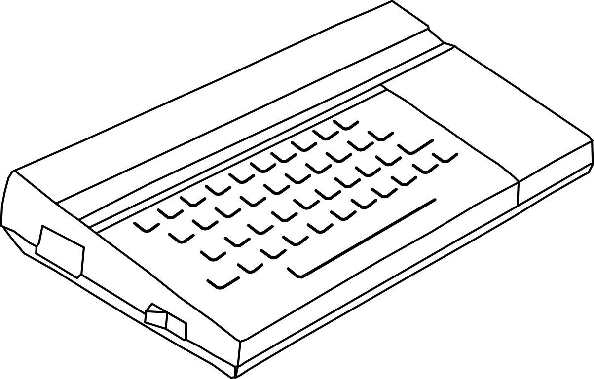
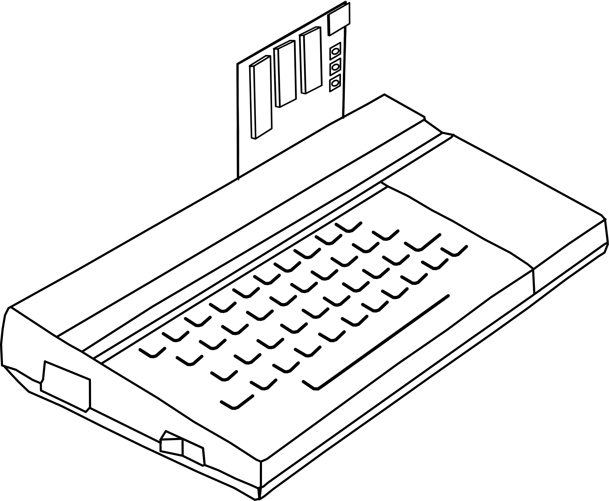

# TS-Pico Quick Start Guide

<!-- The first steps with the TS-Pico, from fitting it to loading a program: a subset of the
     User Manual (user-manual.md), printed as an eight-page booklet by tools/manual-pdf/make.sh.
     Each "##" section is one page of the booklet, and quick.py fails the build if one runs over,
     so keep each about the length it is. When the manual changes what a section says, change it
     here too. -->

## Welcome to the TS-Pico

The TS-Pico retires the cassette. It plugs into the Timex Sinclair 2068's expansion connector
and keeps your programs on a micro SD card, in the same **TAP** files that emulators use. A
`LOAD ""` that took minutes now takes a moment.

This guide takes you from the box to a running program: fitting the TS-Pico, switching on,
giving it commands, finding your way around the card, and loading. The **TS-Pico User Manual**
covers everything else: saving single files, streams, the virtual printer, ROM slots,
cartridges, ZX Spectrum mode and every command.

**You'll need:**

- your Timex Sinclair 2068 and its power supply;
<!-- v2 -->
- the TS-Pico board;
<!-- /v2 -->
<!-- v3 -->
- the TS-Pico v3 card;
<!-- /v3 -->
- an expansion bus board, if you use one (the TS-Pico can also plug straight into the 2068);
- a micro SD card. Your TS-Pico came with one, already set up.



> **Warning.** Switch the 2068 off before you connect or disconnect anything, and take out any
> cartridge in the 2068's cartridge slot.

## Fitting the TS-Pico

**Direct connection.** The TS-Pico plugs straight into the expansion connector at the back
right of the 2068 and sticks out behind it.
<!-- v2 -->


<!-- /v2 -->

**On an expansion bus.** The bus board plugs into the 2068, and the TS-Pico plugs into one of
its slots. Any slot works.

> **Warning.** On an expansion bus, set the TS-Pico's slot's BUSISO bypass, or the TS-Pico
> won't work. With jumpers, remove the jumper for the TS-Pico's slot; with switches, slide its
> BUSISO switch towards the 2068.

Both connectors are keyed, so they only go in one way. Expect a fair amount of resistance when
you press the board home. If you find yourself forcing it, stop and check that the key lines up
with the notch.

**The buttons.**

<!-- v2 -->
- **TS Reset** restarts the 2068. The TS-Pico keeps its state: the mounted file, the current
  folder and so on.
- **Pico Reset** restarts the Pico. Use it only as a last resort, and never while a file is
  being written.

**The P10 jumper** enables writing to the Flash chip. Keep it fitted.
<!-- /v2 -->
<!-- v3 -->
- **TS Reset** restarts the 2068. The TS-Pico keeps its state: the mounted file, the current
  folder and so on.
- **RUN** restarts the card itself. Use it only as a last resort, and never while a file is
  being written.

There are no jumpers to set on the card.
<!-- /v3 -->

## The SD card and switching on

Your card came ready to use. To set up a new one, format it **FAT32** on your computer (cards
up to 16GB work), and copy your `.tap` files into a folder called **`TAP`** at the top of the
card, or into folders inside it. `TAP` is the TS-Pico's top folder; it makes one on a card that
doesn't have it.

<!-- v2 -->
The card goes into the slot at the upper right corner of the board, contacts first, and
clicks into place.
<!-- /v2 -->
<!-- v3 -->
The card goes into the socket on the card's left edge, contacts first, and clicks into place.
<!-- /v3 -->

1. Switch the 2068 on.

   You should see the usual copyright lines and the TS-Pico's own line, for example
   `2026 TS-Pico ROM v2.3`.
2. Press **ENTER**, type `CAT` and press **ENTER**.

   You should see a listing of your `TAP` folder, even if it's empty:

   ```
   Path:/TAP
   SD: 7.4 GB; free: 7.2 GB
   File Name                   Size
   --------------------------------
   <GAMES>                      0 B
   000 frogger.tap            12 kB
   ```

Your TS-Pico is working. **The light** tells you what it's doing:

| What you see | What it means |
|---|---|
| A short flash every couple of seconds | Idle, waiting for a command |
| Steady on | Busy with a command, a SAVE or a listing |
| Flickering | Copying a file you've just mounted |
| Two short flashes every couple of seconds | No SD card |

**No SD card?** Push the card back in and type the command again. If it still isn't found,
<!-- v2 -->
switch the 2068 off, unplug the Pico's USB cable if it's connected, and switch on again.
<!-- /v2 -->
<!-- v3 -->
switch the 2068 off, unplug the card's USB cable if it's connected, and switch on again.
<!-- /v3 -->

## Giving commands

Almost everything the TS-Pico does is reached through a `tpi:` name. The rules are simple.

- **Commands use SAVE.** `SAVE "tpi:dir"` lists the folder; nothing is saved.
- **LOAD "tpi:..." mounts a file**: `LOAD "tpi:frogger.tap"` makes it the "tape" that
  `LOAD ""` reads from.
- **Anything after a space is the argument:** `SAVE "tpi:cd games"`. Upper or lower case
  doesn't matter.
- **The whole name, `tpi:` included, must fit in 31 characters.**
- **Some commands take two numbers**, written like a block of code: `SAVE "tpi:dir" CODE 1,5`.

**Quiet or chatty.** Out of the box, commands work quietly: you see only the report. While
you're learning, turn on the messages, which tell you what a command did and why one failed:

```basic
SAVE "tpi:verbose" CODE 1,1
```

`CODE 1,0` turns them off again.

**The reports you'll see** at the bottom of the screen:

| Report | What it usually means |
|---|---|
| **0 OK** | Done |
| **F Invalid file name** | The file or folder isn't there, or the name isn't allowed |
| **Q Parameter error** | Can't be done right now (file in use, wrong type…) |
| **A Invalid argument** | A `CODE a,b` the command doesn't accept |
| **C Nonsense in BASIC** | An unknown `tpi:` command, or a name over 31 characters |
| **R Tape loading error** | A LOAD found nothing matching, or a damaged TAP |
| **J Invalid I/O device** | The TS-Pico didn't answer |
| **T TS-Pico reset, try again** | The TS-Pico gave up on a transfer. Try again |

## Finding your way around

**Seeing what's there.** `CAT` lists the *current folder*: folders first, in angle brackets,
then files. Each file you can mount gets a three-digit **index number**. If the listing is
longer than the screen, you'll see `Scroll? (Y/n)`: press **Y** or **ENTER** for more, or
**N** to stop.

```basic
CAT            : REM this folder
CAT "games"    : REM another
CAT "*.tap"    : REM TAP files
CAT "games/b*" : REM games, b...
```

`*` matches any run of characters and `?` exactly one.

**Moving between folders.** `MOVE TO "games"` (or `SAVE "tpi:cd games"`) goes into a folder.
`SAVE "tpi:path"` tells you where you are. A few special names help:

| Name | Takes you to |
|---|---|
| `..` | The folder above |
| `/` | The top, the card's `TAP` folder |
| `-` | The folder you were in before |
| `games/arcade` | A folder inside a folder |

`MOVE TO ""` takes you back to where you were.

**Picking from a list.** `SAVE "tpi:cd"` on its own shows the folders here as a numbered
menu. Press a digit **0**-**9**, or **Q W E R T Y** for items 10 to 15, to go into one;
**N** quits.

**Making a folder.** `SAVE "tpi:md tools"`. Name things with letters, digits, `-` and `_`.

## Loading programs

A TAP file is a recording of a cassette. To use one, you **mount** it, as you'd put a
cassette in the player. Mounting looks in the current folder, so go there first.

1. Type `LOAD "tpi:frogger.tap"` and press **ENTER**. (Use the name of one of yours.)

   You should see **0 OK**, after the light flickers. `LOAD "tpi:00"` mounts by index number
   instead: type at least two digits.
2. Type `LOAD ""` and press **ENTER**.

   You should see the first program load, as from a tape. A program saved with `LINE`
   starts by itself.

Now every `LOAD` reads the mounted file, as it would a tape: `LOAD "name"`, `LOAD "" CODE`,
`LOAD "" SCREEN$`, `VERIFY ""` and `MERGE ""`. When a LOAD finds nothing matching, you get
**R Tape loading error** instead of an endless wait. `CAT ""` shows the programs in the
mounted file, and `SAVE "tpi:close"` ejects it.

**With nothing mounted**, `LOAD ""` loads the TS-Pico's menu: **P** picks a file from any folder
and loads it, **F** starts the TS-Pico Commander file manager, and **H** shows the help.

**Saving.** `SAVE "mygame"` writes `mygame.tap` in the current folder. Press **ENTER** at
`Start tape, then press any key.`; it replaces a file of the same name without asking.

**Where next?** The **TS-Pico User Manual** has the rest: `SAVE "tpi:help"` and
`SAVE "tpi:info"` on the 2068, and the manual and the Quick Reference Guide on the website.
