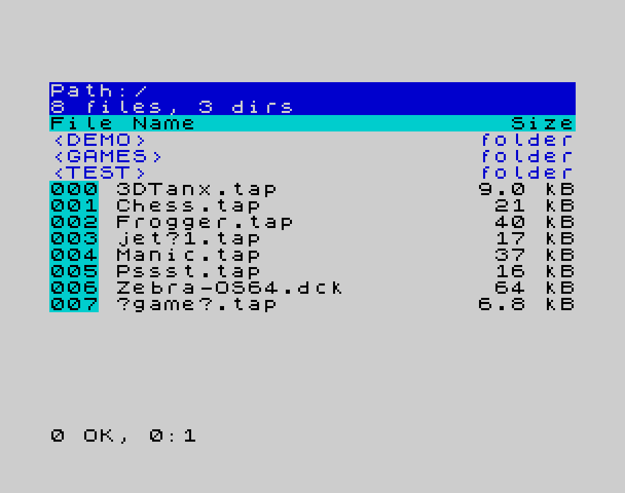
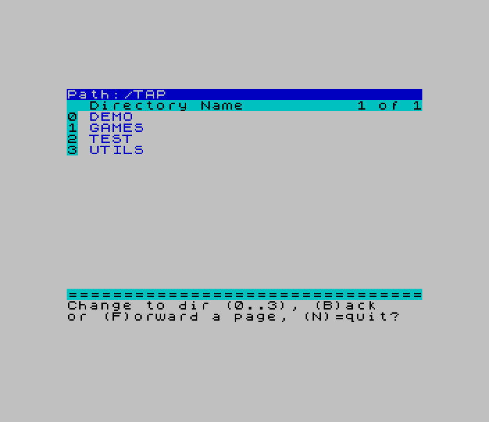
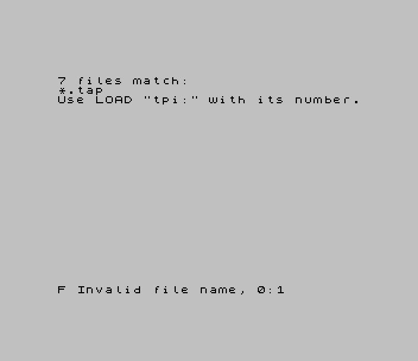
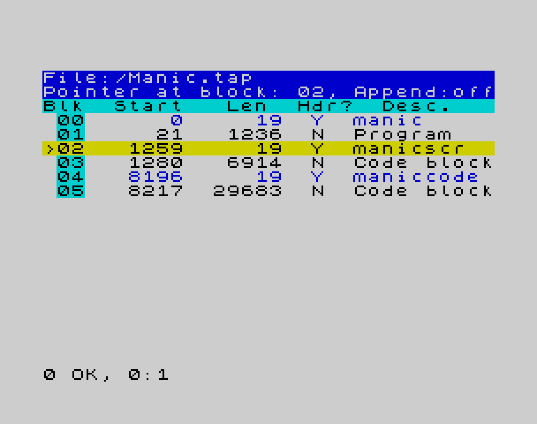
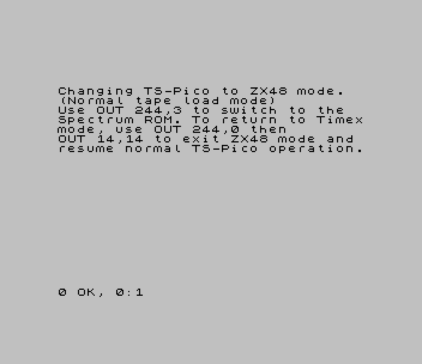
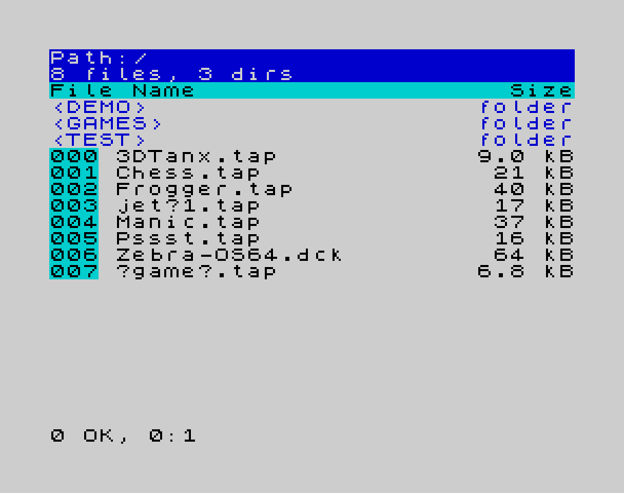
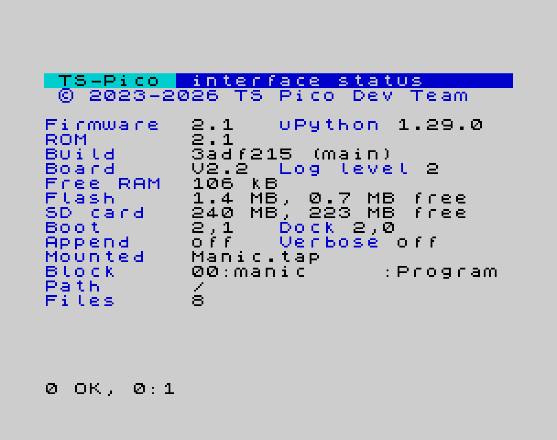
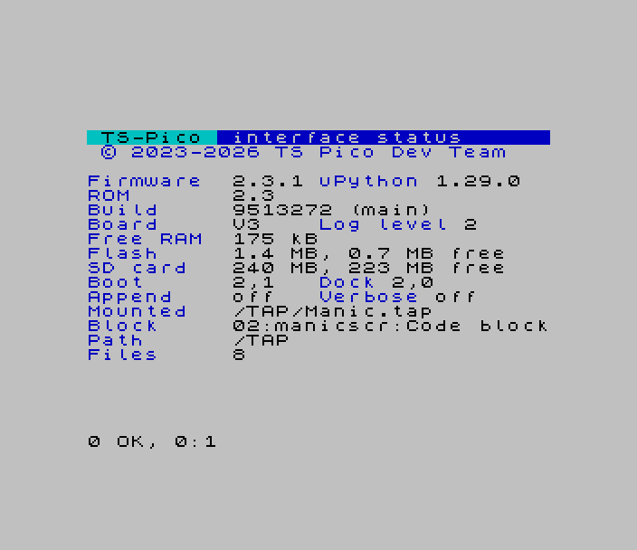

# TS-Pico User Manual

<!-- v2 -->
### For the TS-Pico Interface for the Timex Sinclair 2068 — version 2.3
<!-- /v2 -->
<!-- v3 -->
### For the TS-Pico v3 card for the Timex Sinclair 2068 — version 2.3
<!-- /v3 -->

## Contents

1. Meet the TS-Pico
2. Installing Your TS-Pico
3. Getting Around: Files, Folders and Tapes
4. Loading and Saving
5. Native Files with `f:`
6. Streams and Channels: `OPEN #`
7. The Virtual Printer
<!-- v2 -->
8. ROM Slots, Cartridges and the Flash Chip
<!-- /v2 -->
<!-- v3 -->
8. ROM Slots and Cartridges
<!-- /v3 -->
9. ZX Spectrum Mode
10. Command Reference
11. When Things Don't Go As Expected

Appendices

- A. Upgrading Your TS-Pico
- B. Reports at a Glance
- C. Command Quick Reference
- D. Settings, `config.ini` and TPMODE
- E. The TS-Pico Team
<!-- v3 -->
- F. The Modem
- G. Speech
<!-- /v3 -->

---

# Chapter 1: Meet the TS-Pico

<!-- keywords: tpi: · VERBOSE · reports -->

> **Chapter Preview.** Know what the TS-Pico does, give it a command, and read the reports it
> gives back.

## 1.1 What is the TS-Pico?

Remember loading programs from cassette? You'd press PLAY, wait while the tape warbled, and
hope nothing went wrong at minute four. The TS-Pico retires the cassette. It plugs into the
2068's expansion connector and keeps your programs on a micro SD card, in the same **TAP**
files that emulators use. A `LOAD ""` that took minutes now takes a moment.

<!-- v2 -->
Inside is a Raspberry Pi **Pico** running MicroPython. It talks to the 2068 through two I/O
ports and looks after the SD card. Next to it on the board are:

- **512K of Flash memory**, holding sixteen 32K "slots": the TS-Pico 2068 ROM, a ZX Spectrum
  ROM, a few utility ROMs and cartridges, and room for your own;
- **512K of static RAM**, sixteen more slots that are lost when the power goes off.
<!-- /v2 -->
<!-- v3 -->
The v3 card is built around a Raspberry Pi **RP2350** chip running MicroPython. It talks to
the 2068 through two I/O ports, looks after the SD card, and has no memory chips: it serves the
2068's ROM and cartridges from its own memory. It keeps:

- sixteen 32K **Flash slots** in its own memory: the TS-Pico 2068 ROM, a ZX Spectrum ROM, a
  few utility ROMs and cartridges, and room for your own;
- sixteen **RAM slots**, lost when the power goes off.

It also has a **WiFi modem**, which programs written for the Timex TS2050 modem use to reach
hosts on the internet (Appendix F).
<!-- /v3 -->

The TS-Pico replaces part of the 2068's own ROM with its own version, so the ordinary
commands **LOAD**, **SAVE**, **VERIFY** and **MERGE** go to the SD card, and a family of new commands
lets you look after files and folders.

**What you can do with it:**

- Load and save programs, screens, code and data to TAP files on the SD card
- Browse, create, copy, rename and delete files and folders
- Save a program as a plain file (`foo.bas`, `foo.scr`), not only inside a TAP
- Read and write text and data files from BASIC with `OPEN #`, `PRINT #` and `INPUT #`
- Capture `LPRINT`, `LLIST` and `COPY` to text and picture files
- Run cartridges (DCK files) and alternative ROMs from the Flash slots
<!-- v3 -->
- Run ROMs and cartridges straight from the SD card
- Dial bulletin boards over WiFi with TS2050 terminal programs such as MTERM
<!-- /v3 -->
- Switch the 2068 into a ZX Spectrum and load Spectrum tapes

## 1.2 How TS-Pico commands work

Almost everything the TS-Pico does is reached through a filename that starts with `tpi:`. When
the 2068 sees `SAVE "tpi:..."`, it doesn't save anything; it sends the rest of the name to
the TS-Pico as a command.

```basic
SAVE "tpi:dir"
```

That's the directory command. The rules are simple:

- **Commands use SAVE.** `SAVE "tpi:dir"`, `SAVE "tpi:cd games"`, `SAVE "tpi:info"`.
- **LOAD "tpi:..." mounts a file.** `LOAD "tpi:frogger.tap"` makes `frogger.tap` the "tape" that
  `LOAD ""` reads from. There are no other LOAD commands.

  > **Coming from version 1.1?** Version 1.1 used `LOAD "tpi:dir"`, `LOAD "tpi:path"` and so on.
  > In this version they are all `SAVE` commands. `LOAD "tpi:dir"` now tries to mount a file
  > called `dir`, and gives Report F.

- **Upper or lower case doesn't matter** in the command word: `tpi:DIR`, `tpi:dir` and `TPI:Dir`
  all work.
- **Anything after a space is the argument:** `SAVE "tpi:cd games"`.
- **The whole name, `tpi:` included, must fit in 31 characters.** The 2068 accepts a longer one
  when you type the line, but stops with **C Nonsense in BASIC** when it runs. Watch for this
  when a program builds the name from a string: `SAVE "tpi:cd "+d$` works only while `d$` is
  at most 24 characters.
- **Some commands take numbers** after the name, written the way you'd save a block of code:

  ```basic
  SAVE "tpi:dir" CODE 1,5
  ```

  Nothing is saved. The two numbers (we'll call them *a* and *b*) are passed to the command,
  and each command says what they mean. Leaving `CODE` off is the same as `CODE 0,0`.

The disk commands also have their own keywords, so you can type `CAT` instead of
`SAVE "tpi:dir"`. We'll use both as we go.

## 1.3 Quiet or chatty: VERBOSE

Out of the box, most TS-Pico commands work quietly: a successful command gives you **0 OK**, and a failed one gives you a report such as **F Invalid file name**. That keeps
programs tidy. While you're learning, you'll probably want to see what's going on:

```basic
SAVE "tpi:verbose" CODE 1,1
```

Now commands tell you what they did ("Changed dir to: games") and why they failed ("File does
not exist: frogr.tap"). Turn it off again with `CODE 1,0`. Some commands, such as **DIR**, **PATH**,
**INFO** and the listings, always show their output whatever the setting, and so do a few
messages, such as `No SD card`. Every other message in this manual appears only in verbose
mode: with it off, you see only the report.

## 1.4 The reports you'll see

When something goes wrong, the TS-Pico hands the 2068 a status, and the 2068 turns it into one
of its familiar reports at the bottom of the screen:

| Report | What it usually means with the TS-Pico |
|---|---|
| **0 OK** | Done |
| **F Invalid file name** | The file or folder isn't there, or the name isn't allowed |
| **Q Parameter error** | The command understood you but can't do it (file in use, not empty, wrong mode…) |
| **A Invalid argument** | A `CODE a,b` or an argument the command doesn't accept |
| **C Nonsense in BASIC** | An unknown `tpi:` command, or extra words the command doesn't expect |
| **R Tape loading error** | Data was damaged on the way, a TAP file is damaged, or a LOAD found nothing matching |
| **8 End of file** | You read past the end of a file |
| **6 Number too big** | A number out of range, such as a file index |
| **D BREAK - CONT repeats** | You pressed **BREAK**, or answered N to a "Replace?" question |
| **J Invalid I/O device** | The TS-Pico didn't answer. See Chapter 11 |
| **T TS-Pico reset, try again** | The TS-Pico gave up on a transfer and reset itself. Try again |

Appendix B has the full list.

## 1.5 Summary

1. The TS-Pico keeps your programs on a micro SD card and makes LOAD and SAVE fast.
2. `SAVE "tpi:command"` sends a command; `LOAD "tpi:file"` mounts a file.
3. `CODE a,b` after a command passes it two numbers.
4. Turn on `SAVE "tpi:verbose" CODE 1,1` to see messages while you learn.
5. Errors come back as ordinary 2068 reports.

---

# Chapter 2: Installing Your TS-Pico

<!-- keywords: SD card · jumpers · tpi:dir -->

> **Chapter Preview.** Fit the TS-Pico, read its light and buttons, prepare an SD card, and run
> your first command.

## 2.1 Before you begin

You'll need:

- your Timex Sinclair 2068 and its power supply;
- the TS-Pico board;
- an expansion bus board, if you use one (the TS-Pico can also plug straight into the 2068);
- a micro SD card. Your TS-Pico came with one, already set up.

> **Warning.** Switch the 2068 off before you connect or disconnect anything, and take out any
> cartridge in the 2068's cartridge slot.

## 2.2 Fitting the board

There are two ways to connect the TS-Pico.

**Direct connection.** The TS-Pico plugs straight into the expansion connector at the back
right of the 2068 and sticks out behind it.

**On an expansion bus.** The bus board plugs into the 2068, and the TS-Pico plugs into one of
its slots. Any slot works; many people use the one nearest the 2068.

> **Warning.** On an expansion bus, set the TS-Pico's slot's BUSISO bypass, or the TS-Pico
> won't work. The bus has "BUSISO bypass" jumpers or switches on its right-hand side, between
> the card-edge connectors.
>
> - With jumpers: remove the jumper for the TS-Pico's slot. Park it on a single pin so it
>   doesn't get lost.
> - With switches: slide the BUSISO switch towards the 2068. The other switches stay towards the
>   back of the board, away from the 2068.

Both connectors are keyed, so they only go in one way. Expect a fair amount of resistance when
you press the board home. That's normal. If you find yourself forcing it, stop and check that
the key lines up with the notch.

<!-- v2 -->
## 2.3 A tour of the board

**The Pico** is the small green board with a white **BOOTSEL** button and a Micro-USB socket.
You only need the USB socket for updating the firmware (Appendix A). In normal use the TS-Pico
takes its power from the 2068.

**The buttons.** The TS-Pico has three pushbuttons:

- **TS Reset** restarts the 2068, as its own reset does. The TS-Pico keeps its state: the
  mounted file, the current folder and so on.
- **Pico Reset** restarts the Pico. Use it only as a last resort, and never while a file is
  being written.
- **NMI** isn't used by the standard ROM.

**The light.** The Pico's green LED tells you what it's doing:

| What you see | What it means |
|---|---|
| A short flash every couple of seconds | Idle, waiting for a command |
| Steady on | Busy with a command, a SAVE or a listing |
| Flickering | Copying a file you've just mounted |
| A burst of fast blinks | Something went wrong, for example a file that wouldn't mount |
| Two short flashes every couple of seconds | Running without an SD card (see 2.6) |

**The jumpers.**

- **P10** enables writing to the Flash chip. Keep it fitted: you need it to update the ROM and
  to put cartridges and ROMs into the Flash slots.
- **JP4** chooses the TS-Pico's I/O port range. Leave it on the default `$00..$0F` setting (the
  TS-Pico uses ports 14 and 15).
- **JP1** lets the TS-Pico cooperate with a device plugged in "behind" it on an expansion bus.
- **JP2, JP3 and JP5** are for wiring remote copies of the buttons, for example in a case.

**The SD card slot** is at the upper right corner of the TS-Pico board. The card goes in
contacts first and clicks into place.
<!-- /v2 -->
<!-- v3 -->
## 2.3 A tour of the card

**The edges.** Along the left edge, from the top: the WiFi aerial (part of the modem module),
a **USB-C** socket, and the **micro SD card** socket. You only need the USB socket to update
the firmware (Appendix A). In normal use the card takes its power from the 2068; with a USB
cable connected it can also be powered from the computer.

**The buttons.** Along the top edge, left to right:

- **TS Reset** restarts the 2068, as its own reset does. The TS-Pico keeps its state: the
  mounted file, the current folder and so on.
- **NMI** isn't used by the standard ROM.
- **RUN** restarts the card itself. Use it only as a last resort, and never while a file is
  being written.
- **BOOTSEL** is for installing firmware by hand (Appendix A).

There are no jumpers to set on the card.

**The light.** The card's LED (dimmed, set by `LED_BRIGHTNESS`, Appendix D) tells you what it's
doing:

| What you see | What it means |
|---|---|
| A short flash every couple of seconds | Idle, waiting for a command |
| Steady on | Busy with a command, a SAVE or a listing |
| Flickering | Copying a file you've just mounted |
| A burst of fast blinks | Something went wrong, for example a file that wouldn't mount |
| Two short flashes every couple of seconds | Running without an SD card (see 2.6) |

**The audio jack** gives the card's speech (Appendix G), mixed with the 2068's own sound.
**The other connectors**, a joystick socket and a display header, are for features coming in
later firmware.
<!-- /v3 -->

## 2.4 The micro SD card

Your card came ready to use. If you set up a new one:

1. Format it **FAT32** on your computer. Cards up to 16GB work.
2. Create a folder called **`TAP`** at the top level of the card. The TS-Pico treats `TAP` as
   its root folder. (It makes the folder on a card that doesn't have one.)
3. Copy your `.tap` files into `TAP`, or into folders inside it.
4. If you like, copy the `help` folder from the TS-Pico release to the top level of the card,
   next to `TAP`. That's where `SAVE "tpi:help word"` finds its help pages.

<!-- v3 -->
The card goes into the socket on the card's left edge, contacts first, and clicks into place.
A switch in the socket tells the TS-Pico whether a card is in, so you can take it out and put it
back between commands.
<!-- /v3 -->

**Swapping cards.** You can change cards while the 2068 is on. The next command that reads the
card (a `CAT` or `SAVE "tpi:dir"` will do) notices it's a different card and reads it
afresh. You stay in the same folder if the new card has it, and the mounted TAP stays mounted
if the new card has that file too; otherwise you're back at the top, with nothing mounted.
Append is switched off, so a SAVE can't land in a file on the other card, and any files open
with `OPEN #` are closed.

**Naming files.** Stick to letters, digits, `-` and `_` for anything you'll SAVE from the 2068. The TS-Pico accepts longer names and spaces when *loading*, but a plain `SAVE "name"` only allows letters, digits, `-` and `_`.

## 2.5 Switching on

You'll need the TS-Pico fitted (2.2) and an SD card in its socket (2.4).

1. Switch the 2068 on.
<!-- v2 -->

   You should see the screen look frozen or garbled for a couple of seconds while the Pico
   starts, and the Pico's LED blinking while it opens the SD card and reads your `TAP` folder.
   Then the 2068 starts, with the usual copyright lines and the TS-Pico's own line, which
   includes the ROM version, for example `2026 TS-Pico ROM v2.3`.
<!-- /v2 -->
<!-- v3 -->

   You should see the screen stay dark for a moment while the card loads the ROM into its
   memory and opens the SD card. Then the 2068 starts, with the usual copyright lines and the
   TS-Pico's own line, which includes the ROM version, for example `2026 TS-Pico ROM v2.3`.
<!-- /v3 -->
2. Press **ENTER**.

   You should see the flashing **K** cursor.
3. Type `SAVE "tpi:dir"` and press **ENTER**.

   You should see a listing of your `TAP` folder, even if it's empty:

   ```
   Path:/TAP
   SD: 7.4 GB; free: 7.2 GB
   File Name                   Size
   --------------------------------
   <GAMES>                      0 B
   000 frogger.tap            12 kB
       notes.txt              300 B
   ```

Your TS-Pico is working. Plain `CAT` gives the same listing.

Folders come first, in angle brackets. Each TAP, TZX, DCK, ROM or BIN file gets a three-digit
**index number**. Other files, such as `notes.txt`, are listed without one.

## 2.6 If the SD card isn't found

**Symptom.** The LED gives **two** short flashes every couple of seconds instead of one, and any
command that needs the card says so:

```
No SD card. Insert one and
try again.
J Invalid I/O device, 0:1
```

The TS-Pico keeps running without a card. Commands that don't need it, such as
`SAVE "tpi:info"`, keep working, and so does `LOAD ""` from a TAP you mounted earlier. A `SAVE`
is refused before anything is sent, so your program is still in memory.

**Fix.**

1. Put the card in, or take it out and push it back in.
2. Type the command again.

   You should see your directory listing. The TS-Pico looks for the card every time, so there's
   nothing else to do. A freshly formatted card works too: the TS-Pico makes its `TAP` folder.

**Fallback.** If the card still isn't found, give the whole system a fresh start:

1. Switch the 2068 off.
<!-- v2 -->
2. Unplug the Pico's USB cable, if it's connected to a computer.
<!-- /v2 -->
<!-- v3 -->
2. Unplug the card's USB cable, if it's connected to a computer.
<!-- /v3 -->
3. Wait a few seconds, then switch the 2068 back on.

If the card still isn't found after that, try it in a computer: it may need formatting (FAT32),
or it may be write-protected, in which case the TS-Pico can't make its `TAP` folder.

**Likely cause.** It's most common after a *warm boot*: the TS-Pico restarted while it stayed
powered, for example after a firmware update with the USB cable connected. The SD card stays
powered through the restart and can be left waiting for something that never arrives. It only
recovers once it loses power, which taking the card out, or switching everything off, does.

## 2.7 Summary

1. Switch the 2068 off before connecting anything, and set the BUSISO bypass for the TS-Pico's
   slot on an expansion bus.
<!-- v2 -->
2. Keep the P10 jumper fitted.
<!-- /v2 -->
<!-- v3 -->
2. The card has no jumpers of its own.
<!-- /v3 -->
3. Your files live in the SD card's `TAP` folder; the TS-Pico makes it on a blank card.
4. A short LED flash every couple of seconds means all is well.
5. Two LED flashes mean there's no SD card. Put one in, or reseat it, and type the command
   again; if that doesn't do it, switch off with the USB unplugged.

---

# Chapter 3: Getting Around: Files, Folders and Tapes

<!-- keywords: CAT · CD · MOVE TO · PATH · FFW · REW -->

> **Chapter Preview.** List what's on the card, move between folders, and mount a TAP file so
> that `LOAD ""` reads from it.

## 3.1 What's on the card? DIR and CAT

You've already met the directory listing:

```basic
SAVE "tpi:dir"
```

Or you can use the **CAT** command. The listing shows the folder you're in (the
*current folder*), how big the card is and how much space is free, then folders, then files.
If it's longer than the screen, you'll see `Scroll? (Y/n)` with a percentage showing how far
through you are. Press **Y** or **ENTER** for more, a number **1** to **9** to scroll that many
lines, or **N** to stop.

`CAT` can do more than list the current folder:

```basic
CAT "games"          : REM a different folder, without going there
CAT "*.tap"          : REM only the TAP files
CAT "games/b*"       : REM files in games starting with b
CAT "frogger.tap"    : REM the blocks inside a TAP file
CAT ""               : REM the blocks inside the mounted TAP
```

`*` matches any run of characters and `?` matches exactly one. They work in the last part of a
path. `SAVE "tpi:dir games"`, `SAVE "tpi:dir *.tap"` and so on give the same listings, as long
as the whole name fits in 31 characters.



*`CAT` on a card with four folders and eight files. `{game}.tap` and `jet~1.tap` appear as
`?game?.tap` and `jet?1.tap`; see below.*

> **By the way:** `SAVE "tpi:dir"` checks the card before it lists the folder. After you swap
> cards you see the new card, and if you take the card out, add files from a computer and put
> it back, the new files are there too. No restart needed.

**Names with characters the 2068 can't show.** A file named on a computer can contain characters
the 2068 doesn't have on its keyboard or prints as something else: `|` and `~` come out as the
keywords STICK and FREE, `{` and `}` can come out as ON ERR and SOUND, and accented letters
don't exist at all. The listing shows each of them as `?`, for example `?game?.tap` for
`{game}.tap`. You can type the name just as it's shown; see the next section.

## 3.2 Folders: CD, MOVE TO and PATH

To go into a folder:

```basic
SAVE "tpi:cd games"
```

or:

```basic
MOVE TO "games"
```

To see where you are:

```basic
SAVE "tpi:path"
```

```
Current working dir is:
/TAP/GAMES
```

A few special names help you get around:

| Name | Takes you to |
|---|---|
| `..` | The folder above. You can't go above the root. |
| `/` | The root, the card's `TAP` folder |
| `-` | The folder you were in before the last change |
| `games/arcade` | A folder inside a folder |
| `/games` | A path from the root |

`MOVE TO ""` is the same as `SAVE "tpi:cd -"`: back to where you were.

**Picking a folder from a list.** Type `SAVE "tpi:cd"` on its own and the TS-Pico shows the
folders here as a numbered menu. Press a digit **0**-**9**, or **Q W E R T Y** for items
10 to 15, to go into one; **B** goes back a page, any other key goes forward, and **N**
quits. `SAVE "tpi:cd" CODE 0,1` lists every folder on the card instead.



*The `SAVE "tpi:cd"` menu, waiting for a key.*

**Making a folder:**

```basic
SAVE "tpi:md tools"
FORMAT "tools/"      : REM the same (note the slash)
```

`SAVE "tpi:md tools" CODE 1,0` makes the folder and goes into it.

## 3.3 Mounting a TAP file

A TAP file is a recording of a cassette: a series of blocks, as they'd appear on tape.
To use one, you **mount** it. Think of it as putting the cassette in the player:

```basic
LOAD "tpi:frogger.tap"
```

Now `LOAD ""` loads from that file, one program after another, as a tape would. The
TS-Pico copies the TAP into its own memory while it mounts it. The LED flickers for a moment,
and big files take a second or two.

You can also mount a file by the **index number** shown in the listing:

```basic
LOAD "tpi:0"         : REM the file listed as 000
LOAD "tpi:12"
```

**Remember:**

- Mounting only looks in the **current folder**. Use `MOVE TO` or `tpi:cd` first.
- Only TAP, DCK, ROM and BIN files can be mounted. DCK, ROM and BIN files are cartridges and
  ROM images; they're covered in Chapter 8. TZX files are listed with an index number, but the
  TS-Pico can't mount them: you'll get **Q Parameter error**.
- If the name isn't found, you'll get **F Invalid file name**. A file you've just copied onto
  the card from a computer is found without a restart.
- **Type a `?` where the listing shows one.** `LOAD "tpi:?game?.tap"` mounts `{game}.tap`. A
  `?` stands only for a character the 2068 can't show, so it won't pick `(game).tap` by
  mistake. A `*` stands for any run of characters: `LOAD "tpi:fro*"` mounts `frogger.tap` if
  it's the only match. When several files match, the TS-Pico says how many and asks you to use
  the file's number instead:

  

**Picking a file from a list.** `SAVE "tpi:idir"` shows the indexed files as a menu, using the
same keys as `tpi:cd`, and mounts the one you pick.

## 3.4 Looking inside a TAP

To see what's in the mounted TAP:

```basic
SAVE "tpi:tapdir"
CAT ""               : REM the same
```



*`CAT ""` with `Manic.tap` mounted and the tape pointer at block 02.*

Each program on a tape is two blocks: a short **header** (`Y` in the Hdr? column) carrying its
name, and the data itself, described by its type. The `>` marks the **tape pointer**, the block
the next `LOAD` will start from.
`SAVE "tpi:tapdir" CODE 1,0` shows one line per program or file instead of one per block.
`CAT "other.tap"` shows the contents of any TAP, mounted or not.

## 3.5 Winding the tape: FFW and REW

Like a cassette, the tape winds forward and back:

```basic
SAVE "tpi:ffw"             : REM forward one block
SAVE "tpi:rew" CODE 0,3    : REM back three blocks
SAVE "tpi:ffw" CODE 2,1    : REM forward to the next program or file
SAVE "tpi:rew" CODE 3,2    : REM back two files, then show the tape
```

The tape stops at either end rather than wrapping round. With verbose on you'll see
`Moved ahead to block # 4`, `Can't FWD. Already at end.`, `Can't REW. Already at start.`, or
`Can't FWD. No later file.` when you skip by files from the last program. With verbose off
each of these is **0 OK**.

## 3.6 Ejecting the tape: CLOSE

```basic
SAVE "tpi:close"
```

This unmounts the file. It's always safe, even with nothing mounted.

## 3.7 LOAD "" with nothing mounted

If nothing is mounted and you type `LOAD ""`, the TS-Pico loads a little menu program instead:

- **H** shows the TS-Pico's built-in help;
- **C** gives help on a single command;
- **P** lets you pick a file from any folder and load it;
- **F** starts the **TS-Pico Commander**, a full-screen file manager;
- **R** shows your ROM version;
- **I** shows TS-Pico information;
- **V** has settings for the Pico Video board;
- **Q** quits.

To get the menu back at any time: `SAVE "tpi:close"` then `LOAD ""`.

The Commander lets you browse with the cursor keys, press **ENTER** to go into a folder or
mount a file, and use single keys for most TS-Pico commands. Press **?** in the Commander to
see them all.

**Your own menu.** To have `LOAD ""` load a program of your own at switch-on instead, perhaps
a menu you've written, save it in a TAP on the card and make that TAP the *auto-mount* file:

```basic
SAVE "tpi:automount mymenu.tap"
```

From then on the TS-Pico mounts `mymenu.tap` each time it starts, so the first `LOAD ""` loads
your program. The name is looked for in the current folder, and the TS-Pico remembers where it
is, so it doesn't matter which folder you're in later. At switch-on you're still in the top
folder. If the file has gone from the card, you get the built-in menu. `SAVE "tpi:automount"`
shows the file, and `SAVE "tpi:automount off"` goes back to the built-in menu.

## 3.8 Try it: from the listing to a running program

You'll need a TAP file on the card. These steps use `frogger.tap`; use the name of one of yours.

1. Type `CAT` and press **ENTER**.

   You should see the current folder, with an index number beside each file you can mount.
2. Type `LOAD "tpi:frogger.tap"` and press **ENTER**.

   You should see **0 OK**, after the LED flickers while the TS-Pico copies the file.
3. Type `CAT ""` and press **ENTER**.

   You should see the blocks inside `frogger.tap`, with the tape pointer `>` on the first one.
4. Type `LOAD ""` and press **ENTER**.

   You should see the first program load, as from a tape. A program saved with `LINE` starts by
   itself.
5. Type `SAVE "tpi:close"` and press **ENTER**.

   You should see **0 OK**. With nothing mounted, the next `LOAD ""` loads the menu (3.7).

## 3.9 Summary

1. `CAT` (or `SAVE "tpi:dir"`) lists files; patterns such as `"*.tap"` narrow it down.
2. `MOVE TO "folder"` (or `SAVE "tpi:cd folder"`) changes folder; `..`, `/` and `-` help you move.
3. `LOAD "tpi:name.tap"` mounts a file, by name or by index number.
4. `CAT ""` (or `SAVE "tpi:tapdir"`) shows what's inside the mounted TAP.
5. `SAVE "tpi:ffw"` and `SAVE "tpi:rew"` move the tape pointer; `SAVE "tpi:close"` ejects.
6. `SAVE "tpi:automount name.tap"` makes `LOAD ""` load your own program at switch-on.

---

# Chapter 4: Loading and Saving

<!-- keywords: LOAD · SAVE · VERIFY · MERGE · APPEND -->

> **Chapter Preview.** Load from and save to the SD card with the 2068's own commands, and keep
> several programs in one TAP.

## 4.1 LOAD, VERIFY and MERGE

Once a TAP is mounted, all the loading commands work exactly as they would with tape:

```basic
LOAD ""                  : REM the next program on the tape
LOAD "frogger"           : REM the program called frogger
LOAD "" CODE             : REM the next block of code
LOAD "" SCREEN$          : REM a picture
LOAD "" DATA a$()        : REM an array
VERIFY ""
MERGE ""
```

The TS-Pico starts at the tape pointer and skips blocks that don't match what you asked for.
When it reaches the end, it goes back to the start, like rewinding. If it goes all the way
round without finding a match, you get **R Tape loading error**, instead of the endless wait
you'd get with a real tape. On the way, the 2068 shows the name of each block it passes, as it
does with a cassette.

## 4.2 SAVE

When the TS-Pico is your storage device (it is when you switch on), a plain SAVE writes a
**new TAP file** in the current folder, named after your program:

```basic
SAVE "mygame"            : REM makes mygame.tap
SAVE "mygame" LINE 10    : REM the same, starting at line 10 when loaded
SAVE "pic" SCREEN$
SAVE "code" CODE 32768,1000
```

As with tape, SAVE prints `Start tape, then press any key.` and waits: press a key, and the
program goes to the card.

**Remember:**

- A plain SAVE name may only use **letters, digits, `-` and `_`**. Spaces or other symbols give
  **F Invalid file name** before anything is written.
- Saving over an existing name **replaces that file without asking**.
- If nothing was mounted, the new file becomes the mounted file.
- An empty program gives **A Invalid argument**.

> **Note:** the TS-Pico answers once your data is on the card. If the card fails while it's
> writing (for example because it was pulled out), you get **J Invalid I/O device** instead of
> **0 OK**, and nothing is saved.

## 4.3 Adding to a TAP: APPEND and NEWTAP

Sometimes you want several programs in one TAP, like a real cassette. That's what **append**
mode is for:

```basic
LOAD "tpi:collection.tap"
SAVE "tpi:append" CODE 1,1     : REM or SAVE "tpi:append on"
SAVE "one"
SAVE "two"
SAVE "tpi:append off"
```

With append on, every SAVE is added to the end of the mounted TAP; the name you give is kept
in the tape header but doesn't name a file. `SAVE "tpi:append"` on its own tells you whether
it's on. Mounting any file turns it off.

To start a fresh, empty TAP and switch append on in one go:

```basic
FORMAT "collection.tap"        : REM refuses if the file exists
SAVE "tpi:newtap collection"   : REM the same
```

> **Note:** neither command touches a file that's already there. Both answer **F**, and
> `tpi:newtap` shows `File exists:` when VERBOSE is on.

## 4.4 Using a real cassette recorder

The TS-Pico can step aside and let the 2068 use its cassette port again:

```basic
SAVE "tpi:tape"      : REM LOAD and SAVE use the cassette recorder
SAVE "tpi:sdcard"    : REM back to the TS-Pico (the setting at switch-on)
```

`tpi:` commands keep working in tape mode; only plain LOAD, SAVE, VERIFY and MERGE go to
tape. Printing stays where it was (Chapter 7). You can check the setting with `PRINT PEEK 24027`; see Appendix D.

## 4.5 A program that keeps its pictures on a tape

This program draws three pictures and saves each one into a new TAP, then loads them back by
name and shows them in turn:

```basic
10 FORMAT "pics.tap"
20 FOR i=1 TO 3
30 CLS: CIRCLE 128,88,20*i
40 SAVE "pic"+STR$ i SCREEN$
50 NEXT i
60 SAVE "tpi:append off"
70 FOR i=1 TO 3
80 LOAD "pic"+STR$ i SCREEN$
90 PAUSE 50
100 NEXT i
```

Line 10 makes `pics.tap`, mounts it and turns append on, so lines 30 to 50 add `pic1`, `pic2` and
`pic3` to it instead of making three files. Each SAVE in line 40 waits for you to press a key, as
any SAVE does. Line 80 finds each picture by its tape name. Run it once: on a second RUN, line 10 stops with **F**, because FORMAT never replaces a file.

## 4.6 Summary

1. LOAD, VERIFY and MERGE read the mounted TAP from the tape pointer, wrapping once.
2. SAVE writes `name.tap` in the current folder; names are letters, digits, `-` and `_`.
3. Append mode adds SAVEs to the mounted TAP; `FORMAT "x.tap"` starts a new one.
4. `SAVE "tpi:tape"` and `SAVE "tpi:sdcard"` switch between cassette and TS-Pico.

---

# Chapter 5: Native Files with `f:`

<!-- keywords: f: · LOAD · SAVE -->

> **Chapter Preview.** Save and load single files, such as a program, a picture or an array, that
> you can copy to and from a computer.

## 5.1 Why native files?

A TAP file is a whole cassette. Sometimes you want one file: `advent.bas`, `title.scr`,
`sprites.bin`. You can copy it to and from your computer, and it doesn't disturb the mounted
TAP or its tape pointer. That's what the `f:` prefix is for. Put it in front of a name, and
SAVE and LOAD talk straight to a file on the card:

```basic
SAVE "f:advent.bas" LINE 10
LOAD "f:advent.bas"
```

SAVE prints `Start tape, then press any key.` and waits for a key, as it does for tape.
Everything you can save to tape, you can save this way:

```basic
SAVE "f:title.scr" SCREEN$
SAVE "f:sprites.bin" CODE 50000,768
SAVE "f:scores.dat" DATA s()
LOAD "f:title.scr" SCREEN$
LOAD "f:sprites.bin" CODE
LOAD "f:scores.dat" DATA s()
VERIFY "f:advent.bas"
MERGE "f:subs.bas"
```

The name can include a folder: `SAVE "f:games/advent.bas"`. The extension is up to you;
the TS-Pico knows the file's type from the file itself. The name after `f:` can be up to 64
characters long, counting any folders, slashes and the extension. The 10-character limit
of a tape name doesn't apply here.

## 5.2 Replacing a file

If the file already exists, SAVE asks first, at the bottom of the screen so it doesn't spoil a
picture you're saving:

```
Replace advent.bas? (Y/N)
```

Press **Y** to replace it. Any other key cancels the SAVE with **D BREAK - CONT repeats**, and
the old file is left alone.

## 5.3 What's in the file

Programs, code and arrays are stored with a 128-byte **+3DOS header**, the same format the
Spectrum +3 and most modern Spectrum tools use, followed by the data. A SCREEN$ is stored as
the plain 6912 bytes of the screen, so you can open it in picture tools that understand
Spectrum screens.

A plain file of bytes with no header, such as something from your computer, can still be
loaded as CODE: `LOAD "f:font.bin" CODE 60000` puts the whole file at 60000.

## 5.4 If something goes wrong

| What you see | Why |
|---|---|
| **F Invalid file name** | The file or its folder isn't there (a folder's name, for a LOAD); the name isn't allowed, or is longer than 64 characters; or a file with no header, loaded without `CODE` |
| **Q Parameter error** | A SAVE to a folder's name, or over the mounted TAP; or you asked for the wrong type (for example, `LOAD "f:title.scr"` without `SCREEN$`) |
| **D BREAK - CONT repeats** | You answered anything but Y to "Replace?" |

With verbose on, the TS-Pico says which, for example `advent.bas holds a program`.

## 5.5 A high-score table in a file

```basic
10 DIM s(5)
20 FOR i=1 TO 5: LET s(i)=600-i*100: NEXT i
30 SAVE "f:scores.dat" DATA s()
40 DIM s(5)
50 LOAD "f:scores.dat" DATA s()
60 FOR i=1 TO 5: PRINT i;". ";s(i): NEXT i
```

Line 30 saves the array (press a key when it asks), line 40 empties it, and line 50 brings the
scores back. A game would
save at line 30 when it ends and load at line 50 when it starts. The second time you RUN this,
line 30 asks `Replace scores.dat? (Y/N)`: press **Y**.

## 5.6 Summary

1. `SAVE "f:name"` and `LOAD "f:name"` work with a single file, not a TAP.
2. Every kind of SAVE and LOAD works: programs, CODE, SCREEN$, DATA, VERIFY and MERGE.
3. The mounted TAP and its tape pointer are untouched.
4. Replacing a file asks first.

---

# Chapter 6: Streams and Channels: `OPEN #`

<!-- keywords: OPEN # · PRINT # · INPUT # · LIST # · CLOSE # -->

> **Chapter Preview.** Write and read text files with the 2068's own `PRINT #` and `INPUT #`,
> keep records you can jump to by number, and read a folder listing into a program.

## 6.1 Streams in a nutshell

You already use streams without knowing it. `PRINT` goes to stream 2, the screen, and `INPUT`
comes from the keyboard. The 2068 has sixteen streams, numbered 0 to 15, and **OPEN #** connects
one to a device. The TS-Pico adds two new kinds of device:

- `"f:name"`, a file on the SD card;
- `"d:pattern"`, a list of file names.

```basic
OPEN #4,"f:notes.txt","w"
```

This connects stream 4 to `notes.txt` for **writing**. Now everything you `PRINT #4` goes into
the file, and `CLOSE #4` finishes it off. Streams 4 to 15 are free for your use. Each open
file borrows 512 bytes of the 2068's memory until you close it.

**The modes:**

| Mode | Meaning |
|---|---|
| `"r"` | **Read** (the default if you leave the mode off). The file must exist. |
| `"w"` | **Write**. Creates the file, or empties it if it's already there. |
| `"a"` | **Append**. Adds to the end, creating the file if needed. |
| `"u"` | **Update**. Read and write. Creates the file if needed. |

Add `b` for **binary** (`"rb"`, `"wb"`, `"ab"`, `"ub"`). Without it, files are **text**: the
TS-Pico turns the 2068's line ends and keywords into ordinary text that you can read on any
computer. Reading a text file back turns its line ends back into the 2068's; a keyword spelled
out in the file comes back as its letters.

## 6.2 Writing a text file

Let's try it. Type this program and RUN it:

```basic
10 OPEN #4,"f:shopping.txt","w"
20 PRINT #4;"Eggs"
30 PRINT #4;"Milk"
40 PRINT #4;"Bread, 2 loaves"
50 CLOSE #4
60 PRINT "Saved."
```

Nothing appears on the screen until line 60, because lines 20 to 40 went to the file. Put the
card in your computer and open `shopping.txt`: three lines of plain text.

> **Remember:** always **CLOSE** a file you've written to. The 2068 collects what you print
> and sends it in batches; `CLOSE #4` sends the last batch.

## 6.3 Reading it back

```basic
10 OPEN #4,"f:shopping.txt"
20 FOR i=1 TO 3
30 INPUT #4;a$
40 PRINT i;". ";a$
50 NEXT i
60 CLOSE #4
```

```
1. Eggs
2. Milk
3. Bread, 2 loaves
```

Each `INPUT #4` reads one line. What if you don't know how many lines there are? Try changing
line 20 to `FOR i=1 TO 10`. After the third line, the program stops with
**8 End of file**: you've read past the end. Type `CLOSE #4` to tidy up.

A simple way to know when to stop is to write a marker line yourself:

```basic
10 OPEN #4,"f:shopping.txt","a"
20 PRINT #4;"*END*"
30 CLOSE #4
40 OPEN #4,"f:shopping.txt"
50 INPUT #4;a$
60 IF a$="*END*" THEN GO TO 90
70 PRINT a$
80 GO TO 50
90 CLOSE #4
```

Line 10 uses mode `"a"`, so the marker goes on the end of the file instead of replacing it.

Numbers work too: `INPUT #4;n` reads a line and turns it into a number, as if you'd typed it.

## 6.4 One character at a time: INKEY$ #

`INKEY$ #4` reads a single character from the file:

```basic
10 OPEN #4,"f:shopping.txt"
20 LET a$=INKEY$ #4+INKEY$ #4+INKEY$ #4
30 CLOSE #4
40 PRINT a$
```

This prints `Egg`, the first three letters.

## 6.5 Saving a listing as text: LIST #

`LIST #` sends a program listing down a stream, with every keyword spelled out:

```basic
OPEN #4,"f:listing.txt","w": LIST #4: CLOSE #4
```

Now `listing.txt` holds your program as readable text, handy for sharing it or printing it on
a modern printer.

## 6.6 Capturing the screen: OPEN #2

Stream 2 is the screen. Point it at a file, and everything your program PRINTs goes to the file
instead:

```basic
10 OPEN #2,"f:report.txt","w"
20 PRINT "Report for today"
30 FOR i=1 TO 5: PRINT i,i*i: NEXT i
40 CLOSE #2
50 PRINT "Back on the screen"
```

`CLOSE #2` gives the screen back. The comma in line 30 becomes spaces to the next column, as
on the screen.

## 6.7 Records: jumping straight to what you want

A text file is read from the beginning, line by line. For a list of people, scores or parts,
it's handier to jump straight to entry 7. That's what **record files** are for. Give OPEN #
a record length after the mode:

```basic
OPEN #4,"f:people.dat","u",20
```

Now the file is a row of 20-character **records**, numbered from 1, and **TAB** picks the
record: `PRINT #4;TAB 7;"Maria"` writes record 7, and `INPUT #4;TAB 7;a$` reads it back. (On
the screen, `TAB` moves to a column. On a record file, it moves to a record.)

Let's build a little address book:

```basic
10 OPEN #4,"f:people.dat","u",20
20 PRINT #4;TAB 3;"Carol"
30 PRINT #4;TAB 1;"Alice"
40 PRINT #4;TAB 2;"Bob"
50 INPUT #4;TAB 0;n
60 PRINT "Records: ";n
70 FOR i=n TO 1 STEP -1
80 INPUT #4;TAB i;a$
90 PRINT i;": ";a$
100 NEXT i
110 CLOSE #4
```

```
Records: 3
3: Carol
2: Bob
1: Alice
```

A few things to notice:

- Records can be written in any order. Record 3 came first here.
- `INPUT #4;TAB 0;n` asks for the **number of records** in the file.
- Each record is padded with spaces to its full length, so `a$` above is `"Carol"` followed by
  15 spaces. `LEN a$` is 20.
- Writing past the end makes the file longer. Any records you skip are filled with spaces.
- `PRINT` without `TAB` writes the *next* record, and `INPUT` without `TAB` reads the next one.

**To change a record**, write it again:

```basic
10 OPEN #4,"f:people.dat","u",20
20 PRINT #4;TAB 2;"Robert"
30 INPUT #4;TAB 2;a$
40 PRINT a$
50 CLOSE #4
```

**Two things to watch:**

- A record can't be longer than its length. `PRINT #4;TAB 1;"A name that is far too long"`
  stops with **Q Parameter error**, and nothing is written.
- Keep each record to one `TAB` in a PRINT. A second `TAB` doesn't skip to the next field; it
  jumps to another *record*. Put several fields side by side in one record instead, and slice
  them out when you read:

  ```basic
  PRINT #4;TAB 5;n$( TO 10);p$( TO 10)
  INPUT #4;TAB 5;r$: LET n$=r$( TO 10): LET p$=r$(11 TO 20)
  ```

A PRINT that ends in `;` leaves the record open, so the next `PRINT #4` adds to the same record.

Records can be from 1 to 254 characters long. Add `b` to the mode (`"ub"`) for binary records,
which are padded with `CHR$ 0` instead of spaces.

**Plain files can use TAB too.** Without a record length, `TAB n` means "byte n": `INPUT #4;TAB
101;a$` reads from the 101st character of a text file. In mode `"u"`, a `PRINT #4` straight
after an `INPUT #4` replaces the next line.

**How far TAB reaches.** TAB takes 0 to 65535, like any 2068 TAB; a bigger number stops with
**B Integer out of range**. In a record file that's record 65535. In a file with no record
length, TAB counts bytes, so it reaches the first 65,535. Beyond that, read or write in order:
a `PRINT #4` or `INPUT #4` without `TAB` carries on from where the last one stopped.

## 6.8 Listing files into a program: `d:`

`OPEN #` with `"d:"` gives you a folder listing, one name at a time, for a menu of games for
example:

```basic
10 OPEN #4,"d:*.tap"
20 INPUT #4;TAB 0;n
30 PRINT n;" tapes:"
40 FOR i=1 TO n
50 INPUT #4;f$
60 PRINT i;" ";f$
70 NEXT i
80 CLOSE #4
90 INPUT "Which one? ";k
100 IF k<1 OR k>n THEN GO TO 90
110 OPEN #4,"d:*.tap"
120 FOR i=1 TO k: INPUT #4;f$: NEXT i
130 CLOSE #4
140 LOAD "tpi:"+f$
150 LOAD ""
```

Line 140 builds the command from the name you picked, mounts it, and line 150 loads it.

- `"d:"` on its own lists everything in the current folder; `"d:games/*.bas"` looks in another.
- Folders come first, each ending in `/`, then files, in the same order as `CAT`.
- After the last name, another `INPUT #` gives **8 End of file**.
- A pattern that matches nothing still opens. The first `INPUT #` gives 8 End of file, and
  `TAB 0` gives 0.
- A `d:` stream is read-only.

## 6.9 Good to know

- `CLOSE #` on a stream that isn't open does nothing, as on a standard 2068.
- After `NEW` or a reset, open streams are forgotten; OPEN them again. `CLEAR` and `RUN`
  keep them open.
- An `INPUT #4;"prompt";a$` on a file stream doesn't show its prompt on the screen. On a
  `"u"` file the prompt text is written into the file, so leave prompts out when reading files.
- You can't OPEN a stream that's already open to a file. CLOSE it first, or you'll get
  **O Invalid stream**.
- A file can be read and written by different streams, but they don't know about each other.
  CLOSE one before relying on what the other sees.
- One character can't be written into a file with `PRINT #`: `CHR$ 23`, because the 2068 uses
  it for `TAB`.

**If something goes wrong:**

| What you see | Why |
|---|---|
| **F Invalid file name** | Reading a file that isn't there, or a folder that isn't there |
| **Q Parameter error** | A bad mode; a record too long; reading a file opened for writing; `PRINT #4;TAB 0` |
| **8 End of file** | You read past the end |
| **O Invalid stream** | The stream is already open to a file |
| **4 Out of memory** | No room for another open file (each takes 512 bytes) |

## 6.10 More ways to use files

These patterns come up in most programs that keep data. Each one was run on a 2068 with the
TS-Pico firmware.

**Reading a file of any length.** You don't need to know how many lines a file holds. Let the
2068's **ON ERR** catch the **8 End of file** at the end:

```basic
10 OPEN #4,"f:shopping.txt","w"
20 PRINT #4;"Eggs": PRINT #4;"Milk": PRINT #4;"Bread"
30 CLOSE #4
40 ON ERR GO TO 100
50 OPEN #4,"f:shopping.txt"
60 LET n=0
70 INPUT #4;a$
80 LET n=n+1: PRINT n;". ";a$
90 GO TO 70
100 ON ERR RESET
110 CLOSE #4
120 PRINT n;" lines"
```

```
1. Eggs
2. Milk
3. Bread
3 lines
```

`ON ERR GO TO 100` sends any report to line 100, so a file that isn't there lands there too,
with `n` still 0. `ON ERR RESET` turns the trap off again.

**Several fields to an entry.** Write each field on its own line, with `'` between them, and
read them back with one `INPUT #`:

```basic
10 OPEN #4,"f:scores.txt","w"
20 FOR i=1 TO 3: READ n$,s
30 PRINT #4;n$'s
40 NEXT i
50 CLOSE #4
60 DATA "Alice",120,"Bob",95,"Carol",150
70 OPEN #4,"f:scores.txt"
80 FOR i=1 TO 3
90 INPUT #4;n$,s
100 PRINT n$,s
110 NEXT i
120 CLOSE #4
```

`INPUT #4;n$,s` reads two lines: a name into `n$` and a score into `s`.

**Numbers.** A number you `PRINT #` comes back as a number with `INPUT #`:

```basic
10 OPEN #4,"f:numbers.txt","w"
20 FOR i=1 TO 5: PRINT #4;i*1.5: NEXT i
30 CLOSE #4
40 LET t=0
50 OPEN #4,"f:numbers.txt"
60 FOR i=1 TO 5: INPUT #4;x: LET t=t+x: NEXT i
70 CLOSE #4
80 PRINT "Total: ";t
```

This prints `Total: 22.5`.

**Copying a file.** Two streams can be open at once, one reading and one writing:

```basic
10 ON ERR GO TO 60
20 OPEN #4,"f:shopping.txt": OPEN #5,"f:copy.txt","w"
30 INPUT #4;a$: PRINT #5;a$
40 GO TO 30
60 ON ERR RESET
70 CLOSE #4: CLOSE #5
80 PRINT "Copied."
```

**A file for a spreadsheet.** A text file with commas between the values (a CSV file) opens in
any spreadsheet on your computer:

```basic
10 OPEN #4,"f:squares.csv","w"
20 PRINT #4;"n,square,cube"
30 FOR i=1 TO 5
40 PRINT #4;i;",";i*i;",";i*i*i
50 NEXT i
60 CLOSE #4
```

`squares.csv` holds `n,square,cube`, then `1,1,1`, `2,4,8` and so on. Put the commas in quotes,
as in line 40: a comma on its own between PRINT items moves to the next column, and goes into
the file as spaces.

## 6.11 Summary

1. `OPEN #n,"f:name","mode"` connects a stream to a file: r, w, a or u, plus b for binary.
2. `PRINT #`, `INPUT #`, `INKEY$ #` and `LIST #` work as they do with any stream.
3. Always CLOSE a file you've written to.
4. A record length (`OPEN #4,"f:x","u",20`) makes TAB jump to a record; `TAB 0` counts them.
5. `OPEN #n,"d:pattern"` reads a folder listing, one name per INPUT.
6. `ON ERR GO TO` catches the **8 End of file** at the end of a file of any length.

---

# Chapter 7: The Virtual Printer

<!-- keywords: LPRINT · LLIST · COPY -->

> **Chapter Preview.** Send `LPRINT`, `LLIST` and `COPY` to text and picture files on the card.

## 7.1 Switching the printer

When you switch on, printing goes to a real TS 2040 printer, if you have one. To send it to
the TS-Pico instead:

```basic
SAVE "tpi:picopt"
```

Now:

- **LPRINT** and **LLIST** go into a text file, `/VLPRINT/PRN0001.TXT` on the card. The number
  goes up by one for each new file.
- **COPY** saves a picture of the screen as `/VSCREEN/SCR0001.BMP`, a Windows bitmap you can
  open on any computer.

`SAVE "tpi:ts2040"` switches back to the real printer.

> **Note:** the `VLPRINT` and `VSCREEN` folders are at the top of the card, next to `TAP`, not
> inside it. You'll see them when you put the card in your computer, but not in `CAT`.

## 7.2 Printouts and files

Everything you print goes into the same text file, printout after printout, until you close
it:

```basic
SAVE "tpi:clprint"     : REM finish this file
SAVE "tpi:opprint"     : REM finish this file and start the next one now
```

The next LPRINT after a `tpi:clprint` starts a new file automatically.

The text file is plain text, with a few conventions for things plain text can't show. The
2068's block graphics, user-defined graphics and colour codes are written with backslashes, the
same way the popular `zmakebas` tool writes them: for example `\::` for a solid block, `\A`
for user-defined graphic A, and `\{INK 2}` for a colour change. Print positions are written the
same way: `\{COMMA}` for a comma between items, `\{AT 5,10}` and `\{TAB 8}`. `©` is written
`\*`, and a backslash itself as `\\`.

## 7.3 Shaping the output

| Command | What it does |
|---|---|
| `SAVE "tpi:prnsz" CODE 80,72` | Wrap lines at 80 columns (0 = never) and set pages to 72 lines (0 to 255 each). `SAVE "tpi:prnsz"` alone shows the current size. |
| `SAVE "tpi:autolf"` / `"tpi:noautolf"` | End lines with CR+LF (for Windows) / with LF (the default) |
| `SAVE "tpi:autopg"` / `"tpi:noautopg"` | Start a new page (a form feed) every page length / don't (the default) |
| `SAVE "tpi:bmp" CODE 512,384` | The size of COPY pictures: widths 256, 512, 1024, 2048 or 4096 by heights 192, 384, 768 or 1536. The default is 512×384. |

COPY understands the 2068's other screen modes too: the second screen, hi-colour, and the
512-column hi-res mode.

These settings last until the TS-Pico is switched off.

## 7.4 A printout and a picture from a program

```basic
10 SAVE "tpi:picopt"
20 LPRINT "Squares"
30 FOR i=1 TO 10: LPRINT i;" squared is ";i*i: NEXT i
40 SAVE "tpi:clprint"
50 CLS: CIRCLE 128,88,60
60 COPY
70 SAVE "tpi:ts2040"
```

Lines 20 and 30 go into a new text file in `/VLPRINT`, and line 40 finishes it. Line 60 saves
the circle as a picture in `/VSCREEN`. Line 70 sends printing back to the real printer. Put the
card in your computer to see both files.

## 7.5 Summary

1. `SAVE "tpi:picopt"` sends printing to the card; `SAVE "tpi:ts2040"` sends it back to the printer.
2. LPRINT and LLIST go to numbered `.TXT` files in `/VLPRINT`; COPY goes to `.BMP` files in `/VSCREEN`.
3. `tpi:clprint` finishes a file; `tpi:prnsz`, `tpi:autolf`, `tpi:autopg` and `tpi:bmp` shape the output.

---

<!-- v2 -->
# Chapter 8: ROM Slots, Cartridges and the Flash Chip

<!-- keywords: tpi:boot · tpi:dock · slots -->

> **Chapter Preview.** Choose the ROM the 2068 starts from and the cartridge in its dock, and put
> your own ROMs and cartridges into slots.

## 8.1 The slots

The TS-Pico's 512K Flash chip is divided into sixteen 32K **slots**, numbered 0 to 15. Its
512K of RAM has sixteen more. Flash keeps its contents when the power is off; RAM doesn't.

| Flash slot | What's there |
|---|---|
| 0 | The TS-Pico ZX Spectrum ROM (used by ZX Spectrum mode) |
| 1 | The TS-Pico TS 2068 ROM, the one your 2068 normally starts with |
| 2 | ZX Diagnostics |
| 3 | The TK90/95 ROM (Rodolfo Guerra) |
| 4 to 9 | Free for your own ROMs and cartridges |
| 10 and 11 | Flight Simulator |
| 12 and 13 | Crazy Bugs |
| 14 and 15 | Casino |

A cartridge (a DCK file) takes two slots side by side, starting at an even number.

The TS-Pico uses slots in two ways:

- the **BOOT** slot is the ROM the 2068 starts from;
- the **DOCK** slot is what appears when a program switches to the 2068's cartridge bank,
  which is how cartridges run.

## 8.2 BOOT and DOCK

```basic
SAVE "tpi:boot"                : REM show the boot setting: BOOT is MEM=2, PAGE=1
SAVE "tpi:dock"                : REM show the dock setting: DOCK is MEM=2, PAGE=0
```

`MEM` is **1** for RAM and **2** for Flash; `PAGE` is the slot. To change them:

```basic
SAVE "tpi:boot" CODE 2,4: NEW     : REM start the 2068 from Flash slot 4
SAVE "tpi:dock" CODE 2,12         : REM put Flash slot 12 (Crazy Bugs) in the dock
SAVE "tpi:dock" CODE 0,1          : REM show the previous dock setting
SAVE "tpi:dock" CODE 0,2          : REM swap back to it
```

The change happens straight away. The `: NEW` (or pressing TS Reset) restarts the 2068 so it
boots the new ROM.

**BOOT lasts for one start.** Your choice sticks while the TS-Pico stays powered, and it's used
once more the next time you switch on. After that, the TS-Pico goes back to the standard ROM
in Flash slot 1. So a ROM you're trying out can never lock you out: switch off and on twice,
and you're back to normal.

**DOCK resets at switch-on** to its setting in `config.ini`, normally Flash slot 0.

> **With the USB cable plugged in**, the TS-Pico stays powered when you switch the 2068 off, so
> switching off and on isn't a new start for it: the 2068 comes back with the same BOOT and DOCK.
> To give the TS-Pico a real start, switch the 2068 off, unplug the USB cable, then switch on.

## 8.3 Running a cartridge

Cartridges live in the dock. With a cartridge's slot in the dock, type `NEW` to start it, or press
**TS Reset**: the 2068 restarts, finds the cartridge and runs it.

Don't use `OUT 244,3` for a cartridge. It maps only the first 16K of the dock over the ROM, which is
how ZX Spectrum mode starts, and a cartridge started that way crashes.

**To start in BASIC instead**, hold down **D** while you switch on or press **TS Reset**, and keep
it down until the copyright message appears. The 2068 skips the cartridge. The cartridge stays in
the dock, so the next restart runs it unless you change the dock.

**The dock holds one cartridge at a time.** The Spectrum ROM in Flash slot 0 is what's in
the dock at switch-on, which is what ZX Spectrum mode uses. Put a cartridge in the dock, Pro/File
for example, and it takes the Spectrum ROM's place until you change the dock back
(`SAVE "tpi:dock" CODE 2,0`) or switch off and on. Nothing is erased: the Spectrum ROM is still in
slot 0.

## 8.4 Putting a ROM or cartridge into a slot

You'll need the ROM image (`.rom` or `.bin`) or cartridge (`.dck`) in the current folder on the
SD card, and the P10 jumper fitted (2.3).

> **Warning.** The slot you choose is erased before it's written. You can't write the slot the
> 2068 is running from: erasing it would pull the ROM out from under the running 2068 and hang
> both machines. The loader warns you first (`Currently booted to that slot.`), and if you go on,
> the TS-Pico refuses with **Q Parameter error**:
>
> ```
> Can't write Flash slot 4:
> the 2068 is running from it.
> Boot another slot first.
> ```
>
> Start the 2068 from its normal ROM first (switch off and on, or
> `SAVE "tpi:boot" CODE 2,1: NEW`), then load the new image.

1. Type `LOAD "tpi:myrom.rom"` and press **ENTER**.

   You should see **0 OK**.
2. Type `LOAD ""` and press **ENTER**.

   You should see the ROM Loader, its warning that the slot will be erased, and
   `Press any key ...`.
3. Press any key.

   You should see `Use SRAM(1) or Flash(2)?`.
4. Type **2** for Flash, or **1** for RAM, and press **ENTER**.

   You should see `Select slot (4..14)?` for Flash, or `Select slot (0..14)?` for RAM.
5. Type the slot number, **4** for example, and press **ENTER**.

   You should see `Any changes (y/N)?`.
6. Press **ENTER**.

   You should see `>Erasing slot 4 of Flash` and `>Writing slot 4 of Flash`, each followed by
   `OK`, the commands that use the slot, `SAVE "tpi:boot"CODE 2,4:NEW` and
   `SAVE "tpi:dock"CODE 2,4`, and `Boot to ROM 2,4 NOW (y/N)?`.
7. Type **Y** and press **ENTER** to start the 2068 from the new ROM now, or press **ENTER** to
   stay in the ROM you're using.

RAM is quick and safe to experiment with, but forgets at switch-off; Flash keeps it. Slots 0 to
3 hold the system ROMs. Flash slot 0, the Spectrum ROM, is locked: the loader says so and asks for
another slot. For slots 1 to 3 it makes you confirm that you're ABSOLUTELY SURE before writing
them.

A cartridge loads the same way, into an even slot; the loader then offers to put it in the dock
and restart.

If the image isn't mounted any more when the loader asks for it (after `tpi:close`, say), the
loader stops with `No ROM image mounted` and **F** before it erases anything. Mount the file
and run `LOAD ""` again. Without the P10 jumper the Flash can't be written.

## 8.5 Summary

1. Flash has 16 slots of 32K that survive power-off; RAM has 16 that don't.
2. BOOT is the ROM the 2068 starts from; DOCK is the cartridge bank.
3. `SAVE "tpi:boot" CODE mem,slot` and `SAVE "tpi:dock" CODE mem,slot` choose them (mem 1 = RAM, 2 = Flash).
4. BOOT choices last one power cycle; DOCK resets at switch-on.
5. Mount a `.rom`, `.bin` or `.dck` and `LOAD ""` to put it in a slot, with P10 fitted and never over
   the running ROM.
6. Hold **D** while the 2068 starts to skip the cartridge in the dock.
<!-- /v2 -->
<!-- v3 -->
# Chapter 8: ROM Slots and Cartridges

<!-- keywords: tpi:boot · tpi:dock · slots -->

> **Chapter Preview.** Choose the ROM the 2068 starts from and the cartridge in its dock, and put
> your own ROMs and cartridges into slots.

## 8.1 The slots

The card keeps sixteen 32K **Flash slots**, numbered 0 to 15, in its own memory, and sixteen
**RAM slots** more. Flash slots keep their contents when the power is off; RAM slots don't.

| Flash slot | What's there |
|---|---|
| 0 | The TS-Pico ZX Spectrum ROM (used by ZX Spectrum mode) |
| 1 | The TS-Pico TS 2068 ROM, the one your 2068 normally starts with |
| 2 | ZX Diagnostics |
| 3 | The TK90/95 ROM (Rodolfo Guerra) |
| 4 to 9 | Free for your own ROMs and cartridges |
| 10 and 11 | Flight Simulator |
| 12 and 13 | Crazy Bugs |
| 14 and 15 | Casino |

A cartridge (a DCK file) takes two slots side by side, starting at an even number.

The TS-Pico uses slots in two ways:

- the **BOOT** slot is the ROM the 2068 starts from;
- the **DOCK** slot is what appears when a program switches to the 2068's cartridge bank,
  which is how cartridges run.

## 8.2 BOOT and DOCK

```basic
SAVE "tpi:boot"                : REM show the boot setting: BOOT is MEM=2, PAGE=1
SAVE "tpi:dock"                : REM show the dock setting: DOCK is MEM=2, PAGE=0
```

`MEM` is **1** for RAM, **2** for Flash and **3** for the SD card (8.5); `PAGE` is the slot.
To change them:

```basic
SAVE "tpi:boot" CODE 2,4          : REM start the 2068 from Flash slot 4
SAVE "tpi:dock" CODE 2,12         : REM put Flash slot 12 (Crazy Bugs) in the dock
SAVE "tpi:dock" CODE 0,1          : REM show the previous dock setting
SAVE "tpi:dock" CODE 0,2          : REM swap back to it
```

- **`tpi:boot` restarts the 2068** in the new ROM a moment after the message, when the setting
  changes or the loader has rewritten the slot (8.4). There's no need for `: NEW`.
- **A slot with no ROM in it is refused** (**F**, `No ROM in Flash slot 7`), so you can't start
  the 2068 from an empty slot by mistake. If the boot slot is somehow empty at switch-on, the
  card starts the standard ROM from Flash slot 1 instead and notes it in the log.
- **`tpi:dock` changes the dock straight away**, without restarting the 2068.

**BOOT lasts for one start.** Your choice sticks while the card stays powered, and it's used
once more the next time you switch on. After that, the card goes back to the standard ROM in
Flash slot 1. So a ROM you're trying out can never lock you out: switch off and on twice, and
you're back to normal.

**DOCK resets at switch-on** to its setting in `config.ini`, normally Flash slot 0.

> **With the USB cable plugged in**, the card stays powered when you switch the 2068 off, so
> switching off and on isn't a new start for it: the 2068 comes back with the same BOOT and DOCK.
> To give the card a real start, switch the 2068 off, unplug the USB cable, then switch on.

**64K of RAM in the dock.** A pair of RAM slots in the dock gives a program 64K of extra RAM in
the cartridge bank:

```basic
SAVE "tpi:dock" CODE 1,4      : REM RAM slots 4 and 5 in the dock: 64K of RAM
```

What a program writes there stays put until you switch off, even if you change the dock and come
back later. Changing the dock away from a RAM slot takes about a second while the card saves it.
A **Flash** slot in the dock can't be written, so a program can't alter a cartridge by writing to
it.

## 8.3 Running a cartridge

Cartridges live in the dock. With a cartridge's slot in the dock, type `NEW` to start it, or press
**TS Reset**: the 2068 restarts, finds the cartridge and runs it.

Don't use `OUT 244,3` for a cartridge. It maps only the first 16K of the dock over the ROM, which is
how ZX Spectrum mode starts, and a cartridge started that way crashes.

**To start in BASIC instead**, hold down **D** while you switch on or press **TS Reset**, and keep
it down until the copyright message appears. The 2068 skips the cartridge. The cartridge stays in
the dock, so the next restart runs it unless you change the dock.

**The dock holds one cartridge at a time.** The Spectrum ROM in Flash slot 0 is what's in
the dock at switch-on, which is what ZX Spectrum mode uses. Put a cartridge in the dock, Pro/File
for example, and it takes the Spectrum ROM's place until you change the dock back
(`SAVE "tpi:dock" CODE 2,0`) or switch off and on. Nothing is erased: the Spectrum ROM is still in
slot 0.

## 8.4 Putting a ROM or cartridge into a slot

You'll need the ROM image (`.rom` or `.bin`) or cartridge (`.dck`) in the current folder on the
SD card.

1. Type `LOAD "tpi:myrom.rom"` and press **ENTER**.

   You should see **0 OK**.
2. Type `LOAD ""` and press **ENTER**.

   You should see the ROM Loader, its warning that the slot you choose is replaced, and
   `Press any key ...`.
3. Press any key.

   You should see `Use SRAM(1) or Flash(2)?`.
4. Type **2** for Flash, or **1** for RAM, and press **ENTER**.

   You should see `Select slot (4..15)?` for Flash, or `Select slot (0..15)?` for RAM.
5. Type the slot number, **4** for example, and press **ENTER**.

   You should see `Any changes (y/N)?`.
6. Press **ENTER**.

   You should see `>Writing slot 4 of Flash`, then `OK` a fraction of a second later, the command
   that uses it, `SAVE "tpi:boot"CODE 2,4`, and `Boot to ROM 2,4 NOW (y/N)?`.
7. Type **Y** and press **ENTER** to start the 2068 from the new ROM now, or press **ENTER** to
   stay in the ROM you're using.

RAM is quick and safe to experiment with, but forgets at switch-off; Flash keeps it. Flash slots
4 to 9 are free for you. A cartridge loads the same way, into an even slot (the DCK Loader asks
`Select slot (even 4..14)?`), and offers to put it in the dock.

- **You can write the slot the 2068 is running from.** The 2068 carries on with the ROM it
  started with, and the new one runs from the next switch-on, or straight away after
  `SAVE "tpi:boot"`, even a `tpi:boot` to the slot it's running from. Typing **Y** in step 7
  does that. The loader asks you to confirm before it writes.
- **Flash slot 0 is locked.** It holds the Spectrum ROM that ZX Spectrum mode needs. The loader
  says `Flash slot 0 is locked` and asks for another slot, and the card refuses it anyway (**Q**).
  The web updater puts a fresh copy there. Slots 1 to 3 hold the other system ROMs, and the
  loader makes you confirm that you're ABSOLUTELY SURE before writing them.

If the image isn't mounted any more when the loader asks for it (after `tpi:close`, say), the
loader stops with `No ROM image mounted` and **F**. Mount the file and run `LOAD ""` again.

## 8.5 Slots on the SD card

The card can also boot or dock a ROM or cartridge straight from the SD card, without loading it
into a slot first, so a collection can live on the card. Put the slot files in a folder called
`slots` at the top of the SD card, named as in the card's own memory: `F04.bin` for slot 4, and
for a cartridge two files, `F08.bin` and `F09.bin` for slots 8 and 9. The release's
`v3-slots.zip` holds files in that form. Then use memory **3**:

```basic
SAVE "tpi:dock" CODE 3,8      : REM the cartridge in F08.bin and F09.bin on the SD card
SAVE "tpi:boot" CODE 3,4      : REM start the 2068 from F04.bin on the SD card
```

- **The SD card is read once,** when you give the command. The ROM or cartridge is then in the
  card's memory, so you can take the SD card out afterwards.
- **If the file or the SD card isn't there,** the card uses the Flash slot of the same number
  instead, and `tpi:dock` says `No SD slot: used flash`. A slot that is empty on both refuses to
  boot (**F**).
- **A cartridge from the SD card can't be written by the 2068,** as with a Flash slot.
- **BOOT from the SD card lasts for one start,** as any BOOT does.
- To put a ROM onto the SD card, copy its file there on a computer. The loader in 8.4 writes only
  RAM and Flash slots.

## 8.6 Summary

1. The card has 16 Flash slots of 32K that survive power-off, and 16 RAM slots that don't.
2. BOOT is the ROM the 2068 starts from; DOCK is the cartridge bank.
3. `SAVE "tpi:boot" CODE mem,slot` and `SAVE "tpi:dock" CODE mem,slot` choose them (mem 1 = RAM,
   2 = Flash, 3 = SD card). `tpi:boot` restarts the 2068 by itself and won't boot an empty slot.
4. BOOT choices last one start; DOCK resets at switch-on.
5. Mount a `.rom`, `.bin` or `.dck` and `LOAD ""` to put it in a slot.
6. A pair of RAM slots in the dock gives a program 64K of RAM.
7. Hold **D** while the 2068 starts to skip the cartridge in the dock.
<!-- /v3 -->

---

# Chapter 9: ZX Spectrum Mode

<!-- keywords: tpi:zx48 -->

> **Chapter Preview.** Turn the 2068 into a ZX Spectrum, load Spectrum tapes from the SD card,
> and come back.

## 9.1 Entering Spectrum mode

The 2068 can run Spectrum software with a Spectrum ROM. The TS-Pico keeps one in Flash slot 0,
modified so that its LOAD and SAVE use the SD card.

You'll need a TAP of Spectrum programs on the card. These steps use `spectrum.tap`.

1. Type `LOAD "tpi:spectrum.tap"` and press **ENTER**.

   You should see **0 OK**.
2. Type `SAVE "tpi:zx48"` and press **ENTER**.

   You should see this message:

   
3. Type `OUT 244,3` and press **ENTER**.

   You should see the Spectrum's © 1982 Sinclair Research screen.

## 9.2 What works in Spectrum mode

- `LOAD ""` and `LOAD "name"` load from the mounted TAP.
- `SAVE "name"` saves a new `name.tap` in the current folder, replacing any file of that name.
- `LOAD "tpi:name.tap"` and `LOAD "tpi:nnn"` mount another TAP from the current folder, by name or
  index number.
- With the v4 Spectrum ROM, `SAVE "tpi:dir"` lists the current folder, as `CAT` does on the 2068,
  with `scroll?` for a long one. `SAVE "tpi:dir games"` and `SAVE "tpi:dir *.tap"` work too.

  
- Other `tpi:` commands aren't available: `SAVE "tpi:..."` gives **Q Parameter error**.
  `LOAD "tpi:..."` mounts only `.tap` files: another kind gives **Q**, and a name that isn't
  there gives **F**.

**If a game won't load.** Some Spectrum programs use tricky loading routines. Try the
*compatible* loader, which reads the whole tape into the TS-Pico first:

```basic
SAVE "tpi:zx48" CODE 0,2
```

`CODE 0,1` chooses the normal loader again. A second number of 16384 or more also sets the
compatible loader's buffer size, for example `CODE 0,49152`. A first number of 1 skips the
message (`CODE 1,0`).

## 9.3 Back to the 2068

1. Type `OUT 244,0` and press **ENTER**. This switches back to the 2068 ROM.

   You should see the 2068's three copyright lines.
2. Type `OUT 14,14` and press **ENTER**. This tells the TS-Pico to leave Spectrum mode.

   You should see **0 OK**.

> **Note:** older instructions say `OUT 10,100`. That no longer works: use `OUT 14,14`.

## 9.4 Summary

1. Mount a TAP, `SAVE "tpi:zx48"`, then `OUT 244,3`.
2. LOAD, SAVE and `LOAD "tpi:..."` work in Spectrum mode, and with the v4 Spectrum ROM so does
   `SAVE "tpi:dir"`.
3. `SAVE "tpi:zx48" CODE 0,2` picks the compatible loader for stubborn games.
4. `OUT 244,0` then `OUT 14,14` brings you home.

---

# Chapter 10: Command Reference

<!-- keywords: CAT · ERASE · FORMAT · MOVE · tpi: -->

**How to read an entry.** Messages appear only after `SAVE "tpi:verbose" CODE 1,1`, unless
they're marked *(shown)*: with verbose off you see only the report. Listings and the forms
that show a setting always appear. *(verbose)* marks a message given on success. `CODE a,b` values not listed give
**A Invalid argument**. Every command can also give **J Invalid I/O device** if the TS-Pico
doesn't answer, **D** if you press **BREAK**, and **T** if the TS-Pico resets a transfer.

## 10.1 BASIC keywords

These are the 2068's own keywords, which Timex's ROM never implemented. The TS-Pico ROM
makes them work on the SD card. Every argument is a string expression, so `CAT a$` and
`ERASE "old"+n$` are fine, up to 64 characters. A name over 64 characters, or an empty name
where one is required, gives **F**.

### CAT: list files

```basic
CAT                  : REM the current folder
CAT ""               : REM the blocks in the mounted TAP
CAT "games"          : REM another folder
CAT "*.tap"          : REM files matching a pattern
CAT "games/b*"
CAT "frogger.tap"    : REM the blocks in a TAP file
```

- Folders come first in `<angle brackets>`, then files. Mountable files in the current folder
  have index numbers.
- With a pattern, the second line of the header shows the pattern and the counts, for example
  `*.tap: 12 files, 0 dirs`.
- Files whose names start with a dot are hidden, unless the pattern starts with a dot.
- **F**: `Not found:`, `Not a directory:`, `No match for` a pattern, or `Directory is empty` for
  another folder that's empty *(verbose)*.

As a command: `SAVE "tpi:dir <arg>"`, or `SAVE "tpi:tapdir"` for `CAT ""`.

### ERASE: delete files

```basic
ERASE "old.tap"      : REM delete one file, no questions asked
ERASE "*.bak"        : REM asks about each matching file
ERASE "empty/"       : REM remove an empty folder (note the slash)
```

- With a pattern, you're asked `Erase NAME (Y/N)?` for each file. **Y** erases it; **N**, or
  any other key, skips that file and goes on to the next.
- Only an empty folder can be erased.
- **F**: `Not found:`, `No match for`. **Q**: `File is mounted` (close it first),
  `Directory not empty`, `Can't erase the current directory`, `A directory: ERASE "x/"` (you left
  off the slash).
- *(verbose)* `Erased /old.tap`.

As a command: `SAVE "tpi:erase old.tap"`.

### FORMAT: make a new TAP or folder

FORMAT **never formats your SD card.** It makes something new and empty:

```basic
FORMAT "songs.tap"   : REM a new, empty TAP, mounted with append on
FORMAT "songs"       : REM the same (.tap is added)
FORMAT "tools/"      : REM a new folder
```

- **F**: `Already exists:` (FORMAT never overwrites), `Name not allowed:`, `Not found:` for the
  parent folder. **Q**: `FORMAT makes "x.tap" or "dir/"` for any other extension.
- *(verbose)* `New .tap mounted: /songs.tap` or `Made /tools/`.

As a command: `SAVE "tpi:format songs.tap"`.

### LOAD, SAVE, VERIFY, MERGE with `f:`

See Chapter 5.

### MOVE: copy files and change folder

```basic
MOVE "a.tap" TO "b.tap"       : REM copy a.tap to b.tap
MOVE "a.tap" TO "backup"      : REM copy into a folder, keeping the name
MOVE "*.tap" TO "backup"      : REM copy all matching files into a folder
MOVE TO "games"               : REM change folder
MOVE TO ""                    : REM back to the previous folder
```

- MOVE **copies**; the original stays where it is. To rename or move, use `tpi:ren`.
- It never overwrites. **F**: `/b.tap: exists`. With a pattern, each file gets its own line:
  `copied`, `exists`, `same file`, `no such dir` or `copy failed`.
- **F**: `Not found:`, `No match for`. **Q**: `Can't copy a directory`,
  `Copy them to a directory` (a pattern needs a folder to copy into).
- *(verbose)* `Copied B.TAP`.

As commands: `SAVE "tpi:copy a.tap b.tap"` and `SAVE "tpi:cd games"`.

### OPEN # and CLOSE #

See Chapter 6.

## 10.2 Mounting: LOAD "tpi:..."

```basic
LOAD "tpi:frogger.tap"    : REM mount by name (current folder only)
LOAD "tpi:3"              : REM mount by index number
LOAD "tpi:myrom.rom"      : REM mount a ROM image; then LOAD "" runs the ROM loader
LOAD "tpi:game.dck"       : REM mount a cartridge; then LOAD "" runs the cartridge loader
LOAD "tpi:dirinfo.tap"    : REM mount the folder listing as a tape (see below)
```

- Names match regardless of case. TAP, DCK, ROM and BIN files can be mounted. VERIFY and MERGE
  with `"tpi:..."` mount too.
- `?` stands for a character the 2068 can't show (the listing shows it as `?`), and `*` for any
  run of characters. One match mounts it. With several, you'll get **F** with
  `n files match:` and a reminder to use the number *(shown)*.
- *(verbose)* `File mounted OK`. **F**: `File does not exist:`. **Q**: `Error mounting file:`,
  for example a TZX file, a damaged cartridge, or a failed copy.
- **For programmers:** `dirinfo.tap` holds one character array, `a$`. Row 1 is the number of
  folders, row 2 the number of files, then the folder names, then rows of
  `nnn name        size`. `LOAD "" DATA a$()` reads it into your program. `OPEN #n,"d:"` is
  easier.

## 10.3 The `tpi:` commands

### append

```basic
SAVE "tpi:append"            : REM show: Append is ON / Append is OFF / No .tap mounted
SAVE "tpi:append" CODE 1,1   : REM on  (or SAVE "tpi:append on")
SAVE "tpi:append" CODE 1,0   : REM off (or SAVE "tpi:append off")
```

With append on, SAVEs are added to the end of the mounted TAP. **Q**: `No .tap mounted. Append
failed.` Mounting a file turns append off. See 4.3.

### automount: your own LOAD "" at switch-on

```basic
SAVE "tpi:automount mymenu.tap"   : REM mount this file at switch-on
SAVE "tpi:automount"              : REM show it
SAVE "tpi:automount off"          : REM back to the built-in menu
```

The file is found from the current folder (`.tap` is added if you leave it out) and kept with
its whole path; the current folder at switch-on is still the top one. Nothing is mounted now.
See 3.7. **F**: `Not found:`. **J**: no SD card. The name can be up to 17 characters (1.2).

### autolf, noautolf, autopg, noautopg, bmp, clprint, opprint, prnsz

The virtual printer's settings. See Chapter 7.

### boot  (also memboot)

```basic
SAVE "tpi:boot"              : REM show: BOOT is MEM=2, PAGE=1
SAVE "tpi:boot" CODE m,s     : REM m: 1 = RAM, 2 = Flash; s: slot 0-15
```

<!-- v3 -->
`m` can also be 3, a slot on the SD card (8.5).
<!-- /v3 -->

<!-- v2 -->
Changes the ROM the 2068 starts from. Takes effect at once, so follow it with `NEW` or TS Reset.
<!-- /v2 -->
<!-- v3 -->
Changes the ROM the 2068 starts from, and restarts the 2068 in it a moment later. An empty slot
is refused: **F**, `No ROM in Flash slot s` *(shown)*.
<!-- /v3 -->
The choice (RAM or Flash, and the slot) is also used once more the next time the TS-Pico
starts, then returns to Flash slot 1. RAM loses its contents when the power is off, so only
boot a RAM slot you've loaded since switching on.
*(verbose)* `Change ROM to MEM=2, PAGE=4`. **A**: `Wrong values, MEM=…, PAGE=…` (MEM must be
1 or 2, so `CODE 0,s` is refused too, except `CODE 0,0`, which shows). See Chapter 8.

### cd: change folder

```basic
SAVE "tpi:cd games"          : REM also .., /, -, a/b, /a/b
SAVE "tpi:cd"                : REM pick from a menu of folders
SAVE "tpi:cd" CODE 0,1       : REM pick from every folder on the card
SAVE "tpi:cd games" CODE 1,0 : REM ... then list it
SAVE "tpi:cd games" CODE 1,1 : REM ... then pick a file to mount (like idir)
SAVE "tpi:cd games" CODE 1,2 : REM ... then list the full names
SAVE "tpi:cd games" CODE 2,0 : REM ... then show the new path
```

*(verbose)* `Changed dir to: games` and `Current: /TAP/GAMES`. **F**: `OS error changing to:` a
folder that isn't there, or `-` with no previous folder. **Q**: the same message for a full path
whose folder isn't there, such as `/tap/x`.

### close: unmount

`SAVE "tpi:close"`. Always **0 OK**. *(verbose)* `Unmounting file.`

### copy, erase, format

The command forms of MOVE, ERASE and FORMAT: `SAVE "tpi:copy a.tap b.tap"` (the two names
separated by a space), `SAVE "tpi:erase x"` and `SAVE "tpi:format x.tap"`. They behave like the
keywords, with two differences: the whole name, `tpi:` included, must fit in 31 characters, and a
missing name gives **Q** (`Name required`, or for `tpi:copy`
`Copy needs a source and a destination`) where the keyword gives **F**.

### dir: list the current folder

```basic
SAVE "tpi:dir"               : REM the listing
SAVE "tpi:dir *.tap"         : REM the same as CAT "*.tap"
SAVE "tpi:dir" CODE 1,5      : REM the full name of file number 5
SAVE "tpi:dir" CODE 2,0      : REM full names of all files, with their numbers
SAVE "tpi:dir" CODE 2,20     : REM ... starting at file 20
```

Long names are shortened in the middle with `>` in the normal listing; `CODE 1,n` and `CODE 2,n`
show them in full. **6** for a number past the last file, with *(verbose)* `File index 12 out of
range 0-11` (twelve files), or `No files in this folder`.

### dock  (also memdock)

```basic
SAVE "tpi:dock"              : REM show: DOCK is MEM=2, PAGE=0
SAVE "tpi:dock" CODE m,s     : REM m: 1 = RAM, 2 = Flash; s: slot 0-15
SAVE "tpi:dock" CODE 0,1     : REM show the previous setting
SAVE "tpi:dock" CODE 0,2     : REM swap with the previous setting
```

<!-- v3 -->
`m` can also be 3, a slot on the SD card (8.5).
<!-- /v3 -->

*(verbose)* `Change DOCK to MEM=2, PAGE=0`, and after a swap `Swapped with previous setting`.

Chooses what appears in the cartridge bank. It lasts until the TS-Pico is switched off. While a
ROM or cartridge is mounted for loading, choosing the slot the 2068 is running from gives
**Q** (`Can't write Flash slot N:`, *(shown)*). See Chapter 8.

### ffw, rew: wind the tape

```basic
SAVE "tpi:ffw"               : REM one block
SAVE "tpi:ffw" CODE 0,n      : REM n blocks
SAVE "tpi:ffw" CODE 1,n      : REM n blocks, then show the tape
SAVE "tpi:ffw" CODE 2,n      : REM n files (programs, code…)
SAVE "tpi:ffw" CODE 3,n      : REM n files, then show the tape
```

`tpi:rew` works the same way, backwards. *(verbose)* `Moved ahead to block # 4`,
`Can't FWD. Already at end.`, `Can't FWD. No later file.`, `No .tap file mounted`. All of these
are **0 OK**, even with nothing mounted: with verbose off, nothing tells you the tape didn't move.

<!-- v3 -->
### greet: a greeting at switch-on

```basic
SAVE "tpi:greet HELLO DAVID"   : REM say this at switch-on (and now)
SAVE "tpi:greet"               : REM show it
SAVE "tpi:greet off"           : REM no greeting
```

Speech, G.8. **A**: a name in `[...]` that isn't an allophone.
<!-- /v3 -->

### help

```basic
SAVE "tpi:help"              : REM a summary of the commands
SAVE "tpi:help ?"            : REM the topics you can ask about
SAVE "tpi:help cd"           : REM help on one topic
```

Topics come from the `help` folder on the SD card. They cover most TS-Pico commands and most
BASIC keywords. **F**: `Help for "x" not found` *(shown)*. **Q**: `SD card help folder not found.` *(shown)*

### idir: pick a file to mount

`SAVE "tpi:idir"` shows the mountable files, 16 to a page. Press **0**-**9** or **Q W E R T Y**
to mount one, **B** for the previous page, **N** to quit, or any other key for the next page.

### info

`SAVE "tpi:info"` shows the TS-Pico's status: the firmware version and the version of the ROM
your 2068 is running, free memory, Flash and
SD card space (or `SD card: none`), the BOOT and DOCK slots, append and verbose, the mounted file and tape position,
the current folder and how many files are in it.

<!-- v2 -->

<!-- /v2 -->
<!-- v3 -->

<!-- /v3 -->

With no SD card, the strip and the card's `none` turn red.

### log

```basic
SAVE "tpi:log"               : REM the TS-Pico's activity log
SAVE "tpi:log" CODE 0,500    : REM just the last 500 characters
SAVE "tpi:log clear"         : REM empty it (asks first)
SAVE "tpi:log clear" CODE 255,0   : REM empty it without asking
```

The log records problems the TS-Pico couldn't show on the screen. It's worth a look when
something's gone wrong. *(verbose)* `The log is empty` when nothing has been logged yet.
**Q**: `Log file too large` (use `CODE 0,n`).

### loglevel

```basic
SAVE "tpi:loglevel"          : REM show: LOG level is 2 ERROR
SAVE "tpi:loglevel 1"        : REM or CODE 1,1
```

What goes into the log: 0 INFO, 1 WARNING, 2 ERROR (the default), 3 CRITICAL, 4 SPECIAL. Lower
numbers log more. The setting lasts until the TS-Pico is switched off.

### md: make a folder

`SAVE "tpi:md name"`, or `CODE 1,0` to go into it too. *(verbose)* `Created dir: name`.

- **8**: `MD: directory "x" exists`. 
- **F**: `MD: file "x" exists`, or `MD: name not allowed:` for a
  path (use `FORMAT "a/b/"`) or a character the card can't hold. 
- **A**: no name.

<!-- v3 -->
### modem

```basic
SAVE "tpi:modem"             : REM show the modem's state
SAVE "tpi:modem 2050"        : REM programs dial and see the carrier, as with a TS2050
SAVE "tpi:modem hayes"       : REM talk to the modem directly, with AT commands
SAVE "tpi:modem off"         : REM ports 115 and 119 not answered
SAVE "tpi:modem flow on"     : REM Hayes mode: the card pauses the modem when it falls behind
SAVE "tpi:modem flow off"
```

The modem, Appendix F. The show form gives the mode, whether the WiFi part is on, the line
(on-hook, connected …) and the calls made, for example `Modem: 2050 mode, ESP32 on` and
`Line on-hook; 3 calls, 2 made`; in Hayes mode the second line starts `Flow on` or `Flow off`
instead. A mode is saved for the next start (`MODEM_MODE` in `config.ini`); flow isn't, and a
mode change turns it off (F.6). **A**: any other word.
<!-- /v3 -->

### newtap: make a new TAP

`SAVE "tpi:newtap name"` makes `name.tap`, mounts it and switches append on. A name that
already ends in `.tap` is used as it is: `tpi:newtap a.b.tap` makes `a.b.tap`. **F**: no name
(`Name required for new .tap file` *(shown)*, also for `.tap` on its own), a name with `:*\/|"<>` in it,
or a file of that name already there (`File exists:`; the file is left alone).

### nop

`SAVE "tpi:nop"` does nothing and answers **0 OK**. It's a handy "are you there?" test.

### path

```basic
SAVE "tpi:path"              : REM the current folder
SAVE "tpi:path" CODE 1,0     : REM the mounted file
```

### picopt, ts2040, sdcard, tape

The two switches, handled by the 2068's ROM itself. `tpi:sdcard` and `tpi:tape` choose where
plain LOAD and SAVE go; `tpi:picopt` and `tpi:ts2040` choose where printing goes. See 4.4 and
Chapter 7.

### ren: rename or move a file

```basic
SAVE "tpi:ren old.tap new.tap"    : REM rename
SAVE "tpi:ren game.tap archive"   : REM move into a folder, keeping the name
```

This works for folders too.

- **F**: `Not found:`, `Already exists:`. 
- **Q**: `File is mounted`,
  `Can't rename the current directory`, `Can't move a directory into itself`.

### rm: remove a file or empty folder

```basic
SAVE "tpi:rm old.tap"        : REM asks: Remove "old.tap" (y/N)?
SAVE "tpi:rm notes.txt"      : REM any kind of file
SAVE "tpi:rm GAMES/old.tap"  : REM a path works too
SAVE "tpi:rm 3"              : REM by index number
SAVE "tpi:rm old.tap" CODE 255,0   : REM without asking
```

Press **Y** to remove it. A folder must be empty: one that isn't is refused with the **Q**
below before you're asked, the same with or without `CODE 255,0`.

- **F**: `RM: Not found:`. 
- **Q**: `RM: File is
  mounted; tpi:close it first`, `RM: Directory not empty`, `RM: Can't remove the current directory`.
- **A**: no name, or a CODE other than 255,0.

<!-- v3 -->
### say: speak

```basic
SAVE "tpi:say HELLO, I AM YOUR TIMEX"   : REM speak English
SAVE "tpi:say [HH1 EH LL OW]"           : REM speak allophones by name
SAVE "tpi:say"                          : REM stop speaking
```

Speech, Appendix G. The card speaks while the 2068 carries on; another `tpi:say` waits its
turn. At most 23 characters of text (the whole name fits in 31): say longer text in pieces.
**A**: a name in `[...]` that isn't an allophone. **C**: a longer name.
<!-- /v3 -->

### tapdir: look inside the mounted TAP

```basic
SAVE "tpi:tapdir"            : REM every block
SAVE "tpi:tapdir" CODE 0,3   : REM three blocks either side of the pointer
SAVE "tpi:tapdir" CODE 0,255 : REM a screenful around the pointer
SAVE "tpi:tapdir" CODE 1,0   : REM one line per file
```

` --  No .TAP file mounted!  -- ` if there's nothing to show.

### verbose

```basic
SAVE "tpi:verbose"           : REM show: Verbose is enabled / disabled
SAVE "tpi:verbose" CODE 1,1  : REM on  (or "tpi:verbose on")
SAVE "tpi:verbose" CODE 1,0  : REM off (or "tpi:verbose off")
```

At switch-on, the setting comes from `config.ini` (off unless you change it; see Appendix D).

### zx48

Switches to ZX Spectrum mode. See Chapter 9. In Spectrum mode, `LOAD "tpi:..."` mounts a TAP and,
with the v4 Spectrum ROM, `SAVE "tpi:dir"` lists the folder.

## 10.4 Commands you may see mentioned elsewhere

- **blkrcv**, **fopen**, **chopen**, **chwr**, **chrd** and **chclose** are used internally by
  the ROM loaders and the disk keywords. You won't need to type them.
- **upgrade**, **rompatch** and **sys** belonged to the old 1.1 update process and have been
  removed. Use the web updater (Appendix A).
- **config**, **delete**, **freset**, **getconfig**, **list**, **meminfo** and **stop** are
  reserved for the future. They give **C** with `CMD OK, but not yet implemented`.
- **.fact** and **.rndw** are examples for programmers (see the Programmer's Manual).

- Version 1.1 names such as `LOAD "tpi:dir"`, `getinfo`, `gethelp` and `getlog` have been replaced
  by the `SAVE` commands above.

---

# Chapter 11: When Things Don't Go As Expected

<!-- keywords: VERBOSE · tpi:log -->

> **Chapter Preview.** Find out why a command failed, and fix the problems people meet most often.

## 11.1 First, turn on the messages

A bare report such as **F** or **Q** doesn't say much. Turn on verbose mode and try again:

```basic
SAVE "tpi:verbose" CODE 1,1
```

Now the TS-Pico tells you what went wrong, for example `File does not exist: frogr.tap`. For
things it couldn't show on the screen, look in its log: `SAVE "tpi:log" CODE 0,1000`.

## 11.2 Common problems

### The SD card isn't found

**Fix.** Take the card out and push it back in, then type the command again.
**Fallback.** Switch the 2068 off, unplug the USB cable, and switch on again.
**Likely cause.** The card was left waiting after a restart with the power on. See 2.6.

### J Invalid I/O device on every command

**Fix.** Look at the LED. A short flash every couple of seconds means the TS-Pico is running;
two flashes mean it's running without an SD card (2.6), and commands that need the card show
"No SD card" first. If a computer is connected by USB, close Thonny or any other program
<!-- v2 -->
using the Pico's serial port.
<!-- /v2 -->
<!-- v3 -->
using the card's serial port.
<!-- /v3 -->
**Fallback.** Press **TS Reset**. If that doesn't help, switch off, unplug the USB cable, and
switch on again.
**Likely cause.** A program on the computer interrupted the TS-Pico, or the firmware and the ROM
come from different releases: an older firmware doesn't understand the new ROM, and every
command times out after a long pause (Appendix A).

### T TS-Pico reset, try again

**Fix.** Type the command again.
**Likely cause.** The TS-Pico noticed a transfer had gone wrong and reset itself to be ready for
the next one.

### D BREAK - CONT repeats after a SAVE "f:..."

**Fix.** SAVE again and press **Y** at `Replace? (Y/N)`.
**Likely cause.** You answered something other than **Y**. The file is untouched.

### F on a SAVE

**Fix.** Use only letters, digits, `-` and `_` in a plain SAVE name.
**Fallback.** Save it as a single file, which allows other names: `SAVE "f:any name.bas"`.
**Likely cause.** The name has a space or another character a plain SAVE doesn't allow.

### LOAD "tpi:dir" gives F

**Fix.** Use `SAVE "tpi:dir"`, or `CAT`.
**Likely cause.** `LOAD "tpi:dir"` is version 1.1's command; it now tries to mount a file
called `dir`.

### R Tape loading error after a LOAD shows other names

**Fix.** Check the name with `CAT ""`.
**Fallback.** Mount the TAP that holds the program.
**Likely cause.** Nothing on the mounted tape matches what you asked for. LOAD has already gone
all the way round the tape (4.1), showing the name of each block it passed.

### A mounted file can't be erased or renamed

**Fix.** Unmount it first with `SAVE "tpi:close"`.
**Likely cause.** The TS-Pico refuses to change the file it's reading from (**Q**, `File is
mounted`).

### A new file doesn't show in the listing

**Fix.** Type `CAT` again: the TS-Pico re-reads a folder that has changed on the card.
**Fallback.** Go into another folder and back.
**Likely cause.** The file was copied onto the card from a computer after the last listing.

### The screen is garbled with coloured stripes at switch-on, and TS Reset doesn't help

**Fix.** If you'd been trying out a ROM with `tpi:boot`, switch off and on twice to get back to
the standard ROM.
**Fallback.** If the standard ROM (slot 1) itself is damaged, boot another slot and write it back
from the SD card (Appendix A).
**Likely cause.** The 2068 isn't getting a good ROM from the BOOT slot.

### A cartridge starts every time the 2068 does

**Fix.** Hold down **D** while you switch on or press **TS Reset**, until the copyright message
appears. The 2068 starts in BASIC.
**Fallback.** Put the Spectrum ROM back in the dock: `SAVE "tpi:dock" CODE 2,0`. If the cartridge
is back after every switch-on, check `DCK_SLOT` in `config.ini` (Appendix D).
**Likely cause.** The cartridge's slot is in the dock, from `tpi:dock`, from the DCK Loader or
from `DCK_SLOT`.

<!-- v2 -->
### The Pico doesn't show up on your computer's USB

**Fix.** Hold the white **BOOTSEL** button on the Pico while you plug in the USB cable. If an
`RPI-RP2` drive appears, the cable and computer are fine and you can reinstall the firmware
(Appendix A).
**Fallback.** Try another cable.
**Likely cause.** Some cables only carry power.
<!-- /v2 -->
<!-- v3 -->
### The card doesn't show up on your computer's USB

**Fix.** Hold the card's **BOOTSEL** button, press and release **RUN**, then let go. If an
`RP2350` drive appears, the cable and computer are fine and you can reinstall the firmware
(Appendix A).
**Fallback.** Try another cable.
**Likely cause.** Some cables only carry power.
<!-- /v3 -->

## 11.3 Asking for help

If you're still stuck, the people on the TS2068 list at groups.io are happy to help. It helps to
have:

- the output of `SAVE "tpi:info"`;
- the end of the log, from `SAVE "tpi:log" CODE 0,1000`;
- the exact command you typed and the report you got;
- what you've already tried.

---

<!-- v2 -->
# Appendix A: Upgrading Your TS-Pico

<!-- keywords: web updater · ROM · SD card -->

The TS-Pico's software comes in two parts that go together:

- the **firmware**, the program the Pico runs;
- the **ROM**, the 2068 ROM in Flash slot 1.

Install the firmware and the ROM from the same release: they are made to work together.

## A.1 Before you start

- A computer with **Google Chrome** or **Microsoft Edge**. The updater uses features only they
  have. **On Windows, use the TS-Pico Updater program instead** (see the end of A.2).
- A **Micro-USB cable** that carries data, not just power.
- About fifteen minutes.

> **Warning.** Keep the 2068 switched off while the Pico is being updated. The USB cable powers
> the Pico by itself. The only step that needs the 2068 on is the ROM update, and the updater
> tells you when to switch it on and off again.

## A.2 The web updater

1. Leave the TS-Pico plugged into the 2068, and **switch the 2068 off**.
2. Connect the Pico's Micro-USB socket to your computer. Close Thonny or anything else that
   might be using the Pico.
3. Open the TS-Pico web updater,
   <https://timex-sinclair-projects.github.io/tspico-firmware-build/updater/>, and choose **Latest release**.
4. Press **Connect to TS-Pico** and choose the Pico in the list. The page reads what's installed
   and suggests the right steps.
5. Choose your options:
   - **Erase the Pico first** is recommended. The page ticks it, and keeps it ticked, when the
     ROM is being updated.
   - **Update the TS-2068 ROM** is needed on every board that isn't already on this release.
     The page ticks it for you unless the board already runs it.
6. Press **Start**, and follow the page. It puts the Pico into its update mode by itself. If your
   browser asks you to pick a drive, choose **RPI-RP2**.
7. **If you're updating the ROM**, the page asks you to go to the 2068:
   1. Fit the **P10 jumper** if your board has one, and leave it on.
   2. Switch the 2068 **on**.
   3. Type `OUT 244,3` and press **ENTER**. This switches to the Spectrum ROM.
   4. Type `LOAD ""` and press **ENTER**.
   5. Wait for **DONE** on the TV. The page follows along.
   6. Switch the 2068 **off** again, and press **The 2068 is off — continue** on the page.
8. The page installs the firmware and copies its files to the Pico.
9. When it says **Done**, unplug the USB cable, then switch the 2068 on. The start-up line
   reads `2026 TS-Pico ROM v2.3`. Try `CAT`. `PRINT PEEK 101` gives **35** (ROM 2.3), and
   `SAVE "tpi:info"` shows firmware 2.3.1 and ROM 2.3.

> **Why unplug the USB cable at the end?** It gives the TS-Pico and its SD card a real power-off.
> A card left powered through a firmware update can be stuck until it loses power (see 2.6).

**If the page can't connect,** put the Pico into update mode by hand: with the 2068 off, hold
the Pico's white **BOOTSEL** button, press and release the TS-Pico's **Pico Reset** button (or
unplug and replug the USB cable), then let go. A drive called **RPI-RP2** appears on your
computer. Leave it alone and press **Start** without connecting.

**On Windows**, the browser can't put the firmware onto the Pico. Download
**TS-Pico-Updater.exe** from the
[latest release](https://github.com/timex-sinclair-projects/tspico-firmware-build/releases/latest)
and run it. There's nothing to install. Windows may warn that it doesn't know the program:
click **More info**, then **Run anyway**. The program works like the web page: choose **Latest
release**, then **Connect to TS-Pico**, tick the options, press **Start**, and follow the same
steps as above. You don't have to pick a port or a drive. It finds the Pico by itself.

**Doing it by hand.** The updater's "Do it by hand instead" section offers each file for
download. Put the Pico in BOOTSEL mode before each `.uf2` file and drag the file onto the
RPI-RP2 drive: first `flash_nuke.uf2` (it erases the Pico), then, unless the board already
has this release's ROM, `upgrade.uf2` and the ROM steps above, then `firmware.uf2`. The
firmware and the ROM go together: firmware 2.3 needs ROM 2.3. Finally connect with the web page
and press Start with **Erase** unticked to copy the files.

## A.3 Updating the SD card

New releases can also bring new help pages and programs for the SD card. The web updater page
has them in its **SD card files** section, as a `.zip`. Unzip it and copy the `TAP` and `help`
folders to the top level of your card, replacing the old ones. Your own files in `TAP` are
safe as long as you don't delete the folder first.

## A.4 Installing a new ROM into a spare slot

To try a new ROM without touching slot 1 (a test release, for example), put it in a
spare Flash slot and boot it from there:

1. Copy the ROM file (say `NEWROM.ROM`) to the `TAP` folder on the SD card.
2. Start the 2068 normally, from its standard ROM in slot 1.
3. `LOAD "tpi:NEWROM.ROM"` then `LOAD ""`. Choose **Flash(2)** and slot **4**.
4. `SAVE "tpi:boot" CODE 2,4: NEW` starts the 2068 from slot 4.

To go back, switch off and on twice, or `SAVE "tpi:boot" CODE 2,1: NEW`. You can't rewrite slot
4 while the 2068 is running from it, so boot slot 1 before loading the next version.

## A.5 If slot 1 gets damaged

If the 2068 starts with coloured stripes and TS Reset doesn't help, but another slot boots, you
can put the standard ROM back from the SD card:

1. Copy the ROM file, `TSPICO-23.ROM`, to the card's `TAP` folder. It's in the release
   `.zip` (in `src/rom`), from <https://github.com/timex-sinclair-projects/tspico-firmware-build/releases/latest>.
2. Boot a working ROM from another slot, for example a test ROM in slot 4
   (`SAVE "tpi:boot" CODE 2,4: NEW`).
3. `LOAD "tpi:TSPICO-23.ROM"` then `LOAD ""`. Choose **Flash(2)** and slot **1**, and confirm
   that you're sure.
4. Switch off, unplug the USB cable, and switch on again.

## A.6 Summary

1. Use the web updater in Chrome or Edge, with the 2068 switched off.
2. Switch the 2068 on only for the ROM step, when the page asks.
3. Unplug the USB cable before switching the 2068 on at the end.
4. Keep the P10 jumper fitted.
5. Never write the slot the 2068 is running from.
<!-- /v2 -->
<!-- v3 -->
# Appendix A: Upgrading Your TS-Pico

<!-- keywords: web updater · ROM · SD card -->

The card's software comes in two parts that go together:

- the **firmware**, the program the card runs;
- the **ROM**, the 2068 ROM in Flash slot 1, and the Spectrum ROM in slot 0.

Both come in the same release, and the updater installs them together: the ROMs are files in
the card's memory, written like any other file.

## A.1 Before you start

- A computer with **Google Chrome** or **Microsoft Edge**. The updater uses features only they
  have. **On Windows, use the TS-Pico Updater program instead** (see the end of A.2).
- A **USB-C cable** that carries data, not just power.
- About five minutes, or seven with the modem's software.

> **Warning.** Keep the 2068 switched off while the card is being updated. The USB cable powers
> the card by itself.

## A.2 The web updater

1. Leave the card plugged into the 2068, and **switch the 2068 off**.
2. Connect the card's USB-C socket to your computer. Close Thonny or anything else that might be
   using it.
3. Open the TS-Pico web updater,
   <https://timex-sinclair-projects.github.io/tspico-firmware-build/updater/>, and choose **Latest release**.
4. Press **Connect to TS-Pico** and choose the card in the list. The page sees that it's a v3
   card.
5. Leave **Modem firmware (v3 card)** ticked: it checks the modem's own software and installs
   the release's if it's missing or older, in about a minute and a half. Your WiFi settings and
   phonebook are kept. Then press **Start**, and follow the page. It puts the card into its
   update mode by itself. If your browser asks you to pick a drive, choose **RP2350**.
6. The page installs the firmware, then copies its files and the ROM slots. Slots 0 and 1, the
   Spectrum and TS-Pico ROMs, are always replaced; your own ROMs and cartridges in the other
   slots are kept. Nothing is erased.
7. When it says **Done**, unplug the USB cable, then switch the 2068 on. The start-up line
   reads `2026 TS-Pico ROM v2.3`. Try `CAT`. `SAVE "tpi:info"` shows the firmware and ROM
   versions.

**If the page can't connect,** put the card into update mode by hand: hold its **BOOTSEL**
button, press and release **RUN**, then let go. A drive called **RP2350** appears on your
computer. Leave it alone and press **Start** without connecting.

**On Windows**, the browser can't put the firmware onto the card. Download
**TS-Pico-Updater.exe** from the
[latest release](https://github.com/timex-sinclair-projects/tspico-firmware-build/releases/latest)
and run it. There's nothing to install. Windows may warn that it doesn't know the program:
click **More info**, then **Run anyway**. The program works like the web page: choose **Latest
release**, then **Connect to TS-Pico**, press **Start**, and follow the same steps as above.
You don't have to pick a port or a drive. It finds the card by itself.

**Doing it by hand.** Put the card in update mode (BOOTSEL and RUN) and drag `firmware-v3.uf2`
from the release onto the RP2350 drive. A card being set up for the first time also needs its
ROM slots: `v3-slots.zip` holds them, for copying into `/slots` on the card with Thonny or
`mpremote` (the card's memory isn't a USB drive). The web updater does both for you.

## A.3 Updating the SD card

New releases can also bring new help pages and programs for the SD card. The web updater page
has them in its **SD card files** section, as a `.zip`. Unzip it and copy the `TAP` and `help`
folders to the top level of your card, replacing the old ones. Your own files in `TAP` are
safe as long as you don't delete the folder first.

## A.4 Installing a new ROM into a spare slot

To try a new ROM without touching slot 1 (a test release, for example), put it in a
spare Flash slot and boot it from there:

1. Copy the ROM file (say `NEWROM.ROM`) to the `TAP` folder on the SD card.
2. `LOAD "tpi:NEWROM.ROM"` then `LOAD ""`. Choose **Flash(2)** and slot **4**.
3. `SAVE "tpi:boot" CODE 2,4` starts the 2068 from slot 4.

To go back, switch off and on twice, or `SAVE "tpi:boot" CODE 2,1`. You can rewrite slot 4 while
the 2068 is running from it: the new version runs from the next start.

You can also try a ROM without loading it at all: copy it to the SD card's `slots` folder and
boot it from there (8.5).

## A.5 If slot 1 gets damaged

If the 2068 starts with coloured stripes and TS Reset doesn't help, the ROM in slot 1 may be
damaged. Run the web updater (A.2): it always rewrites slots 0 and 1. Or, if another slot
boots, load the ROM file, `TSPICO-23.ROM` (in the release `.zip`, in `src/rom`), into
**Flash(2)** slot **1** as in A.4, and confirm that you're sure.

## A.6 Summary

1. Use the web updater in Chrome or Edge (on Windows, TS-Pico-Updater.exe), with the 2068
   switched off.
2. It installs the firmware and the ROM slots together, and keeps your own slots.
3. Unplug the USB cable before switching the 2068 on at the end.
<!-- /v3 -->

---

# Appendix B: Reports at a Glance

<!-- keywords: reports -->

| Report | From the TS-Pico, it means |
|---|---|
| **0 OK** | Done |
| **2 Variable not found** | A string variable in a keyword's argument doesn't exist |
| **4 Out of memory** | No room to build a command, or for another open file |
| **6 Number too big** | A file index out of range |
| **8 End of file** | Read past the end; the folder already exists (`tpi:md`) |
| **A Invalid argument** | A `CODE a,b` or argument the command doesn't accept; an empty program SAVE |
| **C Nonsense in BASIC** | An unknown `tpi:` word; a command not yet implemented; extra words after an argument; a `tpi:` name longer than 31 characters (1.2) |
| **D BREAK - CONT repeats** | You pressed **BREAK**, or declined "Replace?" |
| **F Invalid file name** | Not found; not allowed; already exists (FORMAT, MOVE, ren) |
| **J Invalid I/O device** | The TS-Pico didn't answer, or an SD card that won't mount |
| **O Invalid stream** | OPEN # of a stream that's already open to a file |
| **Q Parameter error** | Can't be done right now: mounted, not empty, wrong mode, wrong type, too long, booted slot |
| **R Tape loading error** | Data damaged in transit; a damaged TAP or file; nothing on the tape matched a LOAD |
| **T TS-Pico reset, try again** | The TS-Pico reset a transfer that went wrong. Try again. |

---

# Appendix C: Command Quick Reference

<!-- keywords: commands -->

| Task | Keyword | Command |
|---|---|---|
| List the current folder | `CAT` | `SAVE "tpi:dir"` |
| List matching files | `CAT "*.tap"` | `SAVE "tpi:dir *.tap"` |
| Look inside the mounted TAP | `CAT ""` | `SAVE "tpi:tapdir"` |
| Change folder | `MOVE TO "games"` | `SAVE "tpi:cd games"` |
| Back to the previous folder | `MOVE TO ""` | `SAVE "tpi:cd -"` |
| Where am I? |  | `SAVE "tpi:path"` |
| Make a folder | `FORMAT "dir/"` | `SAVE "tpi:md dir"` |
| Copy a file | `MOVE "a" TO "b"` | `SAVE "tpi:copy a b"` |
| Rename or move a file |  | `SAVE "tpi:ren a b"` |
| Delete a file | `ERASE "a"` | `SAVE "tpi:erase a"` |
| Delete matching files | `ERASE "*.bak"` | `SAVE "tpi:erase *.bak"` |
| New empty TAP | `FORMAT "x.tap"` | `SAVE "tpi:format x.tap"` |
| Mount a file |  | `LOAD "tpi:name.tap"` or `LOAD "tpi:3"` |
| Pick a file to mount |  | `SAVE "tpi:idir"` |
| Unmount |  | `SAVE "tpi:close"` |
| Your own `LOAD ""` at switch-on |  | `SAVE "tpi:automount menu.tap"` |
| Wind the tape |  | `SAVE "tpi:ffw"` / `SAVE "tpi:rew"` |
| Add SAVEs to the mounted TAP |  | `SAVE "tpi:append on"` |
| Save a single file | `SAVE "f:x.bas"` |  |
| Open a file stream | `OPEN #4,"f:x.txt","w"` |  |
| Read a folder listing | `OPEN #4,"d:*.tap"` |  |
| Messages on/off |  | `SAVE "tpi:verbose" CODE 1,1` / `CODE 1,0` |
| Status |  | `SAVE "tpi:info"` |
| Help |  | `SAVE "tpi:help"`, `SAVE "tpi:help word"` |
| The log |  | `SAVE "tpi:log"` |
| Cassette / SD card |  | `SAVE "tpi:tape"` / `SAVE "tpi:sdcard"` |
| Printer to card / printer |  | `SAVE "tpi:picopt"` / `SAVE "tpi:ts2040"` |
<!-- v2 -->
| Boot a ROM slot |  | `SAVE "tpi:boot" CODE 2,s: NEW` |
<!-- /v2 -->
<!-- v3 -->
| Boot a ROM slot |  | `SAVE "tpi:boot" CODE 2,s` |
<!-- /v3 -->
| Dock a slot |  | `SAVE "tpi:dock" CODE 2,s` |
| Start without the docked cartridge |  | hold **D** at switch-on or **TS Reset** |
| Spectrum mode |  | `SAVE "tpi:zx48"`, then `OUT 244,3` |
<!-- v3 -->
| Modem state and mode |  | `SAVE "tpi:modem"`, `SAVE "tpi:modem 2050"` |
| Speak |  | `SAVE "tpi:say HELLO"`, `SAVE "tpi:say"` to stop |
| A greeting at switch-on |  | `SAVE "tpi:greet HELLO"`, `SAVE "tpi:greet off"` |
<!-- /v3 -->

---

# Appendix D: Settings, `config.ini` and TPMODE

<!-- keywords: config.ini · TPMODE -->

## D.1 config.ini

<!-- v2 -->
The TS-Pico keeps a few settings in a file called `config.ini` in the Pico's own memory (not on
<!-- /v2 -->
<!-- v3 -->
The TS-Pico keeps a few settings in a file called `config.ini` in the card's own memory (not on
<!-- /v3 -->
the SD card). It's a single line of text:

<!-- v2 -->
```
{"LOG_LEVEL": 2, "FW_VERSION": "2.3.1", "DCK_SLOT": 0, "ZX_TAPE_COMPAT": false, "ROM_SM": 10, "ROM_VERSION": "2.3", "ROM_SLOT": 1, "VERBOSE": false, "TELEMETRY": false, "LED_BRIGHTNESS": 5, "AUTOMOUNT": ""}
```

The file can hold more settings than these; the TS-Pico 2.x doesn't use them.
<!-- /v2 -->
<!-- v3 -->
```
{"LOG_LEVEL": 2, "FW_VERSION": "2.3.1", "DCK_SLOT": 0, "ZX_TAPE_COMPAT": false, "ROM_SM": 10, "ROM_VERSION": "2.3", "ROM_SLOT": 1, "VERBOSE": false, "TELEMETRY": false, "LED_BRIGHTNESS": 5, "MODEM_MODE": "2050", "MODEM_BAUD": 300, "MODEM_IDLE_MIN": 10, "SPEECH_VOLUME": 35, "SPEECH_RATE": 100, "SPEECH_PORTS": true, "SPEECH_GREETING": "", "AUTOMOUNT": ""}
```
<!-- /v3 -->

| Setting | Meaning | Normally |
|---|---|---|
| `VERBOSE` | Messages on at switch-on | `false` |
| `LOG_LEVEL` | How much goes in the log, 0-4 | `2` |
| `DCK_SLOT` | The DOCK slot at switch-on | `0` |
| `ROM_SLOT` | The BOOT slot. Anything but 1 is used for one start, then set back to 1 | `1` |
<!-- v2 -->
| `ROM_SM` | Whether BOOT and DOCK use Flash or RAM | `10` (both Flash) |
<!-- /v2 -->
<!-- v3 -->
| `ROM_SM` | Whether BOOT and DOCK use Flash, RAM or the SD card | `10` (both Flash) |
<!-- /v3 -->
| `ZX_TAPE_COMPAT` | Spectrum mode uses the compatible loader | `false` |
| `ROM_VERSION`, `FW_VERSION` | Version information read by the updater; `tpi:info` shows `FW_VERSION`, and the ROM's own version | `"2.3"`, `"2.3.1"` |
| `TELEMETRY` | Detailed trace messages over the USB cable, for developers | `false` |
| `AUTOMOUNT` | The TAP mounted at switch-on, so `LOAD ""` loads it (3.7); `""` is none | `""` |
<!-- v2 -->
| `LED_BRIGHTNESS` | Not used on the TS-Pico 2.x | `5` |
<!-- /v2 -->
<!-- v3 -->
| `LED_BRIGHTNESS` | How bright the LED is, 1-100 (%) | `5` |
| `MODEM_MODE` | The modem: `"2050"`, `"hayes"` or `"off"` (Appendix F) | `"2050"` |
| `MODEM_BAUD` | How fast the modem passes received text to programs; 0 is as fast as they read | `300` |
| `MODEM_IDLE_MIN` | Minutes unused before the modem's WiFi part switches off | `10` |
| `SPEECH_VOLUME` | How loud the speech is, 0-100 (%) | `35` |
| `SPEECH_RATE` | The speech's speed, 50-150 (%); its pitch moves with it | `100` |
| `SPEECH_PORTS` | Programs can speak through ports 17 and 37 (Appendix G) | `true` |
| `SPEECH_GREETING` | What the card says at switch-on (G.8); `""` is nothing | `""` |
<!-- /v3 -->

<!-- v2 -->
You'd normally leave this file alone. To change it, connect the Pico to a computer and use a
<!-- /v2 -->
<!-- v3 -->
You'd normally leave this file alone. To change it, connect the card to a computer and use a
<!-- /v3 -->
program such as Thonny. If the file is missing or unreadable, the TS-Pico uses the values above.

## D.2 TPMODE

The 2068's ROM keeps the TS-Pico's two switches in one byte of memory, `PEEK 24027`:

| Bit | Value | Meaning when set |
|---|---|---|
| 1 | 2 | LOAD and SAVE use the TS-Pico (`tpi:sdcard`); clear means cassette (`tpi:tape`) |
| 0 | 1 | Printing goes to the TS-Pico (`tpi:picopt`); clear means the TS 2040 (`tpi:ts2040`) |

So `PRINT PEEK 24027` gives 2 at switch-on, 3 after `tpi:picopt`, and 1 if you then use
`tpi:tape`: each command changes only its own switch. (ROM 1.1 gives 0 there: its `tpi:tape`
turned the printer switch off as well.)

---

# Appendix E: The TS-Pico Team

The TS-Pico began in 2021, when **Ricardo Calcagno** of Argentina, stuck at home during COVID,
decided to learn MicroPython on the new Raspberry Pi Pico. His friend **Gustavo Pane** had
developed the "tpi" system back in 1985, and adapted it for the TS-Pico. Ricardo
contacted **David Anderson**, who hosted international Zoom meetings for Timex Sinclair fans
and introduced Ricardo to **Tim H** of New Zealand and **Jeff Burrell** of the United States,
who designed the hardware. **Ryan Gray** joined the team to work on the firmware: he added the
TS-Pico Commander, the help files and the test programs, and contributes to the MicroPython source.
**Joe Vandezande** designed the 3D-printed enclosures for the TS-Pico, the PicoVideo and the
expansion bus board, and helps with testing and troubleshooting.

Thanks to **Paul Anderson**, **David Green** and **Adam Trionfo** for beta testing.

Special thanks to the people of Timex Computer Corporation; to Johan "Dr Beep" Koelman, whose
PC-ZX interface inspired the TS-Pico; to the members of the TS2068 list at groups.io and the
Zoom meetings; and to our families.

- Source code and releases: <https://github.com/timex-sinclair-projects/tspico-firmware-build>
- Board design: https://github.com/jburrell7/TSPICO
- Expansion bus: https://github.com/jburrell7/TS2068_Extender

<!-- v3 -->
---

<!-- keywords: modem · WiFi · MTERM · tpi:modem -->

# Appendix F: The Modem

The v3 card has a WiFi modem. To the 2068 it looks like the **Timex TS2050**, the modem Timex
sold for the 2068 in 1984, so terminal programs written for the 2050, such as **MTERM**, work
unchanged. Instead of a telephone line it reaches hosts on the internet: the bulletin boards
that are still running, reached by telnet, or your own.

## F.1 How it works

The 2050 was a 300-baud modem. Programs drove it through ports 115 and 119, dialled by pulsing
the line, and watched for the carrier. The card answers those ports the same way. When a
program dials, the card looks the number up in the modem's **phonebook**, where you have
written the host it stands for, and connects. When the host hangs up, the program sees the
carrier drop, as it would have on the phone line.

The modem part is switched off until a program uses it. Starting a program like MTERM
switches it on, and it takes a few seconds to be ready, a little longer while it joins your
WiFi. What a program sends in the meantime waits on the card and goes as soon as the modem is
ready. It switches itself off again after ten minutes unused.

## F.2 Setting up WiFi and the phonebook

You do this once. The modem has a second mode, **Hayes mode**, in which a program talks to it
directly with "AT" commands, as with any modem of the 1990s. The SD card has a small program
for this, MODEMTST:

```basic
SAVE "tpi:modem hayes"       : REM talk to the modem directly
SAVE "tpi:cd test"
LOAD "tpi:modemtst.tap"
LOAD ""
RUN
```

It shows `Status 133`. Turn on **CAPS LOCK**; type each command and press **ENTER**:

1. `ATW"yournetwork,yourpassword"` joins your WiFi. The modem answers `OK` after a few seconds.
2. `AT&W` saves it. (The first time, the modem may print a line starting `[E]` before `OK`. That
   is harmless.)
3. `ATP"1234=bbs.example.com:23,MY BBS"` writes a phonebook entry: dialling **1234** reaches
   that host and port. Add as many as you like, each with its own number. `ATP` on its own lists
   them.
4. `ATI` shows the modem's state, including the WiFi network.

Then switch back:

```basic
SAVE "tpi:modem 2050"
```

You can also try a host in Hayes mode before giving it a number: `ATDT"bbs.example.com:23"`
connects, and the host's text appears.

## F.3 Dialling with MTERM

1. Load MTERM from the SD card and start it.
2. Use its dial command and enter a phonebook number, for example **1234**. MTERM dials it
   (you'll hear nothing: the card listens to the dialling), waits for the carrier and connects.
3. Many hosts wait for you before they say anything: press **ENTER**, or **ENTER** twice, as
   MTERM's own manual suggests.
4. To finish, hang up with MTERM's own command. If the host hangs up first, MTERM notices that
   the carrier has gone.

Received text arrives at the 2050's speed, about 30 characters a second, so MTERM keeps up.
`MODEM_BAUD` in `config.ini` changes that for programs that can take more (Appendix D).

## F.4 The `tpi:modem` command

```basic
SAVE "tpi:modem"             : REM the modem's state
SAVE "tpi:modem 2050"        : REM as a TS2050 (the normal mode)
SAVE "tpi:modem hayes"       : REM AT commands, straight to the modem
SAVE "tpi:modem off"         : REM ports 115 and 119 not answered
SAVE "tpi:modem flow on"     : REM Hayes mode: pause the modem when the card falls behind
SAVE "tpi:modem flow off"
```

The state shows the mode, whether the WiFi part is on, the line and the calls made:

```
Modem: 2050 mode, ESP32 on
Line connected; 3 calls, 2 made
```

In Hayes mode the second line shows the flow control instead of the line: `Flow off; 3 calls,
2 made`. The mode is kept for the next start (`MODEM_MODE` in `config.ini`). Flow control is
for programs (F.6): it isn't kept, and any mode change turns it off.

## F.5 If it doesn't connect

- **Nothing happens when you dial.** Check the number is in the phonebook (`ATP` in Hayes mode).
  A number the phonebook doesn't know never connects.
- **It dials but doesn't connect.** Check the WiFi (`ATI` in Hayes mode), and that the host is
  up: try it with `ATDT"host:port"` in Hayes mode.
- **It connects but the screen stays empty.** Press **ENTER** once or twice.
- **A program that worked with a real 2050 doesn't see the modem.** Check `SAVE "tpi:modem"`
  says 2050 mode, not off.

## F.6 Writing your own programs

The modem is an Intel 8251 serial chip at port 115 (data) and 119 (status, mode and command),
as on the 2050. Status bit 0 means a character can be sent, bit 1 that one has arrived, and bit
7 is the carrier. In Hayes mode the carrier bit is always set and a program sends the modem AT
commands itself. The details, and what MTERM does, are in the developer notes,
`docs/ts2050-software-notes.md`, on the project's GitHub.

MODEMTST, the program in F.2, is a complete terminal in ten lines:

```basic
10 REM TS2050 8251 test terminal
20 FOR i=1 TO 3: OUT 119,0: NEXT i: OUT 119,64: OUT 119,79: OUT 119,55
30 PRINT "Status ";IN 119;" (133 = ready)"
40 LET k$=INKEY$: IF k$="" THEN GO TO 70
50 OUT 115,CODE k$
60 IF INKEY$<>"" THEN GO TO 60
70 LET s=IN 119: IF INT (s/2)-2*INT (s/4)=0 THEN GO TO 40
80 LET c=IN 115: IF c=13 THEN PRINT
90 IF c>31 AND c<128 THEN PRINT CHR$ c;
100 GO TO 40
```

Line 20 resets the 8251 and sets it up as MTERM does: three zeros and 64 reset it, mode 79 is
8 bits, no parity and one stop bit, and command 55 turns sending and receiving on. Lines 40 to
60 send a key you press. Line 70 tests status bit 1, and lines 80 and 90 print a character that
has arrived.

A program in Hayes mode that reads faster text than BASIC, such as a terminal at 64 columns,
can fall behind the modem. The card holds 16 KB; past that, characters are lost. Send the
modem `ATF1` (XON/XOFF flow control), then `SAVE "tpi:modem flow on"`, and dial with an X
after the D or DT, for example `ATDTX"bbs.example.com:23"`. The card then sends the modem XOFF
(character 19) when its store is half full, and XON (17) once the program has read it down.
The modem obeys them only on a call dialled with the X; on any other call it passes them on
to the host as data. On an X call the modem also takes any 19 or 17 the program sends as
XOFF or XON, so don't send binary data that contains them. `SAVE "tpi:modem flow off"` turns
it off again.

## F.7 Summary

1. The modem looks like a TS2050 to the 2068: MTERM and other 2050 programs work as they are.
2. Set up WiFi and the phonebook once, in Hayes mode, with `ATW`, `AT&W` and `ATP`.
3. Dial a phonebook number from the program; press **ENTER** if the host is quiet.
4. `SAVE "tpi:modem"` shows the state and sets the mode.

---

<!-- keywords: speech · tpi:say · SP0256 · allophones -->

# Appendix G: Speech

The v3 card talks. It has the voice of the **General Instrument SP0256-AL2**, the speech chip
in the Currah µSpeech and many 1980s speech kits, recreated from the chip's own ROM. Plug
headphones or an amplified speaker into the card's audio jack; the 2068's own sound comes out
there too.

## G.1 Saying something

```basic
SAVE "tpi:say HELLO, I AM YOUR TIMEX"
```

The card speaks while the 2068 carries on, so a program doesn't wait. A second `tpi:say`
waits its turn; `SAVE "tpi:say"` on its own stops at once.

Like any `tpi:` command (1.2), the whole name must fit in 31 characters, which leaves **23
characters** for what to say. Say longer text in pieces, one after another:

```basic
10 SAVE "tpi:say HELLO, I AM YOUR"
20 SAVE "tpi:say TIMEX SINCLAIR 2068."
```

A program can say a string the same way, keeping each piece to 23 characters:

```basic
10 LET A$="GAME OVER"
20 SAVE "tpi:say "+A$
```

A countdown, spoken as it's shown:

```basic
10 FOR i=10 TO 1 STEP -1
20 PRINT AT 10,15;i;" "
30 SAVE "tpi:say "+STR$ i
40 PAUSE 50
50 NEXT i
60 SAVE "tpi:say LIFT OFF!"
```

Numbers are spoken as words (`2068` is "two thousand and sixty eight"). A full stop, `!`, `?`
or `;` makes a long pause, a comma a shorter one. Text that ends in a word, with no punctuation,
runs straight on into the next `tpi:say`, so a sentence said in pieces sounds as it would in
one.

## G.2 When a word comes out wrong

The card turns spelling into sounds with a set of rules, which get about one word in ten
wrong. Two ways round it:

- **Spell it as it sounds**: `SAVE "tpi:say ZEEBRA"`.
- **Give the sounds themselves**, the chip's *allophones*, in square brackets (G.4):
  `SAVE "tpi:say [ZZ IY BB1 RR2 AX]"`. Brackets and words mix: `SAVE "tpi:say HELLO [PA4] THERE"`.

To fix a word for good, put it in a file called `speech.txt` in the card's own memory (with
Thonny), one word a line, with its sounds in the rules' codes (G.5):

```
# my words
SPECTRUM = spEHktrAXm
ZEBRA = zIYbrAX
```

The card reads it when it starts.

## G.3 Speed, pitch and volume

`SPEECH_VOLUME` (0-100, normally 35) and `SPEECH_RATE` (50-150, normally 100) in `config.ini`
(Appendix D). The chip's speed and pitch go together, as they did when its clock was changed:
80 gives a slower, deeper voice.

## G.4 The allophones

| | | | | | |
|---|---|---|---|---|---|
| `PA1` pause 10 ms | `PA2` pause 30 ms | `PA3` pause 50 ms | `PA4` pause 100 ms | `PA5` pause 200 ms | `OY` b**oy** |
| `AY` sk**y** | `EH` **e**nd | `KK3` **c**omb | `PP` **p**ow | `JH` do**dg**e | `NN1` thi**n** |
| `IH` s**i**t | `TT2` **t**o | `RR1` **r**ural | `AX` s**u**cceed | `MM` **m**ilk | `TT1` par**t** |
| `DH1` **th**ey | `IY` s**ee** | `EY` b**ei**ge | `DD1` coul**d** | `UW1` t**o** | `AO` **au**ght |
| `AA` h**o**t | `YY2` **y**es | `AE` h**a**t | `HH1` **h**e | `BB1` **b**usiness | `TH` **th**in |
| `UH` b**oo**k | `UW2` f**oo**d | `AW` **ou**t | `DD2` **d**o | `GG3` wi**g** | `VV` **v**est |
| `GG1` **g**ot | `SH` **sh**ip | `ZH` a**z**ure | `RR2` b**r**ain | `FF` **f**ood | `KK2` s**k**y |
| `KK1` **c**an't | `ZZ` **z**oo | `NG` a**n**chor | `LL` **l**ake | `WW` **w**ool | `XR` rep**air** |
| `WH` **wh**ig | `YY1` **y**es | `CH` **ch**urch | `ER1` f**ir** | `ER2` f**ir** (longer) | `OW` b**eau** |
| `DH2` **th**ey | `SS` ve**s**t | `NN2` **n**o | `HH2` **h**oe | `OR` st**or**e | `AR` al**ar**m |
| `YR` cl**ear** | `GG2` **g**uest | `EL` sadd**le** | `BB2` **b**usiness | | |

Some sounds come in two or three versions for different places in a word: `TT2` at the start
of a word, `TT1` at the end or after S; `KK1` before E, I and A as in "cat", `KK3` before O and
U, `KK2` at the end; `DD2` at the start, `DD1` at the end. End a phrase with a pause (`PA4` or
`PA5`).

## G.5 The rules' sound codes, for `speech.txt`

Two letters in capitals: `IY` b**ee**t, `IH` b**i**t, `EY` g**a**te, `EH` g**e**t, `AE` f**a**t,
`AA` f**a**ther, `AO` l**aw**n, `OW` l**o**ne, `UH` f**u**ll, `UW` f**oo**l, `ER` m**ur**d**er**,
`AX` **a**bout, `AH` b**u**t, `AY` h**i**de, `AW` h**ow**, `OY` t**oy**, `TH` e**th**er, `DH`
ei**th**er, `SH` lea**sh**, `ZH` lei**s**ure, `HH` **h**ow, `NG` su**ng**, `CH` **ch**ar, `WH`
**wh**ere. One letter in small letters: `p` `t` `k` `b` `d` `g` `f` `v` `s` `z` `m` `n` `l` `w`
`y` `r` and `j` (**j**ar).

## G.6 Programs written for a speech board

The card answers the ports the Pico Speech Synth 2068 board uses (a Pico version of Wilf
Rigter's ZX Voice), so programs written for it speak through the card: `OUT 17,n` speaks allophone `n` (the numbers in G.4's
order, `PA1` = 0 to `BB2` = 63), and `IN 37` is 128 or more while the card is still busy. They
work in Spectrum mode too. Set `SPEECH_PORTS` to `false` if something else on your 2068 uses
those ports.

```basic
10 FOR I=1 TO 5: READ A
20 IF IN 37>=128 THEN GO TO 20
30 OUT 17,A: NEXT I
40 DATA 27,7,45,53,4: REM HH1 EH LL OW PA5
```

## G.7 Where the voice comes from

The SP0256-AL2's ROM is copyright Microchip Technology Inc., which retains the rights to the
algorithms and data it contains, and allows its distribution with this acknowledgment. The
chip is recreated by MAME's SP0256 emulation (Joseph Zbiciak and Tim Lindner, BSD-3-Clause
licence). The spelling-to-sound rules are the US Naval Research Laboratory's (NRL Report
7948, 1976), as John A. Wasser coded them in 1985; both are public domain. The details are in
the `NOTICE` file on the project's GitHub.

## G.8 A greeting at switch-on

The card can say something each time the 2068 starts:

```basic
SAVE "tpi:greet HELLO DAVID"
```

You hear it at once, and from then on at every switch-on. It's said only when the 2068 starts
its own ROM: not after `tpi:boot` has picked another ROM for one start, and not with a
cartridge in the DOCK slot (Chapter 8). `SAVE "tpi:greet"` shows it, and
`SAVE "tpi:greet off"` stops it; there's no greeting until you set one. From BASIC it can be
21 characters (1.2); for a longer one, set `SPEECH_GREETING` in `config.ini`
(Appendix D).

## G.9 Summary

1. `SAVE "tpi:say TEXT"` speaks, while the 2068 carries on; `SAVE "tpi:say"` stops.
2. Allophones in `[...]` say exactly what you want; `speech.txt` fixes words for good.
3. `SPEECH_VOLUME` and `SPEECH_RATE` in `config.ini` set the loudness and the speed.
4. Programs for the Pico Speech Synth 2068 board speak through ports 17 and 37.
5. `SAVE "tpi:greet TEXT"` makes the card say hello at switch-on.
<!-- /v3 -->
